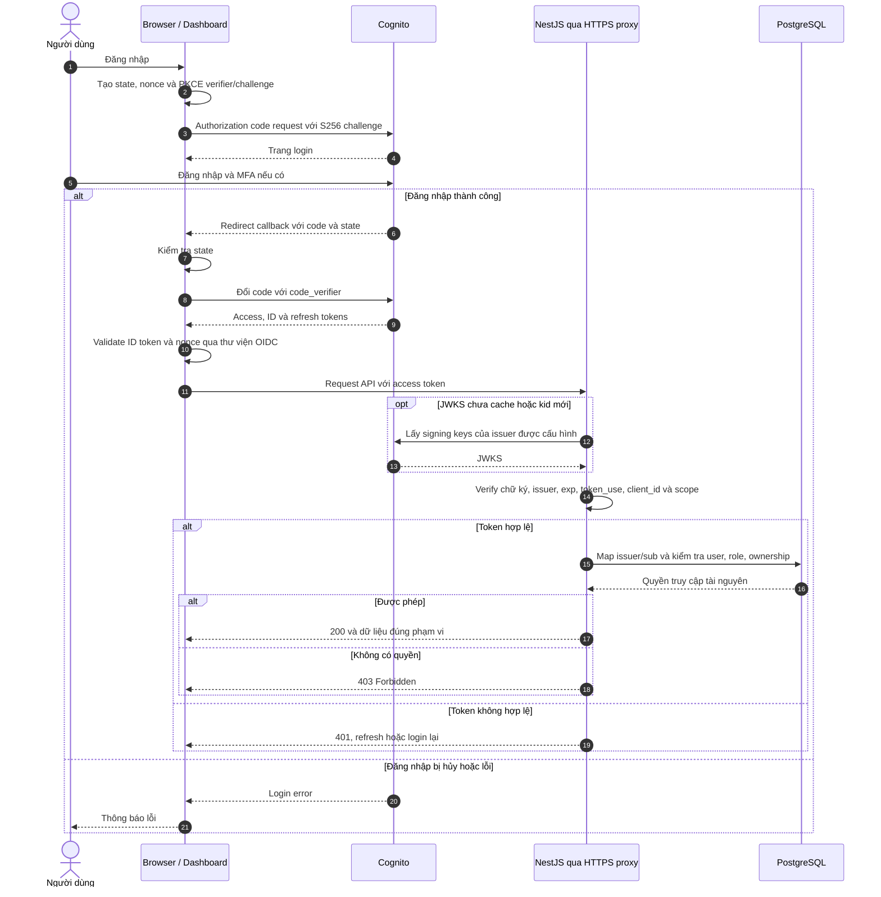
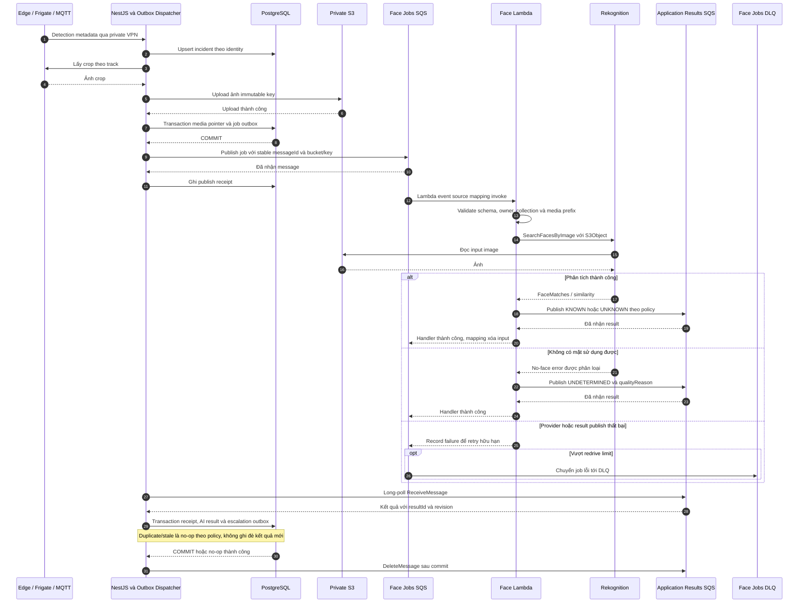
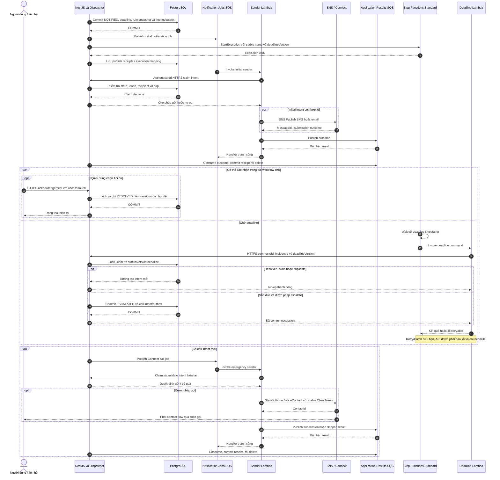
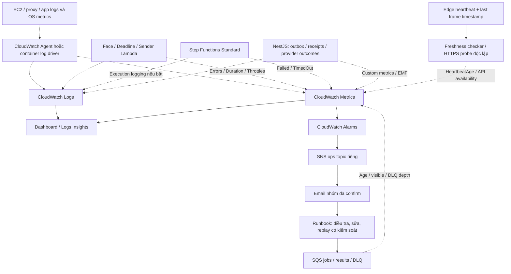

# CameraAI — Luồng AWS chi tiết cho Sprint 4

**Cập nhật 21/10/2026.** Đây là thiết kế mục tiêu theo file draw.io mới; không khẳng định code/resources AWS đã hoàn tất. Đi cùng [kế hoạch thực thi](SPRINT_4_AWS_EXECUTION_PLAN.md) và [file kiến trúc nguồn](diagrams/CameraAI_Hybrid_EC2_Lambda.drawio).

## Quy ước

Trong sequence diagram, `->>` là request/lệnh gửi, `-->>` là response. Queue job vẫn bất đồng bộ dù dùng nét liền. Trong sơ đồ monitoring, nét đứt là telemetry. PostgreSQL giữ trạng thái nghiệp vụ; Lambda gọi NestJS qua HTTPS service auth, không truy cập DB trực tiếp. Reverse proxy được lược bỏ ở các mũi tên API để dễ đọc, nhưng request ngoài EC2 vẫn đi qua nó.

## 2. Đăng nhập bằng Cognito

**Giải thích:** chọn browser PKCE, không nhúng client secret. API dùng access token; mapping user và quyền vẫn ở PostgreSQL. Cache JWKS, không hỏi Cognito mỗi request. Refresh/logout, token storage và reset password phải có implementation/test riêng. G0 chốt có dùng BFF hay browser mode; không trộn hai cách trong cùng contract. Có thể làm luồng này trước khi bất kỳ model fire/fall nào sẵn sàng.

Tham khảo: [Cognito PKCE](https://docs.aws.amazon.com/cognito/latest/developerguide/authorization-endpoint.html).

## 3. Nhận diện khuôn mặt qua S3, SQS, Lambda và Rekognition

**Giải thích:** crop ở S3 trước khi job được publish; S3 không gửi recognition result. Known faces cần được enroll bằng `IndexFaces` và FaceId ánh xạ theo owner; search chỉ dùng mặt lớn nhất nên phải chọn crop phù hợp. Local embedding không nhập thẳng vào Rekognition. Result consumer dedup không loại bỏ mọi chi phí gọi model trùng khi retry. Kết quả lỗi ở Results Queue cũng cần quarantine/alert, không xóa im lặng.

**Làm song song:** AWS dùng ảnh fixture để kiểm tra pipeline; D/E tiếp tục train/evaluate fire/fall. Sau khi model đạt gate, thay nguồn fixture bằng result thật đúng contract, không đổi flow AWS. Hợp đồng UNKNOWN/UNDETERMINED và fallback do B/D review trước.

Tham khảo: [Rekognition API](https://docs.aws.amazon.com/rekognition/latest/APIReference/API_SearchFacesByImage.html), [SQS Lambda mapping](https://docs.aws.amazon.com/lambda/latest/dg/services-sqs-configure.html).

## 4. Cảnh báo và escalation theo deadline

**Giải thích:** Step Functions chỉ điều phối việc chờ; NestJS/DB quyết định có escalate hay không. NOTIFIED không chứng minh SMS đã được đọc. Ack và deadline cạnh tranh bằng transaction, không bằng thời gian bấm ở browser. Có race sau claim trước provider call; phải chốt cancellation policy, không hứa dừng được call đã submit. Connect ContactId/SNS MessageId chưa chứng minh answered/delivered; DTMF và delivery-status callback là việc bổ sung.

**Nhánh lỗi:** job sender retry bounded rồi tới notification DLQ; timeout sau submit cần xử lý trạng thái không chắc chắn. Workflow/queue/outbox có stable IDs, nhưng SNS SMS không có cam kết exactly-once. Tắt deadline owner cũ khi chuyển cloud hoặc chỉ giữ reconciler qua cùng conditional operation. Dry-run là bằng chứng pipeline, không phải bằng chứng call/SMS thật.

Tham khảo: [Standard workflow](https://docs.aws.amazon.com/step-functions/latest/dg/choosing-workflow-type.html).

## 5. Giám sát hệ thống và cảnh báo vận hành

**Giải thích:** monitoring không nằm trong đường commit nghiệp vụ. EC2 cần agent/log driver để chuyển application logs; EBS không làm việc đó. Logs không tự biến thành alarms nếu thiếu metric/filter/EMF phù hợp. Checker độc lập giúp phát hiện cả lúc NestJS/EC2 chết; edge heartbeat không tự chứng minh camera còn frame.

| Tín hiệu                  | Ngưỡng thử ban đầu               | Phản ứng                                          |
| ------------------------- | -------------------------------- | ------------------------------------------------- |
| DLQ visible               | Lớn hơn 0                        | Điều tra payload/IAM/provider trước redrive       |
| Oldest face job           | Trên 30 giây                     | Kiểm tra backlog/throttle; điều chỉnh theo đo E2E |
| Workflow failed/timed out | Có execution lỗi                 | Sửa API, reconcile deadline từ DB                 |
| Heartbeat age             | Trên 90 giây nếu gửi mỗi 30 giây | Kiểm tra edge/mạng; cấu hình missing data         |
| Outbox oldest pending     | Trên 30 giây                     | Kiểm tra dispatcher/queue permissions             |
| EC2/API unavailable       | Probe thất bại liên tiếp         | Khôi phục server và kiểm tra DB                   |

Đây là ngưỡng khởi đầu, không phải SLA; tính cả CloudWatch period/độ trễ. Ops SNS topic tách incident SNS để Sender lỗi vẫn báo được. Kích alarm thật và xác nhận email nhận được. Logs retention dev đề xuất 7 ngày; mask PII, không log token/ảnh/embedding; event ID là log field, không phải metric dimension duy nhất mỗi event. Dashboard metrics không thay bộ đo precision/recall/FAR của AI.

Tham khảo: [CloudWatch Agent](https://docs.aws.amazon.com/AmazonCloudWatch/latest/monitoring/Install-CloudWatch-Agent.html), [CloudWatch alarms](https://docs.aws.amazon.com/AmazonCloudWatch/latest/monitoring/AlarmThatSendsEmail.html).
