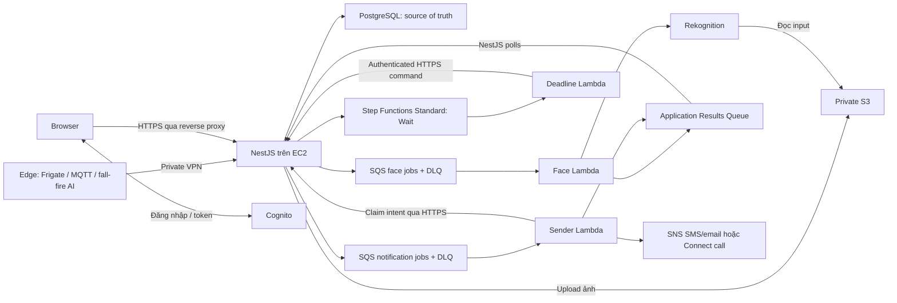
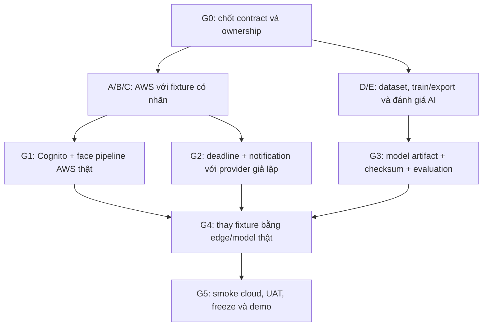

# Sprint 4 AWS — Vừa học qua lab, vừa tích hợp với CameraAI

**Cập nhật:** 21/10/2026. **Trạng thái:** kế hoạch triển khai, không phải báo cáo đã chạy AWS.

## 1. Mục tiêu và cách đọc

Đưa CameraAI lên kiến trúc **Hybrid EC2 + AWS Lambda**: video và model fall/fire xử lý ở máy edge; dashboard/API/database trên EC2; các tác vụ face, thông báo và deadline dùng dịch vụ AWS. Nhóm AWS bắt đầu bằng dữ liệu mẫu ngay khi hợp đồng dữ liệu được chốt, không đợi train model xong.

**Điểm bắt đầu cho nhóm chưa có kinh nghiệm:** [lộ trình lab 00–10](labs/README.md). Làm một request/ảnh/message nhỏ trước, quan sát logs và thử lỗi, rồi mới ghép vào ứng dụng. Tài liệu này giữ vai trò phân công/kiểm soát release; mục 6 là checklist kỹ thuật để tra cứu sau lab, không thay hướng dẫn cho người mới.

**Từ ngữ dùng trong plan:** owner = người chịu trách nhiệm; reviewer = người kiểm tra chéo; gate = mốc chỉ qua khi có bằng chứng; fixture = dữ liệu mẫu có kết quả kỳ vọng; dry-run = chạy pipeline nhưng không gửi SMS/gọi điện thật; outbox = bản ghi công việc cần gửi được lưu cùng transaction DB; receipt = bản ghi đã tiếp nhận/xử lý để chống lặp; evidence = log, ảnh hoặc kết quả test chứng minh đã làm.

**Buổi bắt đầu:** A/B/C làm lab 00–02 để cùng hiểu account/role, S3 và Lambda/SQS. Sau đó chốt AWS-01 và chia bài nâng cao. C kiểm tra điều kiện SMS/Connect sớm; D/E tiếp tục model, chỉ tham gia slot review dữ liệu/contract. Không yêu cầu cả nhóm hiểu hết AWS/IaC/outbox trước bài đầu.

### Lộ trình học gắn với task

| Học qua lab | Kết quả nhỏ nhìn thấy được                             | Task tích hợp sau đó       |
| ----------- | ------------------------------------------------------ | -------------------------- |
| 00–01       | STS identity đúng, ảnh private đọc bằng signed URL     | AWS-02 / S3                |
| 02          | Message gọi Lambda, controlled failure tới DLQ         | AWS-02 / queues và workers |
| 03          | Index/search ảnh và nhận face result ở queue           | AWS-05                     |
| 04          | SAM tái tạo pipeline; outbox/result consumer được test | AWS-01/02/03               |
| 05          | Login PKCE và API kiểm tra quyền                       | AWS-04                     |
| 06          | Wait 10 giây rồi deadline command thật                 | AWS-06                     |
| 07          | Dry-run, email rồi real SMS/call nếu đủ quyền          | AWS-07                     |
| 08          | HTTPS app server và edge connectivity                  | AWS-08                     |
| 09          | Một email alarm thật và heartbeat test                 | AWS-09                     |
| 10          | Model thật thay fixture và tổng duyệt                  | AWS-10                     |

Mỗi lab có phần dọn tài nguyên và mẫu ghi chép. `LAB_PASS` không đồng nghĩa story đã Done; ví dụ handler echo chạy được chưa chứng minh face recognition hoặc notification production đã hoàn tất.

Tài liệu nguồn:

- [Bản sao draw.io do nhóm cung cấp](diagrams/CameraAI_Hybrid_EC2_Lambda.drawio): giữ nguyên nội dung file gốc khi nhập ngày 21/10/2026.
- [Ba sequence diagram và sơ đồ monitoring](METHOD_1_FEATURE_DIAGRAMS.md): làm rõ thứ tự xử lý và nhánh lỗi.
- [Hướng dẫn Lambda/event-driven](../docs/AWS_LAMBDA_EVENT_DRIVEN_TECHNICAL.md): tài liệu kỹ thuật nền.
- [Shared gate AI](../docs/sprint-3/SHARED_GATE_HANDOFF.md), [API change register](../docs/sprint-3/API_CHANGE_REGISTER.md): giữ contract/locks khi làm song song.

File gốc: `D:/hoc tap/project 1/AWS-Architecture/CameraAI_ Hybrid EC2 and AWS Lambda Architecture.drawio`. File có cả cụm tổng quan và cụm chi tiết trong cùng `Page-1`; khi trình bày, dùng cụm có EC2 contents, private media bucket và Step Functions Standard. Các biểu tượng S3 lặp lại được hiểu là **cùng một bucket media**; Results Queue là một tài nguyên logic dùng chung với message type khác nhau, trừ khi nhóm tách rõ contract/queue riêng.

SHA-256 của snapshot draw.io: `0AB1FDF2E87295FFC3F1D6DFFFC2A6D83E20B17CA0E3CBEE5A25031BC29FC564`. Bản gốc ngoài repo được giữ nguyên; thay đổi bản snapshot sau này cần ghi lịch sử và đồng bộ diagram/contract.

**Điểm được cập nhật so với Sprint 4 cũ:** bổ sung SQS/DLQ, ba Lambda, Step Functions Standard, EC2/HTTPS/VPN, result consumer và bằng chứng quan sát. Không đưa `DetectProtectiveEquipment` vào face matching; đó là US-35 ngoài phạm vi chính. Không đổi YOLO/pose thành Rekognition và không train model trên EC2 demo.

## 2. Kiến trúc được chọn

| Nơi chạy                                  | Thành phần                                                | Trách nhiệm                                                     |
| ----------------------------------------- | --------------------------------------------------------- | --------------------------------------------------------------- |
| Edge/local                                | Camera, MediaMTX/FFmpeg, Frigate, Mosquitto, fall/fire AI | Xử lý stream, phát event và cung cấp crop/clip                  |
| EC2 trong public subnet, một AZ           | HTTPS reverse proxy, Next.js, NestJS, PostgreSQL, Redis   | API, quyền, incident state, outbox và các job chưa chuyển cloud |
| EBS cùng AZ                               | Volume ứng dụng/DB                                        | Dữ liệu bền vững; vẫn cần backup/restore                        |
| Cognito User Pool                         | Managed login, token issuance                             | Identity; NestJS vẫn quyết định role/ownership                  |
| Private S3                                | Event crop/clip và presigned URL                          | Không public bucket; lifecycle theo chính sách lưu trữ          |
| SQS + DLQ                                 | Face jobs, notification jobs, application results         | Giao việc bền vững và trả kết quả về NestJS                     |
| Face Lambda + Rekognition                 | Index/enrollment adapter và face search                   | Normalize về hợp đồng face/AI result của project                |
| Step Functions Standard + Deadline Lambda | Wait tới deadline, gọi command về API                     | Không giữ Lambda chạy trong thời gian chờ                       |
| Sender Lambda + SNS/Connect               | Gửi SMS/email hoặc bắt đầu cuộc gọi đã được duyệt         | Claim intent, retry hữu hạn, lưu provider ID                    |
| CloudWatch + topic ops riêng              | Logs, metrics, heartbeat, alarms                          | Quan sát và báo lỗi cho nhóm, tách alert người dùng             |

Các Lambda khởi đầu **không gắn VPC**. Chúng dùng AWS SDK và HTTPS tới API được bảo vệ. Không mở public PostgreSQL, Redis, Frigate hoặc MQTT để giải quyết kết nối. Edge ↔ EC2 dùng software VPN đã cấu hình auth; kiểm tra cả đường backend lấy media và edge gọi authorization.

Luồng chính:



Một AZ phù hợp demo/pilot tiết kiệm, không phải HA production. PostgreSQL nằm cùng EC2 nên EC2/AZ hỏng sẽ gián đoạn API và quyết định deadline. Workflow cần Retry/Catch và reconcile sau phục hồi.

## 3. Hiện trạng phải kiểm tra trước khi code

| Nền tảng trong repo                                                      | Có thể tái sử dụng                              | Không được suy ra đã hoàn tất                           |
| ------------------------------------------------------------------------ | ----------------------------------------------- | ------------------------------------------------------- |
| `apps/orchestrator/src/storage/s3-storage.service.ts`                    | Upload/download/presign và SDK credential chain | Bucket, policy, lifecycle và IAM thật                   |
| `apps/orchestrator/src/auth/auth.module.ts`                              | Guard/role và user repository                   | `AUTH_PROVIDER=cognito` chưa chứng minh Cognito đã wire |
| `apps/orchestrator/src/face-recognition/face-recognition.worker.ts`      | Local face job, result mapping                  | Không phải SQS consumer hoặc Rekognition Lambda         |
| `apps/orchestrator/src/ai-results/ai-result-outbox.service.ts`           | Receipt/outbox và downstream escalation         | Không tự có generic AWS job outbox                      |
| `apps/orchestrator/src/escalation/escalation-deadline-worker.service.ts` | Transaction deadline và call intent             | Không phải workflow Step Functions đã deploy            |
| `apps/orchestrator/src/notifications/`                                   | Telegram, retry và intent records               | SNS/Connect enum chưa đồng nghĩa có adapter thật        |
| `docker-compose.yml` và Dockerfiles                                      | Môi trường dev, build stages                    | Chưa phải cấu hình cloud production đã kiểm chứng       |
| Runtime/training AI và báo cáo Sprint 3                                  | Contract và bằng chứng theo từng module         | Model chưa được đánh giá không được ghi là sẵn sàng     |

Khi bắt đầu task, owner ghi commit baseline và cập nhật trạng thái thật. Mọi đường dẫn `infra/aws`, `services/aws-workers`, `infra/deploy` và fixtures bên dưới là **đầu ra cần tạo**, chưa phải script đang có.

Cấu trúc đầu ra đề xuất, tạo dần theo PR thay vì tạo file rỗng rồi coi hoàn tất:

```text
infra/aws/template.yaml              # SAM: roles, bucket, queues, workers, workflow, logs
infra/aws/workflows/                 # State machine definition nếu tách khỏi template
infra/deploy/                       # EC2/edge Compose và reverse proxy config
services/aws-workers/               # Face, deadline, sender handlers + contract tests
services/aws-workers/events/        # Job/result fixtures, không chứa dữ liệu cá nhân thật
docs/test/sprint-4-aws/              # Evidence và báo cáo nghiệm thu theo môi trường
```

## 4. Làm song song: ai làm gì, chờ gì?

### 4.1. Phân công

| Người            | Luồng chính                                                                           | Reviewer               | Không phải chờ               |
| ---------------- | ------------------------------------------------------------------------------------- | ---------------------- | ---------------------------- |
| A — Frontend     | Cognito login/callback, API token, thông báo trạng thái, tài liệu/demo                | B                      | Model fire/fall              |
| B — Backend      | Contracts, outbox/result consumer, deadline command, sender claim, face orchestration | C; A review quyền/auth | Train hoặc export model      |
| C — Infra        | SAM/IAM, S3/SQS/Lambda/workflow, EC2/HTTPS/VPN, logs/alarms, chi phí                  | B                      | Accuracy AI để dựng pipeline |
| D — AI fire/face | Tiếp tục train/đánh giá fire; tư vấn mapping face và bộ ảnh known/unknown             | E; B review contract   | EC2/SNS/Connect              |
| E — AI fall/QA   | Tiếp tục fall/evaluation; dữ liệu test và replay; hỗ trợ UAT                          | D; A review demo       | AWS notification thật        |

Rekognition adapter do B triển khai với C hỗ trợ Lambda/IAM; D review dữ liệu và semantics trong slot ngắn đã đặt trước. Không dồn toàn bộ US-24 cho D khi D đang train fire. D/E giữ môi trường training riêng; AWS không sửa training locks để build Lambda.

### 4.2. Hai luồng gặp nhau qua contract



- Fixture là event/AI result tuân thủ OpenAPI, có expected output; không giả làm evidence độ chính xác model.
- AWS có thể đạt G1/G2 khi model đang train. Chỉ G4 mới chứng minh model thật → incident → cloud alert.
- Nếu AI chưa đạt, ghi rõ phần AWS đã pass bằng fixture và phần AI còn blocked; không đánh dấu full E2E Done.
- Backend hiện có thể gọi FastAPI `/fire/detect` và `/pose/fall`; nếu diagram dùng AI → MQTT thì phải tạo edge publisher/mapper đúng contract, không mặc định code đã phát MQTT. Chọn một đường chính ở G0; không bật hai producer sinh cùng incident.

### 4.3. Lịch và sức chứa thực tế

Giữ mốc **ngày 25–30 là số ngày tương đối của dự án**, không tự quy đổi sang lịch tháng 10 khi chưa biết ngày bắt đầu. Phần AWS-01..04 có thể bắt đầu ngay trong giai đoạn model Sprint 3 còn chạy. Đây là yêu cầu chuẩn bị release sớm, không đòi D/E dừng AI.

| Giai đoạn                        | A                             | B                                   | C                                    | D/E                             | Gate                   |
| -------------------------------- | ----------------------------- | ----------------------------------- | ------------------------------------ | ------------------------------- | ---------------------- |
| Chuẩn bị song song trước ngày 25 | Khung PKCE và user mapping UI | Contract, receipt, fixtures         | IAM, SAM, queues, bucket, logs       | Train/evaluate theo kế hoạch AI | G0 và smoke fixture    |
| Ngày 25                          | Cognito real dev              | Result consumer và face job adapter | Deploy face worker và IAM            | Review semantics, tiếp tục AI   | G1                     |
| Ngày 26                          | Kiểm thử ownership/refresh    | Deadline command và sender claim    | Standard workflow + sender dry-run   | Replay dataset, AI regression   | G2                     |
| Ngày 27                          | UI/ack cloud                  | Tích hợp edge/model qua contract    | EC2/HTTPS/VPN, thử SMS/call hợp lệ   | Bàn giao model nếu đạt          | G3/G4                  |
| Ngày 28                          | Sửa lỗi auth/UI               | Race/recovery và migration          | Alarm, backup/restore, rollback      | AI regression/evaluation        | Freeze tính năng       |
| Ngày 29                          | UAT, cập nhật báo cáo         | Sửa lỗi nghiêm trọng                | Tập demo, kiểm tra chi phí           | Video test và evidence          | UAT + 2 lần tổng duyệt |
| Ngày 30                          | Demo và bàn giao              | Hỗ trợ demo                         | Theo dõi/tắt tài nguyên sau bàn giao | Trình bày số đo model           | Không thêm tính năng   |

Ước lượng bảng task dưới đây là **72 giờ-người**, cộng 25% dự phòng thành khoảng **90 giờ-người**, chưa gồm training AI. Với A/B/C mỗi người chỉ 12 giờ hiệu quả/tuần, phần AWS có 36 giờ/tuần; không thể dồn tất cả vào bốn ngày cuối. Cần tính cả chuẩn bị song song, đo lại capacity ở planning, hoặc giãn phạm vi/thời gian. Không cộng giờ train máy tự chạy thành giờ dev rảnh và không giữ cam kết 20 SP cũ cho toàn bộ kiến trúc mới.

**Điều chỉnh cho hình thức lab:** các số trên là baseline công việc kỹ thuật, chưa tính đầy đủ thời gian học AWS từ đầu. Sau lab 00–02, ghi thời gian thực tế từng cặp và ước lượng lại các bài tiếp theo. Lịch ngày 25–30 chỉ là mốc release mục tiêu khi các điều kiện tiên quyết đã đạt; nếu chưa đạt, giảm phạm vi hoặc điều chỉnh lịch, không bỏ bước học/kiểm tra quyền để chạy kịp bảng.

## 5. Backlog thực thi

`AWS-xx` là task kỹ thuật dưới story cũ, không chiếm ID US-32..38 đã có. Giờ là dự toán ban đầu, owner refine trước khi nhận; thời gian chờ cấp quyền SMS/Connect được theo dõi riêng.

| Task                                | Ánh xạ         | Owner          | Phụ thuộc                                | Giờ-người | Đầu ra / điều kiện Done                                                         |
| ----------------------------------- | -------------- | -------------- | ---------------------------------------- | --------- | ------------------------------------------------------------------------------- |
| AWS-01: Chốt contract và fixtures   | US-29/30       | B, A           | Không                                    | 4         | Envelope, IDs, schemas, auth/service commands và expected results đã review     |
| AWS-02: IaC nền, IAM, S3, SQS/DLQ   | US-23/29       | C              | AWS-01                                   | 6         | Stack dev tái lập; bucket private; lifecycle và queue permissions có smoke thật |
| AWS-03: Outbox và result consumer   | US-24/26/29    | B              | AWS-01                                   | 8         | DB migration duy nhất; commit-before-delete; duplicate/stale result pass        |
| AWS-04: Cognito end-to-end          | US-25          | A, B           | AWS-01/02                                | 8         | PKCE, verifier, issuer/sub mapping, role/ownership và refresh/logout đã test    |
| AWS-05: Face Lambda + Rekognition   | US-24          | B, C; D review | AWS-02/03                                | 8         | Index/search/delete theo owner; known/unknown/no-face; result queue và DLQ      |
| AWS-06: Deadline workflow           | US-13/29       | B, C           | AWS-02/03                                | 8         | Standard Wait, command idempotent, stale deadline, ack race và restart pass     |
| AWS-07: Sender Lambda + SNS/Connect | US-26/27       | B, C           | AWS-02/03/06                             | 8         | Claim/ledger; dry-run trước; SMS/call có provider ID nếu đủ điều kiện tài khoản |
| AWS-08: EC2/HTTPS/edge split        | US-29/30       | C, B           | AWS-02, các adapter baseline             | 8         | Compose production và edge; private VPN; browser URLs; backup restore           |
| AWS-09: Monitoring/chi phí          | US-28          | C              | Khởi động từ AWS-02, hoàn tất sau 05..08 | 6         | Correlation logs, queue/workflow/heartbeat alarms đã kích thử, runbook          |
| AWS-10: Tích hợp AI, UAT, bàn giao  | US-22/29/30/31 | Cả nhóm        | G1/G2 và AI gate theo từng module        | 8         | Báo cáo phân biệt fixture/model, E2E, evidence, rollback, video                 |
| **Tổng trước dự phòng**             |                |                |                                          | **72**    | Không phải cam kết sẽ hoàn tất nếu chưa đủ capacity                             |

**Ưu tiên khi thiếu thời gian:** giữ S3 → SQS → Lambda → result → DB, Cognito, CloudWatch cơ bản và workflow deadline kiểm thử được. Hoãn cloud live-video, dashboard metrics nâng cao, email incident tùy chọn, gọi nhiều liên hệ/DTMF hoặc kênh real bị chặn tài khoản; giữ provider giả lập và ghi phần chưa nghiệm thu. Không cắt logs/DLQ tối thiểu hoặc bỏ kiểm tra quyền để kịp demo. SMS/call giả lập không được tính là SNS/Connect thật đã Done; liên hệ giảng viên nếu đó là tiêu chí release bắt buộc.

## 6. Hướng dẫn theo từng gói việc

### AWS-01 — Chốt dữ liệu trước khi chia nhánh

1. Sau khi cùng học lab 00–02, B đối chiếu `api/openapi.yaml`, `api/openapi-ai-service.yaml`, `packages/contracts`, schema receipt/outbox hiện có. D/E xác nhận semantics fall/fire/face, không đổi enum tùy tiện.
2. Định nghĩa envelope v1: `messageId`, `eventId`, `cameraId`, `ownerScopeId`, `observationId`, `revision`, `occurredAt`, `correlationId`, `media.bucket/key`. Result có `resultId` ổn định, type và provider metadata. Đây là contract cần implement, không coi field mẫu là DB column sẵn có.
3. Chốt service commands deadline và claim: request schema, error/retry semantics, ownership, command ID, deadline version. Gợi ý HMAC-SHA256 trên method/path/body hash/timestamp/nonce; lưu nonce chống replay, secret riêng theo môi trường, rotation, allowlist command. Không nhúng credential vào URL/log và không dùng API key đơn lẻ như cơ chế đủ chống replay.
4. Tạo fixtures tối thiểu: known, unknown, no-face, AI error, fire P0, fall P1, duplicate, revision cũ, resolved-before-deadline và stale deadline. Face thật dùng ảnh test có đồng ý; fixture AI không chứng minh độ chính xác.
5. Đặt task ở board `Ready`; người khác review schema trước khi code producer/consumer.

**Bằng chứng:** contract review và replay fixture tạo đúng một incident/result theo kỳ vọng. D/E có thể tiếp tục train sau slot review, không chờ AWS account.

### AWS-02 — Dựng stack dev có thể tạo lại

1. C cấu hình profile/role dev, MFA/temporary credentials, Region và budget. Không dùng root hoặc commit `.env`.
2. Tạo `infra/aws/template.yaml` bằng SAM/CloudFormation; tách app worker roles. Chọn SQS Standard, queue jobs và DLQ riêng; Results Queue có redrive/quarantine và consumer chịu duplicate.
3. S3 private, block public access, encryption, lifecycle cho prefix/tag event media. Trường hợp giữ lại phải tag/retention filter đúng; S3 lifecycle là xóa bất đồng bộ, không hứa đúng giây thứ 7 ngày. Nếu bật versioning phải xử lý noncurrent versions/deletes.
4. Cấu hình Lambda event mapping: ví dụ timeout 10 giây, batch 1, batch window 0, visibility ít nhất 60 giây, `maxReceiveCount` khởi đầu 5; bật partial batch failures và concurrency theo quota thực tế. Không bật provisioned polling/concurrency khi chưa cần.
5. Stack outputs chỉ gồm ARN/URL/region không có secret. Ghi lại estimate và deployment inventory.

**Bằng chứng:** upload ảnh, presign đọc được, truy cập anonymous bị chặn; message lỗi tới DLQ; template không cấp wildcard quyền không cần thiết.

### AWS-03 — Làm producer/consumer bền vững

1. Migration mới theo runner hiện có; kiểm tra số migration chưa dùng, không sửa migration đã apply. DB schema/types/OpenAPI đồng bộ khi đổi enum.
2. Commit incident/media pointer/outbox cùng transaction khi phù hợp. Upload object xong mới publish; có kế hoạch dọn object mồ côi khi DB commit thất bại.
3. Dispatcher publish SQS rồi ghi receipt. Publish thành công nhưng crash trước ghi receipt có thể gửi lại; không hứa exactly-once.
4. Result consumer trên NestJS long-poll, validate type/schema/owner, kiểm tra stable result ID và revision; commit trước `DeleteMessage`. Kết quả không hợp lệ đi quarantine và báo vận hành.
5. Chốt owner từng job: local BullMQ hoặc cloud SQS, không chạy hai worker cho cùng observation. Các công việc khác còn BullMQ thì vẫn giữ Redis.

**Bằng chứng:** replay một message 10 lần chỉ có một kết quả nghiệp vụ; version cũ không ghi đè; restart consumer không mất công việc đã commit.

### AWS-04 — Cognito cho A/B làm song song

1. C cấp User Pool + public app client dev; A làm authorization code + PKCE, callback/logout URL và state/nonce. Không đặt client secret trong browser.
2. B wire token verifier: JWKS cache, signature/issuer/expiry/`token_use=access`/client ID, scopes và audience nếu cấu hình. Mapping `(issuer, sub)` về application user, quyền camera vẫn kiểm tra DB.
3. Giai đoạn demo có thể onboarding lại test users; không tự ghép user theo email hoặc hứa chuyển hash mật khẩu cũ sang Cognito. Migration phải giữ quyền/dữ liệu hiện có và được thử trên DB dev.
4. Chốt chiến lược browser token/refresh/logout, bảo vệ XSS/CSRF tương ứng; reset password có test riêng. JWT và Cognito modes tách rõ, không accept token bất kỳ provider để né lỗi.

**Bằng chứng:** login, refresh, logout/reset, token giả/issuer sai, role và cross-owner cases. Các yêu cầu khóa đăng nhập hiện tại phải được kiểm lại theo cấu hình Cognito, không mặc định trùng policy cũ.

### AWS-05 — Face trên Lambda, không chờ model fire/fall

1. B/C dùng fixture crop ở S3; Lambda nhận bucket/key thay video/base64. Collection và media bucket cùng Region.
2. Enrollment gọi `IndexFaces`, lưu FaceId theo owner/person. Search dùng `SearchFacesByImage`; delete dùng FaceId đúng owner; local embedding không nhập trực tiếp vào Rekognition được.
3. Một ảnh có nhiều mặt cần chọn/crop phù hợp vì API search dùng mặt lớn nhất. Map về DTO hiện có, giữ `UNKNOWN` khác `UNDETERMINED`; provider error không thành unknown. Threshold local không dùng nguyên cho similarity Rekognition.
4. Publish result có stable IDs; chỉ ack input job sau result publish. Retry có thể gọi Rekognition trùng và tăng chi phí; receipts DB chỉ bảo vệ kết quả nghiệp vụ, không bảo đảm không tính tiền lặp.
5. Giữ local mode và nhánh fallback có kiểm thử. Nếu fallback tự động: thực hiện tại orchestrator/edge theo owner đã chốt, có collection local tương thích riêng, marker provider/fallback rõ; Lambda không gọi `localhost`. Không chọn local sau một timeout nếu cloud result có thể vẫn đến mà thiếu dedup/version policy.

**Bằng chứng:** known/unknown/no-face, search lỗi, tenant isolation, collection deletion, stale result, fallback được đo thật; không hứa đổi provider trong 10 giây khi chưa có runbook/test.

### AWS-06 — Workflow deadline bảo toàn state machine

1. B tách thao tác xử lý deadline từ polling worker thành service dùng chung; DB là nguồn sự thật, đọc `ruleSnapshot`, `deadlineAt`, version và command ID.
2. Tạo workflow-start outbox trong transaction tạo NOTIFIED/deadline. Dispatcher `StartExecution` với tên ổn định và lưu ARN/input; retry đối chiếu execution cũ thay vì start vô hạn.
3. C tạo Standard workflow `Wait` tới timestamp rồi invoke Deadline Lambda; không `sleep` trong Lambda. Lambda gửi service command qua HTTPS tới NestJS, không ghi DB trực tiếp.
4. NestJS lock/conditional update: resolved/stale/duplicate thì no-op; vẫn due thì commit ESCALATED + notification intent/outbox. Callback xác nhận cạnh tranh qua cùng transaction policy.
5. Retry/Catch hữu hạn khi API down; alarm và reconciler dựa DB sau phục hồi. Polling worker cũ chỉ làm reconciler hoặc bị tắt theo scope cloud, không độc lập tạo cùng call intent.

**Bằng chứng:** ack trước/sát/sau deadline; duplicate StartExecution/command; deadline thay đổi; restart; API outage. Nếu chưa có cloud endpoint, chạy test trên dev deploy hoặc HTTPS tunnel có service auth; không public DB.

### AWS-07 — Sender có thể làm trước bằng dry-run

1. Chốt `DRY_RUN`/real mode trong code/config mới; mặc định dev không gửi SMS/call thật. Biến này phải được implement/validate, không chỉ ghi trong `.env`.
2. Sender Lambda claim notification qua service API: check intent, current state, lease, recipient allowlist, daily cap và cooldown. Stable notification ID theo incident/channel/action/version.
3. SNS gửi SMS/email; Connect dùng `StartOutboundVoiceContact`, contact flow phát loại incident/camera/thời điểm, stable `ClientToken`. Kiểm tra SMS sandbox, destination/quota/spend limit và Connect phone/destination permissions sớm; không coi verify một số là đủ cho mọi service/quốc gia.
4. Publish submission result về Results Queue, NestJS lưu receipt/provider ID rồi delete. MessageId/ContactId không chứng minh đã đọc/nghe; delivery/answer/DTMF cần integration riêng.
5. Retry bounded, lỗi terminal tới DLQ; timeout sau submit cần trạng thái chưa chắc chắn và policy retry để không spam. SNS không có cam kết exactly-once. Xác nhận sau claim có race trước provider call; định nghĩa điểm cam kết gửi và cancellation policy.

**Bằng chứng:** dry-run không phát sinh thông báo thật, retry/duplicate, cap, một SMS và một call test nếu tài khoản cho phép. Nếu chưa được cấp, ghi `BLOCKED_PROVIDER` trong báo cáo task, giữ dry-run; không đánh dấu real AC pass.

### AWS-08 — EC2 và edge thành hai môi trường rõ ràng

1. Tạo Compose production cho EC2 và Compose edge riêng; build image ở CI/local, dùng production stages, không bind-mount source hoặc `--reload` trên EC2. Kiểm chứng image entrypoint và quyền ghi volume, không chỉ đổi `target` rồi coi xong.
2. EC2 Linux x86 khởi đầu thử 4 GiB RAM cho app tier; đo CPU/RAM/container RSS trước chọn size, không hứa micro/free-tier đủ. Không train AI trên instance này.
3. VPC → một AZ → public subnet; EC2 public IPv4 và route tới IGW. Security group chỉ mở HTTPS và VPN theo thiết kế; quản trị qua SSM nếu được cấu hình. DB/Redis/AI/Frigate không public.
4. Reverse proxy route `/` tới Next.js và `/api` tới NestJS; TLS hợp lệ. `NEXT_PUBLIC_*` phải đúng tại build nếu được Next.js nhúng; thay các URL localhost bằng endpoint browser truy cập được. CORS/WEB_ORIGIN khớp thực tế.
5. Kiểm tra MediaMTX gọi auth về API, API lấy crop/clip từ edge, zone/config sync và frame history; camera-source runner/FFmpeg hiện nằm trong backend cần edge adapter/runner hoặc route riêng. Đây là task thật, không coi VPN tự chuyển code về edge.
6. Browser webcam/WHIP và remote WebRTC là gate riêng: HTTPS, ICE candidate và có thể TURN. Chốt demo qua video fixture hoặc VPN có truy cập media nếu chưa làm full remote live video; không claim mọi browser ngoài mạng xem được live.
7. IAM instance role + IMDSv2 và container credential access đúng; không copy access keys vào image. Backup PostgreSQL, restore vào DB dev khác và có rollback image tag; restore backup không làm trực tiếp trên DB đang cần giữ.

**Bằng chứng:** máy thứ hai mở HTTPS, quyền đúng, event/crop/clip qua edge, restart giữ DB, backup restore, camera disconnect thấy alarm.

### AWS-09 — Quan sát ngay từ stack đầu tiên

1. CloudWatch Logs cho Lambda và application logs; CloudWatch Agent/container driver trên EC2. Retention dev khởi đầu 7 ngày; không log token, embedding, ảnh, số điện thoại nguyên vẹn hoặc URL có credential.
2. Log IDs dùng làm thuộc tính tìm kiếm, không dùng mỗi event ID làm custom metric dimension. Theo dõi Lambda errors/throttle, SQS oldest age/DLQ depth, Step Functions failures, pending outbox age và final delivery failures.
3. Heartbeat edge và last frame freshness là hai tín hiệu khác nhau. Checker độc lập/probe API phải phát hiện được khi EC2 chết; chọn missing-data policy rõ. Native EC2 metrics không tự có RAM/filesystem/container health.
4. Alarm gửi email qua SNS topic ops riêng, subscriber confirmed; không tái dùng incident sender đang hỏng. Kích thử DLQ, API down và heartbeat mất để xác nhận người nhận thật nhận được.
5. Tạo estimate theo Region và usage, actual/forecast budget alerts, cap ứng dụng; kiểm kê EC2/EBS/IPv4/logs/S3/artifact buckets/số điện thoại. Budget không phải hard cap.

**Bằng chứng:** tìm xuyên event bằng correlation ID, alarm delivery thật, screenshot metric/test outage, log retention và runbook đã review.

## 7. Hợp đồng bàn giao AWS ↔ AI

| Bên giao    | Nội dung bắt buộc                                                                                                            | Bên nhận kiểm tra                                                                        |
| ----------- | ---------------------------------------------------------------------------------------------------------------------------- | ---------------------------------------------------------------------------------------- |
| B → A/C/D/E | Schema/event fixture, sample HTTP errors, IDs và retry semantics                                                             | Validate fixture từ cùng commit; đổi contract có reviewer                                |
| C → A/B     | Region, queue URLs/ARNs, user pool/client IDs, bucket, workflow ARN, API endpoint                                            | Không chứa secret trong handoff; IAM access bằng role/profile                            |
| D/E → B/C   | Artifact path + SHA-256, model version, input/output, preprocessing, runtime locks, measured thresholds và evaluation report | Load/inference trên runtime đích; không lấy training weights chưa kiểm chứng làm release |
| B/C → D/E   | Adapter/stub giúp replay AI result và xem incident/ack/escalation                                                            | Có cả valid/error/duplicate/stale cases, không buộc train để test AWS                    |

Model gate độc lập theo module: fire chưa đạt thì không chặn test face/Cognito; nhưng không đánh dấu fire E2E Done. Fall temporal state/restart và fire consecutive-frame logic phải giữ semantics hiện tại, không bị cloud adapter cắt thành frame rời làm thay đổi hành vi.

## 8. Ownership file, nhánh và tích hợp

- A sở hữu `apps/web` và Cognito UI; B sở hữu orchestration, shared contracts và migrations; C sở hữu `infra/aws`, `infra/deploy`, CI/deploy; D/E sở hữu model/runtime/module AI theo shared gate.
- Khóa chung `api/*.yaml`, generated contracts, `app.module.ts`, dependency locks và `db/migrations` qua B; không sửa chung từ nhiều nhánh mà chưa đăng ký. Cấp số migration bằng kiểm tra repo tại thời điểm triển khai, không hard-code số trong plan.
- Nhánh đề xuất: `codex/s4-aws-foundation`, `codex/s4-auth-cognito`, `codex/s4-face-pipeline`, `codex/s4-escalation`, `codex/s4-deploy-monitoring`. Đây là tên gợi ý, tài liệu không tự tạo nhánh.
- PR nhỏ theo gate; schema/fixture merge trước, sau đó producer/consumer, cuối cùng bật provider. WIP tối đa một task lớn/người; A/B/C không nhận mọi task cùng lúc.
- Review chéo; không merge PR của chính mình. Người chạy AWS chỉ deploy khi code/stack đã review và account đúng. D/E không phải chờ cả release để bàn giao từng artifact đã đạt.

## 9. Ma trận kiểm thử và Definition of Done

| Gate | Kiểm thử bắt buộc                                                      | Evidence                                                               |
| ---- | ---------------------------------------------------------------------- | ---------------------------------------------------------------------- |
| G0   | Schema fixture, invalid payload, duplicate/stale IDs                   | Fixture + expected JSON + contract review                              |
| G1   | Real Cognito auth/ownership; S3/SQS/Lambda/Rekognition/results/DB      | Log IDs, queue/result receipt, DB query, không lộ secret               |
| G2   | Deadline+ack race, stale version, dry-run sender, bounded retry/DLQ    | State history, one notification intent, workflow execution             |
| G3   | Model artifact/holdout evaluation                                      | SHA-256, runtime/version, TP/FP/FN/P/R/FAR; không lấy fixture accuracy |
| G4   | Edge/model thật → event → AWS result/alert → ack/deadline              | Video/ảnh test và timestamp/correlation xuyên chuỗi                    |
| G5   | HTTPS external client, restart/restore, heartbeat/DLQ alarms, rollback | UAT, runbook, actual cost và video demo                                |

### Lệnh kiểm tra đã có trong repo

Chạy tại repo root. Không dùng `db:reset` trên DB cần giữ; chọn DB dev/test trước migration. Các lệnh AI dùng đúng Python/venv và locks trong shared gate, không tự nâng dependencies.

```powershell
pnpm --filter @cam/orchestrator test
pnpm --filter @cam/orchestrator test:integration
pnpm typecheck
pnpm api:lint
pnpm check:ai
```

Integration cần Docker/Testcontainers. Nếu sửa contract, dùng `pnpm contracts:generate` rồi review diff nguồn/generated. Khi code AWS/IaC đã được tạo, bổ sung vào CI `sam validate --lint`, worker tests và `sam build`; các lệnh SAM dưới đây **chỉ chạy sau khi có template**:

```powershell
aws sts get-caller-identity --profile camerai-dev
sam validate --lint --template-file infra/aws/template.yaml
sam build --template-file infra/aws/template.yaml
sam deploy --guided --stack-name camerai-dev --region ap-southeast-1 --profile camerai-dev
```

Profile `camerai-dev` phải được cấu hình trước. Người chạy đọc change set/chi phí và stack environment; không chép secret vào command history. Sau deploy chạy smoke riêng, không dùng kết quả unit test làm bằng chứng AWS thật.

### Mẫu evidence và DoD cho từng task

```text
Task: AWS-xx
Owner / reviewer:
Commit / environment / Region / thời điểm:
Mode: fixture, model-real, provider-dry-run hay provider-real
Lệnh hoặc thao tác đã chạy:
Kỳ vọng / thực tế / PASS-FAIL-BLOCKED:
CorrelationId / execution ARN / receipt / evidence path:
Phần chưa làm / rollback / chi phí phát sinh:
```

- [ ] Code có review và kiểm tra phù hợp thay đổi; không sửa lock ngoài owner.
- [ ] Có fixture test và failure test; acceptance AWS thật có evidence thực, không chỉ mock.
- [ ] Không có secret/dữ liệu sinh trắc học trong Git/log; IAM ít quyền cần thiết.
- [ ] Có quy tắc ownership local/cloud, rollback và replay không nhân incident/notification.
- [ ] Có runbook lỗi provider/API, DLQ, stale workflow, camera offline và backup restore.
- [ ] Tài liệu chỉ rõ phần Done, chưa làm và bị chặn bởi tài khoản/model; không tự tick hoàn tất.

## 10. Chi phí, rollback và phạm vi demo

Mức **10 USD** giữ làm mục tiêu dev/demo giới hạn thời gian; không phải cam kết toàn stack EC2 24/7 + SMS/Connect dưới 10 USD. Tính trước: giờ EC2 + EBS provisioned + IPv4 giữ lại + S3/requests/egress + face calls/enrollment + queues/workflow/Lambda + logs/alarms + phone/telephony. Free-tier/credits phụ thuộc tài khoản và ngày hết hạn; xác minh Billing thay vì dùng bảng free-tier cũ.

- Dev ưu tiên Compose local và AWS usage nhỏ; EC2 chỉ bật khi cần cloud integration/demo. Dừng EC2 không dừng phí EBS/Elastic IP hoặc mọi resource khác.
- Không thêm NAT/ALB/RDS vào baseline chỉ vì sơ đồ tham khảo có; nếu cần thì ghi lại quyết định và estimate. Production HA là hạng mục sau pilot.
- Rollback theo adapter và owner job: ngừng producer cloud cho scope, xử lý/giữ queue có kiểm soát, đổi flag đã implement rồi mới bật local worker. Không để pending cloud result và local result cạnh tranh thiếu revision policy.
- Không rollback migration bằng xóa DB; dùng migration tương thích ngược, backup/restore có kiểm chứng. Giữ snapshot/evidence cần bàn giao, không purge queue để làm test xanh.
- Kết thúc demo kiểm kê và dọn resource theo inventory; giữ dữ liệu cần thiết có thời hạn. Kiểm tra billing lại vì có độ trễ.

## 11. Nguồn AWS đã đối chiếu

- [SQS event mapping: visibility, retry, partial failure](https://docs.aws.amazon.com/lambda/latest/dg/services-sqs-configure.html).
- [Standard và Express workflows](https://docs.aws.amazon.com/step-functions/latest/dg/choosing-workflow-type.html).
- [Cognito authorization code và PKCE](https://docs.aws.amazon.com/cognito/latest/developerguide/authorization-endpoint.html).
- [Rekognition SearchFacesByImage](https://docs.aws.amazon.com/rekognition/latest/APIReference/API_SearchFacesByImage.html).
- [Rekognition đọc ảnh S3 cùng Region](https://docs.aws.amazon.com/rekognition/latest/dg/images-s3.html).
- [Connect outbound call và idempotency token](https://docs.aws.amazon.com/connect/latest/APIReference/API_StartOutboundVoiceContact.html).
- [Thu thập logs và metrics bằng CloudWatch Agent](https://docs.aws.amazon.com/AmazonCloudWatch/latest/monitoring/Install-CloudWatch-Agent.html).

Thông số timeout/ngưỡng/effort trong plan là giá trị khởi đầu cần đo; chúng không phải giới hạn giá hay cam kết độ trễ E2E. Tiêu chí <10 giây phải đo cả edge, queue, AI và provider, báo p50/p95 và phần vượt, không chỉ Lambda duration.
