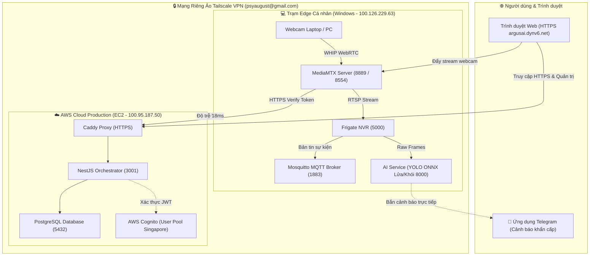

# TỔNG KẾT TOÀN DIỆN NHÁNH FEAT/US-25-COGNITO-ACCOUNT-ROLES

> **Nhánh phát triển:** `feat/us-05-cognito-account-roles` (tương đương `feat/us-25-cognito-auth-role-mapping`)  
> **Thời điểm cập nhật:** 10/11/2026  
> **Commit mốc hiện tại:** `55753ec` (_Merge branch 'main' into feat/us-05-cognito-account-roles_)  
> **Môi trường Cloud:** `https://argusai.dynv6.net`

---

## 1. TỔNG QUAN & KIẾN TRÚC HỆ THỐNG HYBRID

Hệ thống CameraAI hoạt động theo mô hình **Hybrid Cloud & Edge**:

- **AWS Cloud (EC2 - `100.95.187.50` / `argusai.dynv6.net`):** Đóng vai trò máy chủ trung tâm 24/7, chạy Caddy Reverse Proxy (HTTPS), Next.js Frontend, NestJS Backend Orchestrator, PostgreSQL Database, Redis Queue và tích hợp dịch vụ đám mây (AWS Cognito, Rekognition, SNS, CloudWatch).
- **Trạm Edge Cục bộ (Windows DUCANH - `100.126.229.63`):** Chạy cụm Docker tiếp nhận webcam vật lý (MediaMTX cổng 8554/8889), xử lý Computer Vision cục bộ (Frigate cổng 5000) và trung chuyển bản tin sự kiện (Mosquitto MQTT cổng 1883).
- **Mạng riêng ảo Mesh (Tailscale):** Kết nối an toàn giữa máy tính Edge và Cloud EC2 thông qua mạng nội bộ mã hóa WireGuard mà không cần mở port nguy hiểm ra Internet công cộng.



---

## 2. CÁC HẠNG MỤC CÔNG VIỆC ĐÃ HOÀN THÀNH TRÊN NHÁNH

### 2.1. Xác thực AWS Cognito & Quản lý Phân quyền (US-05)

- **Frontend:**
  - Tích hợp luồng chuẩn **Authorization Code Flow + PKCE** (bảo mật tối đa cho ứng dụng SPA, không để lộ Secret Key).
  - Xây dựng màn hình Đăng nhập Cognito, đón token tại `/auth/callback`, cơ chế tự động làm mới phiên (Refresh Token) và Đăng xuất tập trung.
  - Xây dựng giao diện **Quản lý tài khoản**: Xem danh sách người dùng, hiển thị Email đăng nhập Cognito tương ứng và cho phép Quản trị viên phân quyền Role.
- **Backend:**
  - Bật cờ `AUTH_PROVIDER=cognito`.
  - Xác thực chữ ký số JWT token từ AWS Cognito (kiểm tra signature, expiry, issuer, client ID, `token_use=access`).
  - Ánh xạ định danh (Identity Mapping): Sử dụng cặp khóa `(cognito_issuer, cognito_sub)` để map với bảng người dùng trong PostgreSQL nội bộ.
  - Phân quyền Role-based Access Control (RBAC): Các quyền hạn `ADMIN`, `CAREGIVER`, `VIEWER` được lưu trữ và kiểm soát trực tiếp tại Database CameraAI, độc lập với Cognito Groups.

### 2.2. Cơ sở dữ liệu & Database Migrations

- **`0017_cognito_issuer.sql`:** Bổ sung cột `cognito_issuer` và tạo chỉ mục duy nhất (Unique Index) cho cặp `(cognito_issuer, cognito_sub)` nhằm đảm bảo tính toàn vẹn danh tính.
- **`0018_cognito_email.sql`:** Bổ sung trường lưu trữ email đăng nhập Cognito giúp giao diện quản trị hiển thị rõ ràng thông tin người dùng.
- **Ánh xạ sẵn 3 tài khoản nghiệp vụ kiểm thử:**
  - `admin@camerai.local` $\rightarrow$ Role `ADMIN` (Cognito: `admin@camerai.local` — Sub: `59ea256c-4001-70b0-54c5-b3c6028d8cbd`).
  - `caregiver@local` $\rightarrow$ Role `CAREGIVER` (Cognito: `anhnksss7@gmail.com` — Sub: `d91a055c-7081-70c5-c054-bafa4e98c8ae`).
  - `viewer@local` $\rightarrow$ Role `VIEWER` (Cognito: `anhnksss6@gmail.com` — Sub: `19cac50c-f011-702d-b929-5a054a81698e`).

### 2.3. Trạm Edge Cục bộ & Mạng Mesh Tailscale

- Đăng nhập thành công thiết bị Windows DUCANH vào Tailnet `psyaugust@gmail.com`.
- Cấp phát IP ảo cố định: **`100.126.229.63`**.
- Kiểm tra thông tuyến tới EC2 (`100.95.187.50`): Ping ổn định **18ms**, cổng **22 (SSH)** và các cổng ứng dụng nhận kết nối thông suốt.

### 2.4. Khắc phục lỗi truyền phát Webcam WebRTC/WHIP (Lỗi 401 & Chứng chỉ CA)

- **Hiện tượng:** Khi bấm "Bắt đầu truyền phát WHIP" trên domain HTTPS `https://argusai.dynv6.net`, MediaMTX từ chối và báo lỗi đỏ `MediaMTX từ chối truyền phát webcam (401)`.
- **Nguyên nhân:** Token phát stream do Cloud cấp trong RAM của EC2. Khi trình duyệt gửi vé về `camerai-mediamtx` local, container này lại gọi về Backend Local (`http://orchestrator:3001`) để kiểm tra $\rightarrow$ Local không biết vé này nên từ chối. Ngoài ra image gốc của MediaMTX là bản scratch, thiếu chứng chỉ CA gốc nên không thể gọi webhook xác thực qua HTTPS.
- **Giải pháp đã xử lý triệt để:**
  1. Cấu hình biến `MTX_AUTHHTTPADDRESS: ${MEDIAMTX_AUTH_HTTP_ADDRESS:-https://argusai.dynv6.net/api/v1/mediamtx/authorize}` trong `docker-compose.yml`.
  2. Bổ sung `infra/mediamtx/Dockerfile` sử dụng multi-stage build để nhúng gói chứng chỉ `ca-certificates.crt`.
  3. Rebuild và recreate container `camerai-mediamtx`. Kết quả: MediaMTX xác thực vé trực tiếp với Cloud EC2 thành công 100%, camera chuyển sang trạng thái **ONLINE (Xanh lá)**.

---

## 3. HƯỚNG DẪN CÀI ĐẶT & VẬN HÀNH TỪ A - Z (SETUP GUIDE)

### 3.1. Thiết lập máy tính cá nhân

#### Bước 1: Khởi động mạng VPN Tailscale

1. Mở ứng dụng Tailscale trên Windows.
2. Đăng nhập bằng tài khoản `anhnksss1@gmail.com` và tham gia vào mạng của `psyaugust@gmail.com`.
3. Kiểm tra IP máy nhận được:
   ```powershell
   & "C:\Program Files\Tailscale\tailscale.exe" ip -4
   # Yêu cầu in ra đúng dải: 100.126.229.63
   ```
4. Kiểm tra ping thông tuyến tới máy chủ EC2:
   ```powershell
   & "C:\Program Files\Tailscale\tailscale.exe" ping --timeout=3s --c=1 100.95.187.50
   # Kết quả phản hồi qua DERP Singapore dưới 50ms là thành công.
   ```

#### Bước 2: Bật ứng dụng Docker Desktop

Mở **Docker Desktop** trên Windows và đợi vài giây cho icon cá voi xanh chuyển sang trạng thái _Engine running_.

#### Bước 3: Khởi động cụm dịch vụ Edge

Mở PowerShell tại thư mục gốc dự án và chạy:

```powershell
# Bật 3 container xử lý hình ảnh và truyền stream (không cần bật backend local)
docker compose --profile cv up -d mosquitto mediamtx frigate
```

Kiểm tra cả 3 container đang chạy ổn định:

```powershell
docker ps
# camerai-frigate: healthy (Cổng 5000)
# camerai-mediamtx: up (Cổng 8554, 8889, 8189)
# camerai-mosquitto: healthy (Cổng 1883)
```

---

### 3.2. Cấu hình dịch vụ AWS Cognito (User Pool)

Hệ thống sử dụng bộ User Pool đặt tại Singapore:

| Thuộc tính                | Giá trị cấu hình                                                                   |
| :------------------------ | :--------------------------------------------------------------------------------- |
| **Region**                | `ap-southeast-1` (Singapore)                                                       |
| **User Pool ID**          | `ap-southeast-1_4WQxu8bnB`                                                         |
| **Cognito Domain**        | `https://ap-southeast-14wqxu8bnb.auth.ap-southeast-1.amazoncognito.com`            |
| **App Client ID (SPA)**   | `5p3hgqnkmjrdc5ktb99ur46hjr`                                                       |
| **Grant Flow**            | Authorization code grant with PKCE                                                 |
| **OpenID Scopes**         | `openid`, `email`, `profile`                                                       |
| **Allowed Callback URLs** | `http://localhost:3000/auth/callback`<br>`https://argusai.dynv6.net/auth/callback` |
| **Allowed Sign-out URLs** | `http://localhost:3000`<br>`https://argusai.dynv6.net`                             |

---

### 3.3. Cấu hình máy chủ Cloud AWS EC2 (Dành cho Bạn C)

Để máy chủ Cloud chuyển sang nhận trạm camera và phân tích AI từ máy Đức Anh:

#### Bước 1: Cập nhật biến môi trường trên EC2

Mở file `.env` tại thư mục triển khai trên EC2 và cập nhật:

```dotenv
FRIGATE_URL=http://100.126.229.63:5000
MEDIAMTX_RTSP_URL=rtsp://100.126.229.63:8554
MQTT_URL=mqtt://100.126.229.63:1883
M3_ENABLED=true
```

#### Bước 2: Nạp lại cấu hình Backend trên EC2

```bash
sudo docker compose up -d --no-deps --force-recreate orchestrator
```

---

## 4. KẾT QUẢ THỰC TẾ & BẰNG CHỨNG KIỂM THỬ (EVIDENCE & RESULTS)

### 4.1. Đăng nhập & Phân quyền trên Domain `https://argusai.dynv6.net`

- [x] Đăng nhập thành công với tài khoản Admin (`admin@camerai.local`) và các tài khoản Tester qua giao diện đăng nhập AWS Cognito chuẩn.
- [x] Token JWT được backend xác thực chữ ký và trích xuất đúng vai trò (`ADMIN`, `CAREGIVER`, `VIEWER`).
- [x] Màn hình Quản trị hiển thị đúng bảng danh sách người dùng và email Cognito đã liên kết.

### 4.2. Truyền phát Webcam WHIP từ laptop lên Cloud

- [x] Vào **Quản lý Camera** $\rightarrow$ chọn **Phòng khách** (`cam_living_room`).
- [x] Bật xem trước webcam $\rightarrow$ Bấm **Bắt đầu truyền phát WHIP**.

## 5. DANH MỤC TÀI LIỆU LIÊN QUAN TRONG DỰ ÁN

- 📄 [05_SETUP_COGNITO.md](05_SETUP_COGNITO.md): Hướng dẫn chi tiết thiết lập AWS Cognito User Pool và Client SPA.
- 📄 [05_YEU_CAU_C_DE_CHAY_DOMAIN.md](05_YEU_CAU_C_DE_CHAY_DOMAIN.md): Bảng yêu cầu kỹ thuật bàn giao cho Người C để vận hành trên domain HTTPS.
- 📄 [BAN_GIAO_KET_NOI_EC2.md](../../artifacts/edge-setup/BAN_GIAO_KET_NOI_EC2.md): Lệnh kiểm tra mạng Tailscale và các bước nạp cấu hình trạm Edge vào EC2.
