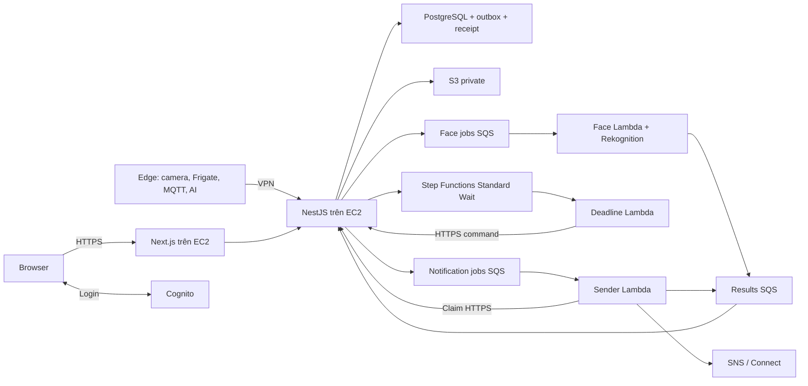

# Sprint 4 — Ba người cùng học AWS và hoàn thành CameraAI

> BẢN CŨ ĐƯỢC LƯU NGÀY 05/11/2026. Không dùng làm hướng dẫn hiện hành. Mở file theo vai trò A/B/C ở thư mục cha.

**G0 đã chốt contract v1 ngày 05/11/2026:** dùng [hợp đồng chung](00_HOP_DONG_G0.md) và [schema/fixtures](../contracts/README.md) làm nguồn thống nhất cho type/field/API/config/owner. Account, quyền, resource IDs và release thực tế vẫn cần xác minh; không ghi G0 access hoặc E2E PASS chỉ vì contract đã chốt.

## Đích đến: tính năng hoàn chỉnh để demo đồ án

Bộ tài liệu này hướng dẫn ba thành viên làm xong tính năng trong CameraAI, triển khai bản chung và demo được. Hoàn thành bài Console mới là bước chuẩn bị; mỗi người phải tiếp tục triển khai code và kiểm thử tới khi chức năng chạy qua ứng dụng.

Đọc [hướng dẫn hoàn thiện tính năng và demo F1–F6](10_HOAN_THIEN_TINH_NANG_VA_DEMO.md) ngay sau phần chuẩn bị. Đây là phần bắt buộc đi cùng tài liệu A/B/C: chỉ rõ phần code cần sửa/tạo, phụ thuộc, đầu ra trên ứng dụng, kiểm tra trước bàn giao và kịch bản diễn tập. Ghép theo 09, nghiệm thu theo 05, ghi evidence vào 06.

Giữ quy mô lab phục vụ học và bảo vệ đồ án. Không tự bỏ tính năng đã chốt vì chưa có code: `NEEDS_IMPLEMENTATION` là việc thành viên phải hoàn thiện, không phải kết quả hoàn tất. Dry-run/fixture chỉ chứng minh đúng phạm vi thử; demo tính năng thật cần luồng ứng dụng và bằng chứng tương ứng.

Ngày đối chiếu tài liệu AWS: **04/11/2026**. Ngôn ngữ Console dùng trong hướng dẫn: **English**. Region chung: **Asia Pacific (Singapore), ap-southeast-1**.

Bạn không cần biết AWS trước khi bắt đầu. Cần biết chạy dự án local, sửa cấu hình và đọc kết quả kiểm thử. Các bước tạo tài nguyên dùng Console; các bước tích hợp ứng dụng vẫn cần lập trình. Không có thao tác bấm nút nào tự viết adapter NestJS hoặc sender an toàn cho bạn.

Đã kiểm tra trực tiếp Console ngày 04/11/2026 cho Cognito, S3, SQS, Lambda, EC2 và bổ sung SNS, SMS, Step Functions, CloudWatch, IAM. Xem [các bước chi tiết và phạm vi kiểm chứng](08_THUC_HANH_CONSOLE.md). Đã tạo và xóa thử SNS topic; các phần còn lại mới kiểm tra biểu mẫu, chưa phải kiểm thử tích hợp thành công. Connect chưa kiểm tra được trang instance.

## Bắt đầu ở đâu?

1. Cả ba đọc [chuẩn bị chung](01_CHUAN_BI_CHUNG.md), làm mốc G0 trong một phiên ngắn.
2. Mở ba tài liệu A/B/C và bắt đầu **cùng lúc**. Không yêu cầu A học xong toàn bộ rồi B mới làm.
3. Ghi tài nguyên và kết quả vào [mẫu bàn giao](06_MAU_BAN_GIAO.md).
4. Làm [runbook ghép hệ thống R0–R7](09_RUNBOOK_GHEP_HE_THONG.md): nối cấu hình, deploy stack, auth, pipeline face/results, deadline, sender, cloud/edge và vận hành/CD. Dùng [bảng nghiệm thu](05_GHEP_HE_THONG.md) để duyệt kết quả.
5. C triển khai CD theo [hướng dẫn CD hiện có](../../CD_INTEGRATION_GUIDE.md) sau khi bản deploy thủ công đã hoạt động.

## Phân công mới cho đúng ba người

Đây là phân công thực thi bổ sung cho nhóm ba người, thay bảng A/B/C/D/E khi dùng bộ tài liệu này. Không yêu cầu có người thứ tư để hoàn thành phần AWS. Nếu model AI chưa sẵn sàng, giữ phần phụ thuộc ở trạng thái chờ và báo đúng phạm vi đã kiểm chứng.

| Người                                                                     | Tự làm ngay sau G0                                                | Phần tích hợp chịu trách nhiệm                                                          | Người kiểm tra chéo                            |
| ------------------------------------------------------------------------- | ----------------------------------------------------------------- | --------------------------------------------------------------------------------------- | ---------------------------------------------- |
| [A — Đăng nhập, người nhận, thông báo](02_NGUOI_A_DANG_NHAP_THONG_BAO.md) | Cognito, hai user thật; SNS email; kiểm tra điều kiện SMS/Connect | Auth frontend/backend từ code đã review; sender Lambda và claim/result notification     | B kiểm tra quyền và ledger; C kiểm tra IAM     |
| [B — Dữ liệu, face, deadline](03_NGUOI_B_DU_LIEU_WORKFLOW.md)             | S3, SQS/DLQ, Lambda, Rekognition và Wait bằng dữ liệu lab         | Job/result contract, outbox, result consumer, face worker, deadline command và workflow | A kiểm tra kết quả người dùng; C kiểm tra IAM  |
| [C — Máy chủ, triển khai, giám sát](04_NGUOI_C_HA_TANG_VAN_HANH.md)       | Quyền dùng chung, mạng, EC2/SSM, DNS, ops email, khung deploy     | SAM stack tích hợp, HTTPS/VPN, backup/restore, alarms, CD, inventory chi phí            | B kiểm tra dữ liệu/restore; A kiểm tra browser |

A không chờ B để mở Cognito/SNS. B dùng ảnh và queue riêng, không chờ EC2. C dựng server/HTTPS bằng bản JWT local đã kiểm chứng, không chờ Cognito hoặc model. Sender/deadline thật chỉ nối sau khi B có service API và C có HTTPS. Ba người làm song song không có nghĩa mọi bước không có phụ thuộc.

## Hệ thống cuối cùng cần có

Giữ camera và model fall/fire ở edge. Một EC2 chứa app/DB/Redis là lựa chọn demo/pilot của dự án, không phải kiến trúc HA. Lambda dùng Event Functions On-Demand cho công việc theo queue; dùng Step Functions Standard để nhìn thấy và khôi phục workflow chờ theo kiến trúc đã chốt. Không chuyển kiến trúc chỉ vì Console giới thiệu tính năng mới.

## Những gì đã có và chưa thể mặc định là có

| Thành phần                                          | Mốc kiểm tra khi viết tài liệu                                                       | Hành động                                                                    |
| --------------------------------------------------- | ------------------------------------------------------------------------------------ | ---------------------------------------------------------------------------- |
| Nhánh hướng dẫn                                     | Đổi từ `docs/sprint4-cognito-cd-guides` sang `docs/sprint4-beginners-parallel-guide` | Chỉ chứa tài liệu, không dùng để deploy lab                                  |
| Code JWT/Cognito                                    | `lab-test` tại `bf8fafa` có các commit triển khai trước đó                           | Review/test rồi đưa vào nhánh tích hợp theo PR; không chép tay lại nếu đã có |
| `.env` ở máy mỗi người                              | Không nằm trong commit                                                               | Tự cấu hình; không dùng file mẫu làm credential                              |
| `infra/aws`, `services/aws-workers`, `infra/deploy` | Chưa có trong hai snapshot được kiểm tra                                             | Là đầu ra cần tạo; các đường dẫn trong hướng dẫn là đích thực hiện           |
| Model thật và AWS thật                              | Chưa có evidence từ tài khoản người học trong lần viết này                           | Nhóm chạy và ghi kết quả; không tự đánh dấu PASS                             |

## Lịch gợi ý theo phiên, không ép thành bốn ngày

| Phiên | A                                          | B                                | C                                   | Mốc            |
| ----- | ------------------------------------------ | -------------------------------- | ----------------------------------- | -------------- |
| 0     | Account/CLI/contract                       | Account/CLI/contract             | Quyền/budget/inventory              | G0             |
| 1     | User Pool + SNS email                      | S3 + SQS + echo Lambda           | EC2 + SSM + production Compose      | Ba bài độc lập |
| 2     | Auth local tích hợp                        | Face thật với ảnh mẫu; consumer  | HTTPS + VPN + SAM review            | G1             |
| 3     | Sender dry-run + real channel đủ điều kiện | Deadline API + Standard workflow | Deploy dev, logs/alarms             | G2             |
| 4     | Test user/ownership                        | Duplicate/race/recovery          | Backup/restore + rollback           | G3             |
| 5     | Browser UAT                                | Ghép model/edge thật             | CD staging, promote khi được review | G4             |
| 6     | Demo và báo cáo                            | Replay lỗi và bằng chứng         | Dọn hoặc bàn giao tài nguyên        | G5             |

Mỗi phiên có thể cần nhiều buổi. Plan cũ 72 giờ-người + dự phòng chưa gồm đầy đủ thời gian học AWS. Sau phiên 1, cả ba đo lại thời gian; nếu không đủ, điều chỉnh phạm vi với người phụ trách, không bỏ kiểm thử.

## Quy tắc hoàn thành

- `LAB_PASS`: thao tác dịch vụ đơn lẻ chạy đúng.
- `INTEGRATION_PASS`: ứng dụng thật đi qua dịch vụ và kiểm tra quyền đúng.
- `E2E_PASS`: video/model thật → incident → thông báo thật hoặc phạm vi dry-run được ghi rõ.
- `BLOCKED_ACCOUNT`: thiếu quyền, quota, phương thức thanh toán hoặc kênh liên lạc chưa được duyệt.
- `NEEDS_FIX`: mã hoặc cấu hình còn lỗi. Screenshot trang Console xanh không đủ để đổi thành PASS.
- `NEEDS_IMPLEMENTATION`: runbook yêu cầu file/API/worker chưa có trong commit code; hoàn thành PR tương ứng trước khi chạy chặng phụ thuộc.

Mọi `AWS-01..10` trong [kế hoạch gốc](../../SPRINT_4_AWS_EXECUTION_PLAN.md) được ánh xạ trong [bảng nghiệm thu](05_GHEP_HE_THONG.md). [Lab 00–10](../../labs/README.md) vẫn là bài thực hành bổ trợ có code mẫu; bộ này bổ sung thứ tự bấm Console, tổ chức ba người và quy trình ghép.
