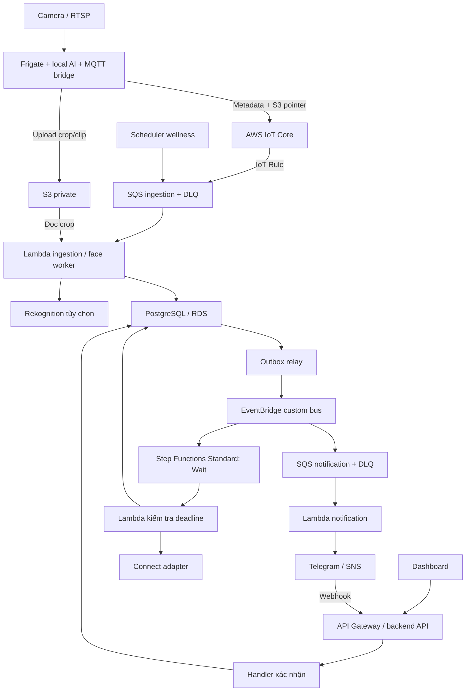

# CameraAI — Technical guide AWS Lambda và event-driven

Ngày đối chiếu code và tài liệu AWS: **09/10/2026**. Region ví dụ: `ap-southeast-1` (Singapore). Đây là hướng dẫn và thiết kế đề xuất, **không phải xác nhận tài nguyên đã được triển khai lên AWS**. Chưa chạy kiểm thử AWS hoặc tạo tài nguyên bằng tài liệu này.

## 1. Nên học gì trước?

Bạn nên học theo thứ tự IAM → Lambda → S3/SQS → event-driven reliability → triển khai bằng SAM → monitoring/budget. Với CameraAI, hãy làm được một sự kiện từ camera đến cảnh báo trước khi chuyển toàn bộ backend.

| Thứ tự | Kiến thức | Bài thực hành gắn với project | Điều kiện hoàn thành |
| --- | --- | --- | --- |
| 1 | AWS account, Region, IAM role/policy, MFA, CLI profile, temporary credentials | Tạo môi trường dev, budget và role chỉ đọc/ghi một prefix S3 | Không dùng root hoặc commit access key |
| 2 | Lambda handler, event/context, SDK, timeout, memory, cold start, execution role | Handler nhận `eventId`, validate và ghi structured log | Payload sai được xử lý có chủ đích; có test |
| 3 | S3 object/key, presigned URL, lifecycle; SQS visibility, DLQ | Upload crop, đưa pointer S3 vào queue, Lambda đọc ảnh | Không đưa video/base64 vào message |
| 4 | At-least-once, idempotency, ordering, retry/backoff, inbox/outbox, transaction | Gửi cùng một event nhiều lần, giả lập lỗi sau DB commit | Một kết quả nghiệp vụ, không mất công việc |
| 5 | EventBridge event bus/rule, Step Functions Standard, Scheduler | Route `ai.result.ready`; chờ deadline rồi đọc lại trạng thái | Event đã RESOLVED không bị escalated |
| 6 | API Gateway, Cognito JWT, webhook security | Callback xác nhận của dashboard/Telegram | Kiểm tra cả identity lẫn quyền sở hữu event |
| 7 | SAM/CloudFormation, change set, stack outputs, rollback, CI/CD OIDC | Tạo stack dev tái lập được | Deploy từ source, không phụ thuộc thao tác Console chưa ghi lại |
| 8 | CloudWatch metrics/alarms, Cost Explorer, Budgets | Theo dõi queue age, lỗi và chi phí demo | Có runbook xử lý lỗi và dừng phát sinh chi phí |

Gợi ý 10 buổi học: buổi 1–2 IAM/budget; 3 Lambda; 4 S3; 5 SQS/DLQ; 6 idempotency/outbox; 7 SAM; 8 workflow; 9 API/auth; 10 kiểm thử E2E và tổng kết chi phí. Đây là lịch gợi ý, không phải cam kết thời gian.

## 2. Hiện trạng thực tế trong repository

Không suy ra một provider đã hoạt động chỉ vì có biến môi trường hoặc được nhắc trong README.

| Thành phần | Bằng chứng | Trạng thái và việc còn thiếu |
| --- | --- | --- |
| Edge/video | `infra/frigate`, `infra/mediamtx`, `infra/mosquitto`, `docker-compose.yml` | Frigate, MediaMTX, FFmpeg, Mosquitto chạy dạng tiến trình/container |
| Backend | `apps/orchestrator/src` | NestJS, MQTT subscriber, PostgreSQL, BullMQ/Redis, worker và REST API đã có code |
| S3 | `storage/s3-storage.service.ts`, `storage/storage.module.ts` | Có upload/download/presign và switch `STORAGE_PROVIDER`; chưa chứng minh bucket/IAM đã tạo |
| Nhận diện khuôn mặt | `services/ai-service/app/services/face_matcher.py`, `face_embedder.py` | Luồng local dùng YuNet/SFace; cấu hình `rekognition` không chứng minh adapter AWS hoàn chỉnh |
| Auth | `auth/auth.module.ts` | JWT local đang được wire; `AUTH_PROVIDER=cognito` chưa đủ để thay toàn bộ auth |
| Notification | `notifications/notifications.module.ts`, thư mục `notifications/telegram` | Telegram có implementation; enum/channel SNS/Connect không chứng minh đã gọi AWS |
| Inbox/outbox | `db/migrations/0010_event_ai_result_receipts.sql`, `ai-results/ai-result-outbox.service.ts` | Có nền tảng durable receipt/outbox để tái sử dụng |
| Lambda và hạ tầng event-driven | Chưa thấy SAM/CDK/Terraform cho luồng này trong cây file đã kiểm tra | Cần thêm handler, adapter, event contract và infrastructure-as-code |
| Fall/fire/wellness | `docs/sprint-3`, migrations 0013–0015 và config AI | Có thiết kế/schema; phải kiểm tra implementation và acceptance trước khi coi là hoàn tất |

Tài liệu nền: [C4](architecture/C4_ARCHITECTURE.md), [data flow](architecture/DATA_FLOW.md), [API](api/API_GUIDE.md), [environment](../.env.example). Hướng dẫn này bổ sung một phương án migration; chưa thay kiến trúc đang chạy.

## 3. Kiến trúc đề xuất và ranh giới Lambda

Lambda phù hợp với công việc hữu hạn: validate event, xử lý crop, gọi Rekognition, cập nhật kết quả, gửi notification hoặc xử lý callback. Giữ stream RTSP, MQTT subscriber lâu dài, FFmpeg, tracking và inference liên tục ở edge/container. Không đưa nguyên `AppModule` lên Lambda rồi để timer, BullMQ hoặc MQTT subscription chạy nền.



**Bước đầu tiết kiệm:** giữ backend, DB, Redis và AI hiện tại; dùng S3 thật và một SQS/Lambda worker. Có thể dùng bridge hiện tại gửi SQS bằng temporary credentials trước khi học IoT Core. Lambda gọi backend qua endpoint HTTPS được bảo vệ hoặc backend consume kết quả từ queue; Lambda không truy cập được `localhost` hay tên container Docker của máy bạn. Không public trực tiếp Frigate/DB để giải quyết kết nối.

**Bước tiếp theo:** IoT Core nhận metadata, EventBridge route domain events, Step Functions điều phối deadline; RDS và hosting cloud được thêm khi cần backend luôn trực tuyến. Mỗi job tại một thời điểm chỉ có một chủ xử lý: BullMQ cũ hoặc SQS/Lambda mới. Không bật song song hai worker gửi cùng thông báo.

S3 upload hoàn tất trước khi publish metadata; lưu công việc chưa publish vào spool/outbox ở edge để replay sau mất mạng. Nếu upload thành công nhưng publish thất bại, reconcile object mồ côi bằng job hoặc lifecycle. Nếu dùng S3 ObjectCreated làm trigger thì chọn nó làm nguồn công việc rõ ràng, tránh xử lý trùng với metadata từ MQTT.

## 4. Contract và độ tin cậy

Envelope dưới đây là **contract mới đề xuất**, không phải payload Frigate hoặc DTO hiện có. Viết mapper sang hợp đồng `api/openapi.yaml` và `SubmitAiResultDto`; không thay enum/schema bằng ví dụ này.

```json
{
  "schemaVersion": 1,
  "messageId": "evt-demo-001-face-1",
  "eventId": "event-uuid",
  "eventType": "camera.person.detected",
  "cameraId": "camera-uuid",
  "ownerScopeId": "owner-uuid",
  "trackId": "track-42",
  "observationId": "track:track-42:face",
  "revision": 1,
  "occurredAt": "2026-10-09T03:00:00Z",
  "media": { "bucket": "your-dev-bucket", "key": "incoming/demo/crop.jpg" },
  "correlationId": "trace-demo-001"
}
```

EventBridge bọc envelope bằng `source`, `detail-type` và `detail`. Truyền bucket/key thay vì presigned URL sắp hết hạn; allowlist bucket/prefix và xác minh quyền sở hữu camera từ registry/DB. Không tin `ownerScopeId` do thiết bị gửi nếu chưa đối chiếu identity.

Các nguyên tắc triển khai:

1. SQS Standard có thể giao lại hoặc đảo thứ tự. Dùng khóa dedup bền vững trong DB; receipt cùng resultId/revision phải có unique constraint. Không chỉ dùng biến trong RAM Lambda.
2. Commit cập nhật event và outbox trong cùng transaction; relay publish rồi đánh dấu đã gửi. Relay có thể publish lại khi crash, nên downstream cũng phải dedup. Khi publish EventBridge phải kiểm tra lỗi từng entry, không chỉ HTTP success.
3. Dùng version/revision và conditional update/row lock khi callback cạnh tranh với deadline. Trạng thái cuối không bị event cũ ghi đè.
4. Notification có ledger theo event/channel/action/version. Nếu provider thành công nhưng process chết trước khi ghi ledger, vẫn có nguy cơ gửi lại; không hứa exactly-once cho Telegram/SNS. Với Connect dùng token ổn định khi API hỗ trợ.
5. Retry lỗi tạm thời với backoff/jitter và giới hạn attempts; payload sai chuyển quarantine/DLQ có lý do. Không retry vô hạn lỗi authorization/schema.
6. SQS source queue cấu hình redrive tới DLQ. On-failure destination của Lambda async không thay thế SQS DLQ. Bật `ReportBatchItemFailures`; trả `messageId` của từng record thất bại.

Ví dụ cấu hình ban đầu: Lambda timeout 10 giây, batch size 1, batching window 0, visibility timeout 60 giây, `maxReceiveCount=5`, DLQ retention 14 ngày. Điều chỉnh sau khi đo p95/p99 và thời gian API/DB; đây không phải SLA. AWS hướng dẫn visibility ít nhất 6 lần function timeout cộng batching window. [SQS configuration](https://docs.aws.amazon.com/lambda/latest/dg/services-sqs-configure.html), [partial batch failures](https://docs.aws.amazon.com/lambda/latest/dg/services-sqs-errorhandling.html).

## 5. Hướng dẫn từng dịch vụ

### 5.1 IAM — quyền truy cập

**Vai trò:** xác định bridge, Lambda và CI được làm gì.

**Triển khai:** bật MFA cho tài khoản quản trị; dùng IAM Identity Center/profile cho người học và OIDC role cho CI. Tách deployment role với execution role. Lambda face chỉ cần consume queue, đọc prefix crop, gọi face API và ghi log; notification chỉ được đọc secret cần dùng và publish topic/call flow được phép. Resource policy của SQS/EventBridge/Lambda phải giới hạn nguồn bằng ARN/account thích hợp; role của IoT Rule được `sqs:SendMessage` tới đúng queue.

**Kiểm thử:** đọc object được phép thành công; prefix khác bị AccessDenied; producer không được purge queue; CI không được dùng root. Dùng IAM policy simulator và một negative test trên dev.

**Budget:** IAM không phải phần chi phí chính, nhưng quyền rộng cho phép tạo tài nguyên ngoài budget. Tag tài nguyên với `Project=CameraAI`, `Environment=dev`, `Owner`, `ExpiresAt`; tag không tự xóa tài nguyên.

### 5.2 Amazon S3 — snapshot/crop/clip

**Vai trò:** thay MinIO bằng object storage thật; SQL giữ metadata và key.

**Triển khai:** tạo bucket tên duy nhất trong region đã chọn; Block Public Access, encryption mặc định, TLS-only bucket policy. Lifecycle 7 ngày cho media thông thường, tách prefix/tag media cần giữ; nếu bật versioning phải xử lý cả noncurrent versions và incomplete multipart uploads. Presigned GET chỉ cấp sau authorization. CORS giới hạn origin dashboard khi browser cần truy cập cross-origin.

Backend hiện tại dùng:

```dotenv
STORAGE_PROVIDER=s3
AWS_REGION=ap-southeast-1
S3_BUCKET=ten-bucket-dev-da-tao
```

Adapter S3 dùng credential chain nếu không truyền access key: trên AWS ưu tiên execution/task role. Docker local cần cấu hình credential/profile được cấp tạm thời riêng; thay `.env` không tự cung cấp credential cho container. Không để `S3_BUCKET` rỗng và không dựa vào bucket mặc định của code.

**Kiểm thử:** upload/download cùng nội dung; presign hết hạn bị từ chối; anonymous GET thất bại; metadata `event_media` trỏ đúng object; rollback provider MinIO không làm mất khả năng đọc media cũ. Lifecycle là bất đồng bộ, không cam kết xóa đúng giây thứ 7 ngày.

**Budget:** dung lượng GB-tháng, PUT/GET, egress, versions. Clip thường tốn hơn crop; chỉ upload clip khi policy cần. [S3 pricing](https://aws.amazon.com/s3/pricing/).

### 5.3 AWS IoT Core — gateway MQTT cloud

**Vai trò:** nhận sự kiện edge bằng MQTT/TLS và route tới SQS; không nhận stream RTSP.

**Triển khai:** tạo Thing/device identity, certificate và IoT policy cho từng bridge. Bridge subscribe Mosquitto local rồi publish topic ví dụ `camerai/dev/camera-01/events` lên IoT endpoint qua TLS. Giới hạn client ID/topic cho từng thiết bị; bảo vệ và xoay certificate. IoT Rule dùng SQL chọn topic này, action gửi SQS Standard, error action tới nơi có thể quan sát. QoS và spool/reconnect cần được kiểm thử riêng.

IoT Rule SQS action không hỗ trợ FIFO; nếu cần ordering chặt, thêm adapter gửi FIFO và chọn group theo camera/event, hoặc xử lý revision trong DB. [IoT SQS action](https://docs.aws.amazon.com/iot/latest/developerguide/sqs-rule-action.html).

**Kiểm thử:** certificate hợp lệ publish được; certificate bị revoke/topic trái phép thất bại; ngắt mạng rồi replay; rule permission sai phải có error trace.

**Budget:** connection minutes, messages, rules/actions; lọc bớt update ở edge, tránh gửi mọi frame. [IoT pricing](https://aws.amazon.com/iot-core/pricing/).

### 5.4 Amazon SQS — buffer công việc và DLQ

**Vai trò:** hấp thụ burst và retry khi worker/AI lỗi; mỗi loại công việc có queue riêng để cô lập tải.

**Triển khai:** tạo ingestion queue, notification queue và DLQ tương ứng; encryption, retention, redrive policy, resource policy tối thiểu. Tạo Lambda event source mapping với partial batch response. Đặt maximum concurrency của mapping và reserved concurrency của function phù hợp khả năng DB/provider; đừng để tổng mapping vượt giới hạn function. Giữ queue trong cùng region với Lambda.

**Kiểm thử:** một record lỗi không làm replay record đã thành công; poison message vào DLQ sau attempts; redrive sau sửa lỗi không tạo thêm incident; visibility không hết trước khi xử lý xong.

**Budget:** số requests và payload; batch khi có đủ lưu lượng, giới hạn retry và alarm tuổi queue. [SQS pricing](https://aws.amazon.com/sqs/pricing/).

### 5.5 AWS Lambda — worker sự kiện

**Triển khai:** viết handler riêng, chỉ import domain logic/repository cần dùng. Khởi tạo SDK client ngoài handler để tái sử dụng; luôn chờ hoàn tất DB/API trước khi return. Chọn runtime còn hỗ trợ tại thời điểm deploy; bắt đầu 256–512 MB rồi đo duration. Timeout, concurrency và log retention khai báo bằng SAM. Dùng version/alias để rollback.

Với Lambda thông thường, invocation tối đa 15 phút; tài liệu hiện có ngoại lệ cho Managed Instances. Phương án này dùng Lambda thông thường và handler ngắn. Không dùng `sleep(T_wait)` để chờ người dùng. [Lambda quotas](https://docs.aws.amazon.com/lambda/latest/dg/gettingstarted-limits.html).

**Kiểm thử:** success, timeout, duplicated event, SDK throttling, DB unavailable, cold start, malformed payload và partial batch failure. SAM local không mô phỏng đầy đủ IAM, queue polling hay network AWS.

**Budget:** requests và GB-seconds; ví dụ 0,5 GB × 0,3 giây × 30.000 invocation = 4.500 GB-seconds, chưa tính retries/worker khác. Provisioned concurrency chỉ bật khi số đo latency chứng minh cần. [Lambda pricing](https://aws.amazon.com/lambda/pricing/).

### 5.6 Amazon EventBridge — route domain event

**Vai trò:** fan-out `ai.result.ready`, `event.escalated`, `event.resolved`; SQS vẫn là buffer của consumer.

**Triển khai:** tạo custom bus theo environment, rule filter `source`/`detail-type`/version và target SQS hoặc state machine. Cấu hình retry/DLQ của target cùng resource/execution policy. Relay đọc outbox và publish; không phát lại event tiêu thụ lên chính route đó thành vòng lặp. Archive/replay chỉ bật khi có nhu cầu và budget.

**Kiểm thử:** event khớp đi đúng target; event version sai không kích hoạt worker; lỗi permission tới target vào DLQ; replay có dedup.

**Budget:** events, archive/replay và dịch vụ downstream; fan-out nhân số lần xử lý. [EventBridge pricing](https://aws.amazon.com/eventbridge/pricing/).

### 5.7 Step Functions Standard và EventBridge Scheduler

**Vai trò:** Standard workflow chờ deadline escalation; Scheduler chạy lịch wellness hoặc tác vụ bảo trì.

**Triển khai escalation:** sau transaction NOTIFIED/outbox, relay start workflow với `eventId`, `ruleVersion`, `deadlineAt`, `aggregateVersion`. Dùng tên execution xác định cho lần cảnh báo; workflow `Wait` đến deadline → Lambda đọc DB → conditional update chỉ khi trạng thái vẫn hợp lệ → tạo notification outbox. Lưu ID execution để quan sát; rule thay đổi phải có policy snapshot rõ ràng, không để workflow cũ áp deadline mới tùy ý.

Callback và deadline cùng dùng transaction/conditional update; nếu callback đã RESOLVED, workflow kết thúc không gọi điện. Có reconciliation tìm event có deadline mà thiếu workflow để phục hồi lỗi start; không mất escalation vì crash giữa commit và start.

Scheduler có độ chính xác theo cửa sổ 60 giây kể cả khi tắt flexible window, nên không phù hợp deadline cháy 30 giây. Step Functions Wait cũng không bảo đảm thời điểm thực thi chính xác tuyệt đối; đo latency thực tế và chừa margin cho mục tiêu dưới 3 phút. Với wellness, khai báo timezone `Asia/Bangkok`, input ID lịch và ngày kỳ kiểm tra, retry/DLQ, xóa one-time schedule sau hoàn tất khi phù hợp. [Scheduler precision](https://docs.aws.amazon.com/scheduler/latest/UserGuide/schedule-types.html), [workflow types](https://docs.aws.amazon.com/step-functions/latest/dg/choosing-workflow-type.html).

**Kiểm thử:** deadline 30/60/120 giây; RESOLVED trước/sát deadline; callback trùng; sửa rule; start workflow lỗi; lịch wellness đúng timezone. Không chọn Express mặc định cho chờ phản hồi người dùng dài.

**Budget:** Standard tính state transitions, Scheduler tính invocations; tránh workflow trên từng frame và vòng polling dày. [Step Functions pricing](https://aws.amazon.com/step-functions/pricing/).

### 5.8 Amazon Rekognition — face provider tùy chọn

**Vai trò:** thay face matching local cho M1, không mặc định thay YOLO/fire hoặc chuỗi pose/fall.

**Triển khai:** tạo collection theo scope/environment; implement `IndexFaces`, `SearchFacesByImage`, `DeleteFaces` và mapping provider FaceId ↔ known face trong DB. Crop đúng người trước search; API search dùng mặt lớn nhất trong ảnh. Không thể upload trực tiếp embedding YuNet/SFace vào collection như embedding AWS. Khi migration phải đăng ký lại từ ảnh được phép dùng; nếu ảnh đã xóa thì cần người dùng đăng ký lại.

Chuyển similarity AWS về policy rõ ràng; không dùng nguyên threshold 0–1 local cho giá trị similarity 0–100. Giữ `UNDETERMINED` khi không có mặt/multiple faces/lỗi kỹ thuật thay vì gán UNKNOWN. [SearchFacesByImage](https://docs.aws.amazon.com/rekognition/latest/APIReference/API_SearchFacesByImage.html).

**Kiểm thử:** known/unknown/no-face/multiple-face; collectionVersion cũ; xóa FaceId; API throttle; so sánh false accept/reject trên cùng bộ ảnh test. Cấu hình `FACE_PROVIDER=rekognition` chỉ bật sau adapter và contract tests đã hoàn tất.

**Budget:** API calls theo loại và lưu face metadata; một lần search mỗi observation/track phù hợp policy, không mỗi frame; cap số search/ngày. [Rekognition pricing](https://aws.amazon.com/rekognition/pricing/).

### 5.9 API Gateway và Amazon Cognito — API/auth

**Triển khai:** tạo HTTP API cho handler ngắn và user pool/app client cho dashboard; dùng JWT authorizer hoặc validation JWT đúng issuer/audience/expiry tại backend. Mapping Cognito `sub` sang user/owner nội bộ; cập nhật login/refresh/logout và authorization trong dashboard/NestJS. Có biến `AUTH_PROVIDER` chưa đồng nghĩa module đã hỗ trợ Cognito.

Route Telegram webhook dùng secret token của webhook và validation callback theo user/event; route thiết bị dùng identity riêng, không dùng JWT của người dùng để thay certificate. Nếu giữ NestJS REST API, gateway có thể proxy qua integration phù hợp. Live stream/SSE hiện tại cần thiết kế hosting riêng; không giả định HTTP handler Lambda giữ được kết nối media lâu dài.

**Kiểm thử:** token thiếu/hết hạn/sai audience bị chặn; user A không đọc/xác nhận event user B; webhook sai secret bị chặn; throttle burst; không log JWT/cookie.

**Budget:** API requests, data transfer và Cognito theo usage/tier. Tách endpoint media khỏi JSON API; rate limit nguồn phát công việc tốn tiền. [API Gateway pricing](https://aws.amazon.com/api-gateway/pricing/), [Cognito pricing](https://aws.amazon.com/cognito/pricing/).

### 5.10 Amazon SNS, Amazon Connect và Telegram

**SNS triển khai:** tạo topic/email subscription, confirm email; adapter publish từ notification ledger/outbox. SMS cần kiểm tra sandbox, destination, origination identity, region và quota/spending limit theo tài khoản; không coi SMS hoạt động chỉ bằng topic ARN.

**Connect triển khai:** tạo instance, outbound number và contact flow phát lời cảnh báo; cấp `connect:StartOutboundVoiceContact` tới resource cần thiết, giới hạn số người nhận và attempts. Dùng `ClientToken` ổn định cho cùng hành động gọi; lưu ContactId để theo dõi kết quả. Chỉ thử số người thân/test đã đồng ý. [Connect API](https://docs.aws.amazon.com/connect/latest/APIReference/API_StartOutboundVoiceContact.html).

**Telegram:** tái sử dụng message builder và callback semantics hiện tại; chuyển việc gửi sang Lambda khi network/secret phù hợp. Lambda trong private subnet cần đường egress để gọi Telegram; không có internet chỉ vì đã gắn VPC.

**Kiểm thử:** ban đầu mock SMS/call và dùng email/test chat; test retry 429/5xx, callback duplicate, người nhận sai và ledger crash window. AWS/provider nhận request thành công không có nghĩa người nhận đã đọc hoặc nghe.

**Budget:** SNS requests/email/SMS; Connect phút gọi, điện thoại và thành phần liên quan theo quốc gia. Đặt cap ứng dụng số SMS/cuộc gọi/event/ngày, cooldown và allowlist. [SNS pricing](https://aws.amazon.com/sns/pricing/), [Connect pricing](https://aws.amazon.com/connect/pricing/).

### 5.11 PostgreSQL/RDS, VPC và hosting container

**Vai trò:** giữ PostgreSQL làm source of truth để bảo toàn schema/transaction hiện có; không cần chuyển DynamoDB chỉ vì dùng Lambda.

**Triển khai:** giai đoạn local giữ PostgreSQL hiện tại. Khi lên cloud, tạo RDS PostgreSQL private subnet/security group, backup/retention, TLS và secret riêng. Lambda cần VPC connectivity nếu kết nối DB private; pool nhỏ và concurrency cap để không vượt connections. RDS Proxy là tùy chọn phải cân chi phí. Chạy migrations qua job được kiểm soát, backup trước thay đổi schema; không mỗi Lambda cold start. Backend/AI lâu dài có thể dùng EC2 hoặc ECS/ECR; Frigate gần camera cần tài nguyên/thiết bị phù hợp.

**Kiểm thử:** migrate trên DB dev mới và bản nâng cấp; duplicate/transaction race; network bị chặn; restore backup; DB failover theo cấu hình chọn. Các file migration đang có tiền tố số trùng nên phải kiểm tra cách runner xác định migration ID và thứ tự trước deploy.

**Budget:** DB/container chạy theo giờ, disk/backup, load balancer, NAT và public IPv4 có thể lớn hơn Lambda. Nếu $10 là budget demo, giữ DB/AI ở local trước; không hứa toàn bộ RDS/ECS/Connect nằm trong $10. [RDS pricing](https://aws.amazon.com/rds/postgresql/pricing/), [VPC pricing](https://aws.amazon.com/vpc/pricing/).

### 5.12 Secrets Manager, CloudWatch và AWS Budgets

**Secrets:** đưa Telegram bot token, DB password, internal token vào Secrets Manager; execution role đọc đúng secret. Cache có thời hạn và có kế hoạch rotation; không đưa secret vào stack output/source/log. Kiểm thử role trái phép và token đã rotate. Secret được tính theo lưu trữ/API calls. [Secrets pricing](https://aws.amazon.com/secrets-manager/pricing/).

**CloudWatch:** JSON log với correlationId/eventId/messageId, duration, retry, status; không log ảnh, face embedding hoặc secret. Retention dev đề xuất 7 ngày. Alarm DLQ visible > 0, queue oldest age vượt latency budget, Lambda errors/throttles, workflow failed/timed out, DB connections và notification failures. Endpoint/camera im lặng cần heartbeat alarm vì không có event không đồng nghĩa hệ thống khỏe.

Kiểm thử alarm bằng lỗi kiểm soát và xác nhận có người nhận; không chỉ tạo alarm trên Console. Logs/metrics/alarms có chi phí, tránh debug mọi frame. [CloudWatch pricing](https://aws.amazon.com/cloudwatch/pricing/).

**Budgets:** tạo cost budget tháng và email actual/forecast; $10 là mốc tham khảo đã có trong README, cần chủ project chọn mức thực tế. Budgets báo trễ và không phải hard spending cap. [AWS Budgets behavior](https://docs.aws.amazon.com/cost-management/latest/userguide/budgets-managing-costs.html).

## 6. Quy trình triển khai từng bước

### 6.1 Baseline local trước khi tạo cloud resource

Các lệnh PowerShell dưới đây dùng script đã có trong repo; cần dependencies/Docker đã cài và `.env` hợp lệ. Không overwrite `.env` đang dùng và không chạy `db:reset` trên dữ liệu cần giữ.

```powershell
if (-not (Test-Path .env)) { Copy-Item .env.example .env }
docker compose up -d
pnpm db:migrate
pnpm --filter @cam/orchestrator test
pnpm --filter @cam/orchestrator test:integration
pnpm test:ai
```

Integration tests dùng Docker/Testcontainers; kiểm tra điều kiện và skip trong từng test. Lưu baseline: event nhận được, media đọc được, kết quả face đúng contract, Telegram callback thay đổi trạng thái. Các bài test hiện tại không xác nhận IAM/AWS thật.

### 6.2 Chuẩn bị hạ tầng mới bằng SAM

SAM phù hợp để học vì khai báo Lambda và resource AWS qua CloudFormation. Các file dưới đây **cần được tạo trong bước implementation sau**, chưa tồn tại do viết tài liệu này:

```text
infra/aws/template.yaml          # queues, roles, functions, log groups, outputs
infra/aws/samconfig.toml         # region/stack dev, không chứa secret
services/aws-workers/           # handlers và domain adapters
services/aws-workers/events/    # fixture SQS và domain event
services/aws-workers/tests/     # contract/idempotency/failure tests
```

Template giai đoạn 1 phải có S3 private/lifecycle, SQS/DLQ/redrive, Lambda role tối thiểu, event source mapping, log retention/alarms, tags và outputs. Giai đoạn 2 thêm IoT rule, EventBridge, workflow và callback API. Không dùng tên bucket/ARN cố định chia sẻ giữa dev/prod.

Sau khi handler/template thực sự đã được viết, cài AWS CLI và SAM CLI rồi chạy:

```powershell
aws sso login --profile camerai-dev
aws sts get-caller-identity --profile camerai-dev
sam validate --lint --template-file infra/aws/template.yaml
sam build --template-file infra/aws/template.yaml
sam deploy --guided --stack-name camerai-dev --region ap-southeast-1 --profile camerai-dev
aws cloudformation describe-stacks --stack-name camerai-dev --region ap-southeast-1 --profile camerai-dev --query "Stacks[0].Outputs"
```

`aws sso login` yêu cầu profile SSO đã cấu hình; chọn account/role đúng trước deploy. Đọc change set, resource replacement và IAM changes. SAM có thể tạo deployment bucket/artifact cũng cần tính chi phí. [SAM deploy guide](https://docs.aws.amazon.com/serverless-application-model/latest/developerguide/using-sam-cli-deploy.html).

### 6.3 Nối từng luồng, chưa bật mọi provider cùng lúc

1. Tạo budget trước; deploy S3, xác minh adapter backend với ảnh test.
2. Deploy queue/worker; gửi fixture từ CLI/bridge, nhận kết quả qua backend adapter hoặc result queue. Chưa bật event camera thật.
3. Thêm dedup/inbox/outbox và failure tests; tắt worker BullMQ tương ứng khi chuyển ownership.
4. Nối một camera qua bridge/IoT; giới hạn event rate, đo latency và costs.
5. Thêm routing notification và Step Functions; test race callback/deadline.
6. Thêm Cognito/Rekognition/SNS/Connect từng provider sau khi adapter đã hoàn chỉnh. Smoke test mỗi lần, có rollback flag/config thực sự được code đọc.

CI/CD: lint/build/tests → SAM validate → deploy dev → smoke test → review thay đổi → prod. Dùng OIDC thay access key lâu dài. Alias/version rollback code; migration DB phải backward-compatible vì rollback Lambda không rollback schema.

## 7. Ma trận kiểm thử và tiêu chí nghiệm thu

| Tầng/tình huống | Cách thực hiện | Kết quả cần thấy |
| --- | --- | --- |
| Unit/contract | Fixture Frigate → mapper → domain envelope → AI result DTO | Schema/enum đúng; thiếu field được từ chối |
| Idempotency | Gửi cùng message 10 lần, restart worker giữa chừng | Một incident; receipt/outbox có unique semantics |
| Ordering | Revision 2 đến trước revision 1 | Revision cũ không ghi đè kết quả mới |
| DB/publish crash | Dừng process sau commit, trước hoặc sau publish | Relay phục hồi; consumer chịu duplicate |
| Partial batch | Một record lỗi trong batch nhiều record | Record thành công không bị chạy lại do lỗi kia |
| Poison message | Cố định lỗi schema/provider | DLQ có reason/correlation, không vòng retry vô hạn |
| Media race | Event đến khi key không tồn tại hoặc upload lỗi | Retry có giới hạn; không ghi kết quả face giả |
| Face quality | known/unknown/no-face/multi-face/low-light | UNKNOWN khác UNDETERMINED; đo FAR/FRR |
| Deadline race | Xác nhận ngay trước/sát/sau deadline | State machine theo policy; không gọi sau RESOLVED đã commit |
| Camera/network | Mất MQTT/cloud rồi kết nối lại | Spool replay, dedup; heartbeat báo outage |
| Security | User sai owner, token sai, certificate revoke | AccessDenied/401/403 đúng; không rò media |
| Provider retry | Telegram 429, SNS/Connect throttle, timeout | Backoff/cooldown; không tạo storm |
| Load | 1 camera rồi burst nhiều camera có mức trần | Queue age/connections nằm trong mục tiêu đã chọn |
| Budget | Bật cap số face call/callout rồi vượt cap | Công việc tốn tiền bị chặn theo policy, alarm được nhận |
| Recovery | Redrive DLQ và rollback alias | Không mất event; kết quả cũ vẫn đọc được |

Các test sẵn có đáng tái sử dụng: `mqtt-consumer.service.spec.ts`, `mqtt-db.integration.spec.ts`, `face-recognition.worker.spec.ts`, `ai-results-db.integration.spec.ts`, `ai-result-outbox.service.spec.ts`, `escalation-deadline-worker.service.spec.ts`, `telegram.adapter.spec.ts`, `telegram-db.integration.spec.ts` trong `apps/orchestrator/test`.

Acceptance đề xuất: luồng một camera thật chạy end-to-end; duplicate không nhân incident; DLQ/alarm được kiểm chứng; state không hồi quy khi event đảo thứ tự; đo p95/p99 từ `occurredAt` đến NOTIFIED và ESCALATED. Mục tiêu dự án dưới 3 phút phải đo toàn luồng, gồm camera detection, network, queue, inference, thời gian chờ và provider delivery. Không coi Lambda duration là latency toàn hệ thống.

## 8. Budget: dự toán, giới hạn và theo dõi

### 8.1 Lập dự toán từ workload

Ví dụ giả định demo: 2 camera, tổng 1.000 event/ngày, tháng 30 ngày; 1 crop 200 KB/event, 10% event có clip 5 MB; giữ media 7 ngày; 2 invocation/event, 512 MB, 300 ms/invocation; 20 face đăng ký. **Đây là số giả định để nhập calculator, chưa phải giá tiền hoặc workload đo được.**

| Hạng mục | Khối lượng ước tính |
| --- | --- |
| Events | 30.000/tháng, chưa gồm heartbeat/update/retry |
| Lambda | 60.000 invocation; 9.000 GB-seconds |
| Face search | Tối đa 30.000 nếu mỗi event search một lần; giảm theo track/dedup |
| Media upload | Crop ~6 GB/tháng + clip ~15 GB/tháng |
| Media lưu ổn định 7 ngày | ~4,9 GB trung bình khi phân bố đều, chưa versions/retained media |
| Queue/bus requests | Tính từng hop, batch, polling, retry và fan-out, không chỉ đếm events |
| Notification | Tính theo escalation ratio, số kênh, số người nhận, attempts và phút gọi |

Tổng dự toán = Lambda + S3 + SQS + IoT + EventBridge/workflow + Rekognition + API/auth + notifications + logs/secrets + hosting/DB/network. Dữ liệu tải lên và tải xem nhiều lần có biểu phí khác nhau; nhập egress vào calculator.

Chọn region và usage tại [AWS Pricing Calculator](https://calculator.aws/) và các pricing links theo dịch vụ ở trên; lưu estimate/ngày tạo vào repo. Không khẳng định free tier luôn miễn phí: quyền lợi phụ thuộc tài khoản, thời điểm đăng ký, credits và service; calculator có thể không tự trừ free tier. [Calculator guide](https://docs.aws.amazon.com/pricing-calculator/latest/userguide/getting-started.html).

### 8.2 Thiết lập quản lý cost

1. Billing → Budgets → monthly cost budget, ví dụ $10 cho demo hạn chế; alert actual 50%, 80%, 100% và forecast 100%. Xác nhận email nhận được.
2. Dùng account tổng cho budget đầu tiên; khi tag đã được kích hoạt làm cost allocation tag, thêm budget filter `Project=CameraAI`. Đừng bỏ sót resource chưa tag hoặc shared/network charges.
3. Cost Explorer xem theo service/region/tag hằng ngày trong thời gian demo. Ghi ngày, usage, actual cost và forecast vào bảng theo dõi.
4. Cài cap ứng dụng: event/camera/phút, face searches/ngày, SMS/calls/ngày, max attempts và allowlist. Reserved concurrency hạn chế tốc độ nhưng không giới hạn tổng tiền trong tháng.
5. S3 lifecycle; CloudWatch retention; tắt archive/provisioned concurrency không cần; không để container/DB/NAT chạy ngoài giờ demo khi không có yêu cầu luôn trực tuyến.

Ví dụ chia hạn mức nội bộ $10: $3 cho event compute/messaging, $3 cho media/AI, $1 cho observability/secrets, $1 cho notification thử nghiệm, $2 dự phòng. Đây là phân bổ mục tiêu, **không phải báo giá**, và chưa bao gồm phương án RDS/ECS/NAT luôn bật. Nếu calculator vượt mức, giảm phạm vi hoặc tăng budget trước triển khai.

Budgets không dừng dịch vụ ngay khi chạm ngưỡng. Budget Actions có thể bổ sung kiểm soát nhưng vẫn phụ thuộc cập nhật billing; phải có runbook và giới hạn ở ứng dụng.

### 8.3 Runbook khi chi phí tăng bất thường

1. Xem service/region tăng và metric event rate, invocations, retries, queue age; tìm vòng lặp event hoặc provider lỗi.
2. Tạm ngừng producer/rule/event source mapping của môi trường dev, giữ queue để điều tra; không purge bằng phản xạ. Reserved concurrency 0 có thể chặn invocation nhưng không chặn mọi chi phí storage/queue/provider.
3. Disable SMS/call thật qua cấu hình, giảm event rate; xử lý lỗi rồi replay có giới hạn.
4. Kiểm tra DB/container/NAT/load balancer, S3 versions và logs. Billing có độ trễ nên kiểm tra lại sau khi đã dừng tải.

## 9. Vận hành, rollback và dọn môi trường

| Sự cố | Kiểm tra | Hành động |
| --- | --- | --- |
| Không có event | Heartbeat, bridge certificate, IoT rule, camera health | Phục hồi bridge, replay spool |
| Queue tăng | Throttles, timeout, DB pool, downstream quota | Sửa bottleneck; tăng concurrency chỉ khi DB/provider chịu được |
| DLQ có record | Error reason và correlationId | Sửa code/config, redrive dev có giới hạn |
| Alert trùng | Ledger/outbox, message ID, crash window | Sửa idempotency; không chỉ tăng visibility |
| Event không escalated | Deadline DB, execution ID, relay backlog | Reconcile missing workflow; xác minh rule snapshot |
| Không gọi được Telegram | VPC egress, secret, 429 | Phục hồi network/token, backoff |
| Login lỗi sau Cognito migration | issuer/audience/sub mapping, refresh flow | Rollback auth rollout có kiểm soát |

Trước xóa stack dev: dừng producer, export dữ liệu/log cần bàn giao, kiểm tra queue/outbox chưa xử lý, xác định resource được Retain. Khi implementation SAM đã có, dùng `sam delete` cho đúng stack/profile/region sau kiểm tra. Bucket không rỗng/versioned và resource Retain có thể tồn tại sau xóa stack; không tự xóa dữ liệu cần giữ để làm lệnh thành công.

Sau demo kiểm kê deployment buckets, S3 versions, ECR images, log groups, schedules, secrets, RDS snapshots, ECS/EC2, NAT, load balancer, public IP và số điện thoại Connect. Xóa stack không chứng minh bill về 0; kiểm tra Billing/Cost Explorer sau đó.

## 10. Thứ tự implementation khuyến nghị cho CameraAI

1. **MVP:** S3 adapter thật + một SQS/Lambda face job hoặc notification job + DLQ + CloudWatch + budget. Giữ REST API/DB/AI ở môi trường hiện tại, giải quyết kết nối bằng adapter an toàn.
2. **Reliability:** contract mapper, inbox/outbox, notification ledger, revision handling, replay và failure tests.
3. **Event-driven hoàn chỉnh:** bridge IoT Core, EventBridge domain bus, Step Functions deadline, Scheduler wellness và callback path.
4. **AWS providers:** Rekognition, Cognito, SNS, Connect từng dịch vụ; bổ sung cloud hosting/RDS khi cần uptime.
5. **Bàn giao:** source IaC/handlers, estimate chi phí, số đo latency/AI, test report, rollback và cleanup inventory.

Bài thực hành đầu tiên nên chọn: **upload một crop lên S3 → gửi pointer vào SQS → Lambda xử lý → lưu kết quả qua contract hiện tại → quan sát log/DLQ**. Khi làm được luồng này và test duplicate/crash, bạn đã nắm phần cốt lõi để mở rộng event-driven cho project.
