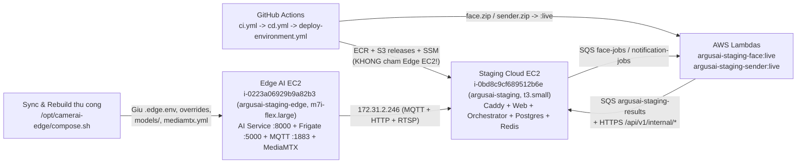

# Bàn giao Nghiệm thu Face Track-Once & Thông báo Staging (`SNS_EMAIL`)

Tài liệu bàn giao kỹ thuật cho các agent và kỹ sư tiếp quản nhánh `fix/staging-face-remaining-gaps` (tách từ `main` sau PR #50 [`c8fd730`](https://github.com/DuongDaiPhat/aws-camera-ai/commit/c8fd7309cef48b834c84348adbde7382353f7b9a)) cùng hiện trạng hạ tầng Staging Cloud EC2, Edge AI EC2 và kênh `SNS_EMAIL` thật.

> **Quy tắc bảo mật:** Tài liệu này chỉ ghi định danh tài nguyên, ARN, tên biến và số liệu nghiệm thu đã xác minh. Tuyệt đối **không** lưu mật khẩu, token (`AI_INTERNAL_TOKEN`, `INTERNAL_SERVICE_TOKEN`, `SMOKE_INTERNAL_TOKEN`, `JWT_SECRET`, `POSTGRES_PASSWORD`, `MEDIAMTX_PUBLISH_PASSWORD`), presigned S3 URL hay nội dung `runtime.env` / `.edge.env` trong Git.

Tham chiếu liên quan: [Báo cáo kiểm thử Dev 25/25](test/FACE_REACCEPTANCE_2026-11-23/REPORT.md) · [Thiết kế 5 lớp Face Track-Once](reports/FACE_TRACK_ONCE_OPTIMIZATION_REPORT.md) · [Hướng dẫn setup Notification](NOTIFICATION_SETUP_TEST.md) · [Mục lục tài liệu](README.md)

---

## 1. Tổng quan & Vấn đề gốc (Dev vs Staging Gap)

Trên môi trường **Dev** (chạy E2E với AWS Rekognition dev, kiểm thử ngày 23/11/2026 trong [báo cáo kiểm thử Dev](test/FACE_REACCEPTANCE_2026-11-23/REPORT.md)), bộ kiểm thử đạt **`25/25`** tiêu chí nghiệm thu trong phạm vi đã điều chỉnh (`16` lượt replay chốt, `19` event, `21` face job, `21` `SearchFacesByImage`; giữ gate cứng `80 px` và chấp nhận 2 video stress mặt nhỏ ~29–52 px chưa đạt).

Tuy nhiên, khi đưa cùng kiến trúc **PR #49** (`fab5e1d`, release `fab5e1dfd201332714a28c4bd44053d841980cdc-45220432753-1`) lên **Staging** và chạy lại đầy đủ 32 lượt replay `1920x1080` H.264/CRF12 tại ngưỡng `FACE_SESSION_CACHE_SIMILARITY_THRESHOLD=0.52`, kết quả ban đầu là **NO-GO** (`23/25` tiêu chí chính lượt gốc, `8/11` mở rộng). Bốn khoảng trống hạ tầng/hành vi chỉ lộ ra dưới điều kiện Staging thật:

1. **`TC07-separated*` lỗi `14 x HTTP_503` + tranh chấp lock trên AI Service 2 vCPU:**
   - Trong `fab5e1d`, `services/ai-service/app/routers/face.py` giữ `BoundedSemaphore(face_max_concurrent=2)` với `slots.acquire(blocking=False)`, nên hai request `/face/assess` đến sát nhau lập tức trả `HTTP 503 PROVIDER_UNAVAILABLE` khi cả hai slot đang bận (hoặc trong lúc warmup/assess kéo dài).
   - Đồng thời, `FaceQualityAssessor.assess()` giữ một global `self._lock` bao trọn `_assess_image()`, buộc 2 request phải xếp hàng tuần tự và vượt quá `FACE_QUALITY_GATE_TIMEOUT_MS=2000`.
   - Tổng đo ở baseline `fab5e1d`: **`14` lần `HTTP_503`** (`8` ở `TC07-separated-052`, `6` ở `TC07-separated-glasses-052`) và **`6` lần `QUALITY_GATE_TIMEOUT`** (`3` + `3`), khiến `TC07-separated-glasses-052` bỏ sót người B (`KNOWN: 1, NOT_ANALYZED: 1`).
2. **`TC09-stranger-052` thiếu ảnh `SNAPSHOT` trong `event_media`:**
   - Frigate gửi MQTT `new` và `update` cho track người lạ với `has_snapshot=false` (và sau khi track kết thúc, endpoint snapshot Frigate trả `404`).
   - `MqttConsumerService.synchronizeMedia()` trước PR #50 chỉ tải ảnh khi `after.has_snapshot === true`, dẫn đến sự kiện `TC09-stranger-052` có `0` bản ghi `event_media` và giao diện hiển thị _"Ảnh camera chưa sẵn sàng"_.
3. **`TC05-no-glasses` / `TC05-glasses` & độ trễ MQTT `end` từ Frigate (`13–18s`):**
   - Do cấu hình Frigate dùng `detect.max_disappeared: 75` ở `5 FPS` (~`15s`), Frigate phát sự kiện MQTT `type=end` chậm khoảng **13–18 giây** sau `frame_time` cuối cùng còn thấy người trong luồng live (ví dụ đo trong `frigate-events.jsonl` baseline `fab5e1d`: `13.53s`, `14.04s`, `15.18s`, `17.75s`, `17.90s`; ở `TC04-glasses-052` trễ `15.55s` trên `fab5e1d` và `14.26s` trên `c8fd730`).
   - Vì track cũ vẫn chưa nhận `end` (`endedAt === null`) khi track mới xuất hiện sau che khuất hoặc quay lại, logic nối incident trước PR #50 bỏ qua track cũ và sinh sự kiện mới.
4. **`TC04` / `TC08` tách track (dư sự kiện `NOT_ANALYZED` / `KNOWN`):**
   - Trong `TC04-no-glasses-052` (`3` events), `TC04-glasses-052` (`4` events ở `fab5e1d`), `TC08-glasses-052` (`3` events ở `fab5e1d`; 2 lượt lặp tạo `5` và `4` events), Frigate tạo thêm các track ngắn/phụ trong khi track chính vẫn chưa `end` hoặc vừa chuyển ID, gây dư sự kiện dù số lần gọi Rekognition vẫn được giữ ở `1` (`TC04`) hoặc `2` (`TC08`).

---

## 2. Bản đồ Hạ tầng Staging & Edge (Rất quan trọng cho Agent sau)

Tất cả tài nguyên AWS Staging thuộc Account `926883321040`, Region `ap-southeast-1`.



### 2.1. Staging Cloud EC2 (`argusai-staging`)

- **Instance:** `i-0bd8c9cf689512b6e` (`Name=argusai-staging`, `t3.small`, `x86_64`, Private IP `172.31.9.115`, Public EIP `175.41.136.219`, SG `sg-0c2a61c0d8f54bb5d` chỉ mở inbound `80`/`443`).
- **Endpoint công khai:** `https://argusai-staging.duckdns.org`.
- **Pipeline triển khai tự động:**
  1. [`.github/workflows/ci.yml`](../.github/workflows/ci.yml) chạy 9 job song song + gate `ci-ok`.
  2. [`.github/workflows/cd.yml`](../.github/workflows/cd.yml) (job `package`) build Docker images `linux/amd64` cho `apps/web` và `apps/orchestrator` đẩy lên ECR (`camerai/web`, `camerai/orchestrator`), đóng gói `face.zip` và `sender.zip` qua `services/aws-workers/build.py`, tạo `bundle.tgz` (`release.env`, `deploy/compose.yml`, `deploy/Caddyfile`) đẩy lên `s3://argusai-releases-926883321040/releases/<RELEASE_ID>/`.
  3. [`.github/workflows/deploy-environment.yml`](../.github/workflows/deploy-environment.yml) gọi [`tools/cd/request-deploy.sh`](../tools/cd/request-deploy.sh) gửi SSM `AWS-RunShellScript` chạy `/opt/camerai/deploy-host.sh <RELEASE_ID> apply` ([`tools/cd/deploy-host.sh`](../tools/cd/deploy-host.sh)), lấy biến môi trường từ **SSM Parameter Store `/camerai/staging/runtime-env`** (`SecureString`, `Advanced`, hiện ở **Version 20**), migrate DB, cập nhật symlink `/opt/camerai/current` → `/opt/camerai/releases/<RELEASE_ID>` và chạy stack [`deploy/compose.yml`](../deploy/compose.yml) (`camerai-staging-{orchestrator,web,caddy,redis,postgres}-1`).

### 2.2. Edge AI EC2 (`argusai-staging-edge`)

- **Instance:** `i-0223a06929b9a82b3` (`Name=argusai-staging-edge`, **`m7i-flex.large`** — 2 vCPU, Private IP `172.31.2.246`, SG `sg-04ae036558033453c` nhận TCP `8000`, `5000`, `1883`, `8554` từ `argusai-staging-sg`, mở `80`/`443` & `8189/udp,tcp` cho MediaMTX WebRTC `https://argusai-staging-media.duckdns.org`).
- **CẢNH BÁO QUAN TRỌNG:** **GitHub CD KHÔNG triển khai lên `i-0223a06929b9a82b3`!** Việc push/merge vào `main` **CHỈ** triển khai `orchestrator`, `web` và các Lambda. Mọi thay đổi trong [`services/ai-service`](../services/ai-service) (hoặc [`infra/frigate/frame-metadata/`](../infra/frigate/frame-metadata)) **BẮT BUỘC phải đồng bộ thủ công và rebuild trên `i-0223a06929b9a82b3`**!
- **Quản lý thủ công tại `/opt/camerai-edge`:**
  - Dùng duy nhất wrapper `/opt/camerai-edge/compose.sh`, thực thi:
    `exec docker compose -p argusai-edge -f edge-compose.yml -f edge-face.override.yml -f edge-runtime.override.yml "$@"`
  - Các thành phần **bắt buộc phải bảo toàn** (tuyệt đối không dùng `git reset --hard`, `git clean`, hoặc ghi đè khi cập nhật):
    - `edge-compose.yml`, `edge.Caddyfile`, `compose.sh`
    - `edge-face.override.yml` (cấu hình Quality Gate + `FACE_CPU_THREADS` và mount `track_stabilizer.py` — lưu ý file này **override** biến cùng tên trong `.edge.env`!)
    - `edge-runtime.override.yml` (cấu hình `M2A_ENABLED=true`, `M3_ENABLED=true`, `FIRE_MODEL_*`)
    - `.edge.env` (env nội bộ của Edge gồm `AI_INTERNAL_TOKEN` — không in, không ghi đè)
    - `services/ai-service/models/`: chứa các model đã kiểm SHA-256 theo [`services/ai-service/model-manifest.json`](../services/ai-service/model-manifest.json):
      - `w600k_r50.onnx` (`4c06341c33c2ca1f86781dab0e829f88ad5b64be9fba56e56bc9ebdefc619e43`)
      - `face_detection_yunet_2023mar.onnx` (`8f2383e4dd3cfbb4553ea8718107fc0423210dc964f9f4280604804ed2552fa4`, YuNet)
      - `face_recognition_sface_2021dec.onnx` (`0ba9fbfa01b5270c96627c4ef784da859931e02f04419c829e83484087c34e79`)
      - `pose_landmarker_lite.task` (`59929e1d1ee95287735ddd833b19cf4ac46d29bc7afddbbf6753c459690d574a`)
      - `fire-smoke-yolo26n-checkpoint-nms.onnx` (`773e23d1896d82787819f665694bfbc33825081f7f7a0f5fa5b1c6a22cb54650`, Fire YOLO)
    - `infra/mediamtx/mediamtx.yml` (có cấu hình riêng đang tracked modified trên Edge) và `infra/frigate/config.yml`

### 2.3. AWS Lambdas Staging

- **Face Lambda:** `argusai-staging-face:live` (Python `3.12`, `x86_64`, Timeout `120s`, Memory `512 MiB`, ESM `427458da-f189-45e5-b141-c6213daca71f` từ `argusai-staging-face-jobs` với `ReportBatchItemFailures`, đẩy kết quả về `argusai-staging-results`). Được CD tự động cập nhật từ `face.zip` khi `FACE_FUNCTION_NAME=argusai-staging-face`.
- **Sender Lambda:** `argusai-staging-sender:live` (Python `3.12`, `x86_64`, Timeout `30s`, Role `ArgusAI-Lambda-Staging-Sender`, hiện trỏ **Version `6`**, ESM `7f4927f4-dcf6-498d-add6-3bb2dff02b6c` `Enabled` từ `argusai-staging-notification-jobs`, đẩy outcome về `argusai-staging-results`). Được CD tự động cập nhật code từ `sender.zip` qua [`tools/cd/deploy-sender.sh`](../tools/cd/deploy-sender.sh) (giữ env vars cấu hình trên AWS Lambda).

---

## 3. Những gì đã làm trên nhánh (`PR #50` `c8fd730` + Follow-up PR trên `fix/staging-face-remaining-gaps`)

### 3.1. Phần đã merge & deploy Staging: PR #50 (`c8fd730`)

PR [#50](https://github.com/DuongDaiPhat/aws-camera-ai/pull/50) (squash-merged thành [`c8fd730`](https://github.com/DuongDaiPhat/aws-camera-ai/commit/c8fd7309cef48b834c84348adbde7382353f7b9a), CI `45328036668`, CD `45328502382`, Staging release `c8fd7309cef48b834c84348adbde7382353f7b9a-45328502382-1`) và bản rebuild `ai-service` tương ứng trên Edge `i-0223a06929b9a82b3` đã giải quyết triệt để `HTTP_503` và `TC09-stranger` snapshot:

1. **Bounded semaphore slot wait + YuNet detector pool + lock-free ArcFace ONNX inference:**
   - [`services/ai-service/app/config.py`](../services/ai-service/app/config.py) & [`services/ai-service/app/routers/face.py`](../services/ai-service/app/routers/face.py): thêm `face_acquire_timeout_seconds` (mức PR #50: `0.8s`) và async helper `_acquire_slot(slots, timeout)` qua `run_in_threadpool(slots.acquire, True, timeout)` cho `/face/assess`, `/face/embed`, `/face/match`, chỉ trả `503 PROVIDER_UNAVAILABLE` nếu hết timeout vẫn không lấy được slot.
   - [`services/ai-service/app/services/face_quality.py`](../services/ai-service/app/services/face_quality.py): thu hẹp `self._lock` về đúng `_load()` / `warmup()`; dùng `queue.Queue[cv2.FaceDetectorYN]` (`_detector_pool`, kích thước `max(1, face_max_concurrent)`) với fallback `self._detector_lock` khi test thay `self._detector`; chạy `ArcFaceOnnxRecognizer` (`align_crop` + `feature`) không giữ lock (`onnxruntime.InferenceSession.run()` thread-safe), giữ `self._sface_lock` riêng cho OpenCV SFace.
2. **Fair per-camera sampling (`samplesCollected === 0` trước):**
   - [`apps/orchestrator/src/face-recognition/face-track-optimization.config.ts`](../apps/orchestrator/src/face-recognition/face-track-optimization.config.ts) & [`face-recognition-coordinator.service.ts`](../apps/orchestrator/src/face-recognition/face-recognition-coordinator.service.ts): thêm `inFlightAssessByCamera` và `maxConcurrentAssessPerCamera` (`FACE_MAX_CONCURRENT_ASSESS_PER_CAMERA`, ở PR #50 là `2`). Trong `sampleAvailableFrame`, các track `samplesCollected === 0 && state === 'COLLECTING'` được ưu tiên trước, sau đó mới xét `lastSampleAttemptAt ?? 0` cũ nhất.
3. **Absent-from-live-frame continuation (xử lý độ trễ Frigate `end`):**
   - [`track-identity-state.service.ts`](../apps/orchestrator/src/face-recognition/track-identity-state.service.ts), [`face-session-cache.service.ts`](../apps/orchestrator/src/face-recognition/face-session-cache.service.ts) & [`face-recognition-coordinator.service.ts`](../apps/orchestrator/src/face-recognition/face-recognition-coordinator.service.ts): thêm `getAbsentKnownTrackIds`, `findKnownTracksForCamera` và `SpatialReidLookupOptions` (`allowAbsentTrackIds`). Track `KNOWN` có `endedAt === null` chỉ được xem là ứng viên continuation khi đã biến mất khỏi `latestFrame` tươi (`<= 2000ms`), vẫn tuyệt đối không gộp nếu người cũ còn hiện diện trong live frame.
4. **Timestamped full-frame fallback snapshot + tối ưu PNG CPU:**
   - [`apps/orchestrator/src/media/frigate-media.adapter.ts`](../apps/orchestrator/src/media/frigate-media.adapter.ts): thêm `getTimestampedFullFrame(cameraSlug, now)` và đặt `.png({ compressionLevel: 1 })` ở `cropPersonFrame` / `getRecognitionHead` để giảm tốn CPU trên host 2 vCPU.
   - [`apps/orchestrator/src/ingestion/mqtt-consumer.service.ts`](../apps/orchestrator/src/ingestion/mqtt-consumer.service.ts): thêm `storeTimestampedFallbackSnapshot(messageType, event, cameraSlug)` gọi ở `synchronizeMedia` trên `update` / `end` khi `after.has_snapshot` là `false` và event chưa có `SNAPSHOT` trong `event_media`, đồng thời phát `event.updated` qua SSE.

### 3.2. Phần Follow-up PR trên nhánh `fix/staging-face-remaining-gaps` (Chưa merge / Chưa deploy Staging)

Nhánh `fix/staging-face-remaining-gaps` xử lý 3 nguyên nhân gốc còn lại được chẩn đoán từ đợt nghiệm thu `c8fd730`:

1. **Sửa nối chuỗi continuation 3 mảnh (`TC05-glasses`):**
   - [`track-identity-state.service.ts`](../apps/orchestrator/src/face-recognition/track-identity-state.service.ts): thêm `eventDedupKey?: string` vào `TrackRecord` và `GetOrCreateTrackInput`, gán khi tạo track hoặc bổ sung nếu record hiện tại chưa có.
   - [`face-recognition-coordinator.service.ts`](../apps/orchestrator/src/face-recognition/face-recognition-coordinator.service.ts): `ensureTrackRecord` truyền `eventDedupKey: event.dedup_key ?? undefined`; `tryResolveContinuationDedupKey` trả về ``matchedCandidate.eventDedupKey ?? `frigate:${after.camera}:${matchedCandidate.trackId}` ``. Nhờ vậy chuỗi `track1 -> track2 -> track3` luôn phân giải về đúng `dedup_key` của sự kiện gốc (`track1`), không tạo event thứ hai khi `track3` ghép qua `track2`.
2. **Tuần tự hóa theo camera & tránh ONNX CPU thrashing trên Edge 2 vCPU (`TC07-separated*`):**
   - [`face-track-optimization.config.ts`](../apps/orchestrator/src/face-recognition/face-track-optimization.config.ts): đổi mặc định `maxConcurrentAssessPerCamera` từ `2` xuống **`1`** (`FACE_MAX_CONCURRENT_ASSESS_PER_CAMERA=1`) và tăng `qualityGateTimeoutMs` từ `2000` lên **`3500`** (`FACE_QUALITY_GATE_TIMEOUT_MS=3500`).
   - [`services/ai-service/app/config.py`](../services/ai-service/app/config.py): tăng mặc định `face_acquire_timeout_seconds` từ `0.8` lên **`1.5`** (`FACE_ACQUIRE_TIMEOUT_SECONDS=1.5`).
   - [`.env.example`](../.env.example): cập nhật `FACE_ACQUIRE_TIMEOUT_SECONDS=1.5`, `FACE_QUALITY_GATE_TIMEOUT_MS=3500`, `FACE_MAX_CONCURRENT_ASSESS_PER_CAMERA=1` và đặt **`FACE_CPU_THREADS=1`** (chú ý `app/config.py` vẫn giữ fallback `face_cpu_threads: int = 2` khi env không set, nên Edge `edge-face.override.yml` / `.edge.env` bắt buộc đặt `FACE_CPU_THREADS: "1"`).
3. **Loại bỏ nghẽn `processingQueue` & overlap thoáng qua khi Frigate đổi ID (`TC04` / `TC08`):**
   - [`apps/orchestrator/src/ingestion/mqtt-consumer.service.ts`](../apps/orchestrator/src/ingestion/mqtt-consumer.service.ts): `buildEventContext(messageType, after)` nhận `messageType` từ `synchronizeEvent`.
     - Nếu `this.continuationKeys` còn hạn (`expiresAt > now`), tái sử dụng ngay (`0 ms`, làm mới LRU).
     - Nếu `messageType === 'end'` (miss cache), **không** gọi `resolveContinuationDedupKey`, dùng luôn `rawKey`.
     - Chỉ ở `new` (hoặc `update` đầu tiên nếu lỡ `new`), gọi `resolveContinuationDedupKey(after, camera, isRestrictedZone ? 0 : 1000)` đúng **1 lần**, và **cache cả hit lẫn miss (`verified ?? rawKey`)** trong `this.continuationKeys` (TTL `120_000 ms`, giới hạn LRU `5000`). Sự kiện `RESTRICTED_ZONE` (`P1`) luôn truyền `waitForFrameMs = 0`.
   - [`face-recognition-coordinator.service.ts`](../apps/orchestrator/src/face-recognition/face-recognition-coordinator.service.ts): `resolveContinuationDedupKey` bổ sung `hasKnownCandidate` (tồn tại track `KNOWN` khác trên cùng camera/owner trong `TrackIdentityStateService`) để cho phép chờ tối đa `Math.min(4, Math.max(0, Math.ceil(waitForFrameMs / 250)))` nhịp `250ms` (~`1000 ms` khi `waitForFrameMs === 1000`, `0` với `P1`), giúp bắt kịp trường hợp Frigate đổi ID trong khoảng 250–600ms trước khi track cũ rời `latestFrame`. Điều kiện trong `tryResolveContinuationDedupKey` vẫn giữ nguyên bắt buộc `record.endedAt !== null || absentKnownIds.has(record.trackId)`, nên tailgating thật (2 người cùng đứng trong live frame) vẫn trả `null`.

### 3.3. Bảng biến cấu hình mới / đã cập nhật

| Biến môi trường                         | PR #50 (`c8fd730`) | Follow-up (`fix/staging-face-remaining-gaps`)            | Vị trí định nghĩa / áp dụng                                                        | Mục đích                                                                                          |
| --------------------------------------- | ------------------ | -------------------------------------------------------- | ---------------------------------------------------------------------------------- | ------------------------------------------------------------------------------------------------- |
| `FACE_ACQUIRE_TIMEOUT_SECONDS`          | `0.8`              | `1.5`                                                    | `services/ai-service/app/config.py`, `.env.example`, Edge `.edge.env`              | Thời gian chờ tối đa khi `BoundedSemaphore` bận trước lúc trả HTTP `503`                          |
| `FACE_MAX_CONCURRENT_ASSESS_PER_CAMERA` | `2`                | `1`                                                      | `face-track-optimization.config.ts`, `.env.example`, Orchestrator env              | Giới hạn `/face/assess` đồng thời mỗi camera; `1` giúp tuần tự hóa, tránh nghẽn CPU               |
| `FACE_QUALITY_GATE_TIMEOUT_MS`          | `2000`             | `3500`                                                   | `face-track-optimization.config.ts`, `.env.example`, Orchestrator env              | Timeout HTTP phía Orchestrator cho mỗi request `POST /face/assess`                                |
| `FACE_CPU_THREADS`                      | `2`                | `1` (`.env.example` & Edge; `config.py` vẫn default `2`) | `.env.example`, Edge `edge-face.override.yml`, `services/ai-service/app/config.py` | Giới hạn số intra-op thread của ONNX Runtime (`w600k_r50.onnx`), chống thrashing trên Edge 2 vCPU |

---

## 4. Bất biến bắt buộc không được phá vỡ (Invariants)

Mọi thay đổi tiếp theo trên Orchestrator, AI Service, Edge hoặc Lambda **bắt buộc** giữ nguyên toàn bộ các bất biến sau:

1. **Ngưỡng Quality Gate & Matching (không hạ gate để tăng pass):**
   - `FACE_GATE_MIN_FACE_PX=80` (`face_gate_min_face_px=80`)
   - `FACE_GATE_MIN_DETECTION_SCORE=0.90` (`face_gate_min_detection_score=0.90`)
   - `FACE_GATE_MIN_NORMALIZED_SHARPNESS=12` (`face_gate_min_normalized_sharpness=12.0`)
   - `FACE_QUALITY_GATE_FAIL_OPEN=false` (`qualityGateFailOpen=false`)
   - `FACE_SESSION_CACHE_SIMILARITY_THRESHOLD=0.52` (`sessionCacheSimilarityThreshold=0.52` trên Staging theo chỉ định; giữ nguyên cấu hình đang chạy)
   - `REKOGNITION_MATCH_THRESHOLD=0.90` (trong [`services/aws-workers/face/handler.py`](../services/aws-workers/face/handler.py))
   - Cửa sổ và nhịp lấy mẫu: `FACE_BEST_SHOT_WINDOW_MS=4000` (`bestShotWindowMs=4000`), `FACE_MIN_SAMPLE_INTERVAL_MS=150` (`minSampleIntervalMs=150`), `FACE_SPATIAL_REID_MAX_GAP_MS=20000` (`spatialReidMaxGapMs=20000`)
2. **An toàn chống Tailgating:**
   - [`infra/frigate/frame-metadata/track_stabilizer.py`](../infra/frigate/frame-metadata/track_stabilizer.py) **giữ nguyên hoàn toàn**, không thêm logic gộp active tracks theo IoU.
   - Các track đang đồng thời xuất hiện trong `latestFrame` **không bao giờ** bị gộp vào track `KNOWN` khác (`absentKnownIds` chỉ chứa track `KNOWN` đã vắng mặt khỏi frame mới `<= 2000ms` hoặc đã `endedAt !== null`; mọi nhánh continuation đều từ chối khi `faceCount > 1`, `failOpenApplied=true`, hoặc khuôn mặt không khớp embedding đã cache).
3. **`RESTRICTED_ZONE` (`P1`) không bao giờ bị trễ:**
   - Trong `MqttConsumerService.buildEventContext`, khi `isRestrictedZone === true`, tham số `waitForFrameMs` bắt buộc bằng **`0`** để không cản trở luồng cảnh báo ưu tiên cao `P1`.

---

## 5. Kết quả Nghiệm thu Staging & Hiện trạng Kênh Thông báo (`SNS_EMAIL`)

### 5.1. So sánh số liệu Staging Live: Baseline (`fab5e1d`) vs Post-PR #50 (`c8fd730`)

> **Phân biệt phạm vi thực nghiệm:** Toàn bộ số liệu dưới đây được đo **trực tiếp trên Staging** (`32` lượt replay `-052`, `1920x1080` H.264/CRF12, `SENDER_DRY_RUN=true`) ở bản `fab5e1d` và `c8fd730`. Các bản vá follow-up trên nhánh `fix/staging-face-remaining-gaps` (Mục 3.2) **chưa được merge/deploy lên Staging để chạy lại 32-replay**.

| Chỉ số / Bộ kiểm tra                                   | Baseline `fab5e1d` (PR #49)            | Post-PR #50 `c8fd730`                          | Ghi chú & Ý nghĩa                                                                                  |
| ------------------------------------------------------ | -------------------------------------- | ---------------------------------------------- | -------------------------------------------------------------------------------------------------- |
| Tổng sự kiện (`32` lượt `-052`)                        | `57` events                            | `54` events                                    | Giảm dư sự kiện trên `TC04-glasses` (`4 -> 2`) và `TC08-stress`                                    |
| Tổng `face.job` / `SearchFacesByImage`                 | `40` jobs / `39` Searches              | `39` jobs / `38` Searches                      | `1` case `TC10-empty-052` chạy fast path `operation=none` (`0` Search)                             |
| Lỗi `HTTP_503` từ AI Service                           | `14` (`8` + `6` ở `TC07-separated*`)   | **`0`**                                        | Giảm 100% nhờ bounded slot wait + detector pool + lock-free ArcFace                                |
| Lỗi `QUALITY_GATE_TIMEOUT`                             | `6` (`3` + `3` ở `TC07-separated*`)    | `11` (`6` + `5` ở `TC07-separated*`)           | Do 2 request `FACE_CPU_THREADS=2` chạy đồng thời trên 2 vCPU Edge                                  |
| `event_media` `SNAPSHOT` + S3 (`audit_event_media.py`) | Thiếu ở `TC09-stranger-052` (`0` rows) | **`54/54` (`100%`)** events, **`39/39`** crops | `TC09-stranger-052` lưu thành công `680,216 B` JPEG lên S3                                         |
| Required (`audit_required.py`)                         | `23/25` (lượt gốc)                     | `23/25`                                        | `TC09-unknown-cap-052` đã đạt; còn fail `TC05-glasses-052`, `TC08-no-glasses-052`                  |
| Extended (`audit_extended.py`)                         | `24/25`                                | `23/25`                                        | Fail `TC05-glasses-052`, `TC08-no-glasses-052`                                                     |
| Additional (`audit_additional.py`)                     | `8/11`                                 | `7/11`                                         | Fail `TC04-no-glasses-052`, `TC04-glasses-052`, `TC07-separated-052`, `TC07-separated-glasses-052` |

- **Vì sao cần follow-up PR trên `fix/staging-face-remaining-gaps`:**
  - `TC05-glasses-052` đã nối 2 track đầu thành công nhưng vỡ ở mảnh thứ 3 (`sqbz6a -> 6i2fb0 -> r90de2`) do `tryResolveContinuationDedupKey` trả `matchedCandidate.trackId` thay vì `eventDedupKey` gốc -> sửa bằng `TrackRecord.eventDedupKey`.
  - `TC07-separated*` hết `HTTP_503` nhưng dính `11` `QUALITY_GATE_TIMEOUT` vì 2 slot `FACE_CPU_THREADS=2` (= 4 threads) tranh chấp trên Edge 2 vCPU cùng Frigate 1080p -> sửa bằng `FACE_MAX_CONCURRENT_ASSESS_PER_CAMERA=1`, `FACE_QUALITY_GATE_TIMEOUT_MS=3500`, `FACE_ACQUIRE_TIMEOUT_SECONDS=1.5` và `FACE_CPU_THREADS=1`.
  - `TC04-*` / `TC08-*` phát sinh track phụ thoáng qua trong lúc Frigate đổi ID hoặc làm chậm `processingQueue` khi tra lặp trên `update`/`end` -> sửa bằng negative caching trong `MqttConsumerService.continuationKeys`, bỏ qua tra cứu khi `end` miss cache, và bounded overlap wait `hasKnownCandidate` (~`1000ms` max, `P1=0ms`).

### 5.2. Hiện trạng Kênh Thông báo Thật (`SNS_EMAIL`) đang ACTIVE trên Staging

Sau khi hoàn tất 32-replay Face QA (và clean toàn bộ QA fixture), cấu hình `SNS_EMAIL` thật đã được bật và xác minh E2E hoàn chỉnh trên release `c8fd7309cef48b834c84348adbde7382353f7b9a-45328502382-1` (bằng chứng chi tiết tại `artifacts/staging-acceptance-20261124-post-fix/notify-e2e-evidence.json`):

- **SSM Parameter `/camerai/staging/runtime-env` (`SecureString`, `Advanced`, Version `20`, từ v19):**
  - `SENDER_DRY_RUN=false`
  - `SNS_TOPIC_ARN=arn:aws:sns:ap-southeast-1:926883321040:argusai-staging-incident-email-phat`
  - `camerai-staging-orchestrator-1` đã recreate sạch (không còn `NODE_OPTIONS`, trạng thái `running` / `healthy`).
- **Lambda `argusai-staging-sender:live` (Version `6`, `State=Active`, `LastUpdateStatus=Successful`):**
  - `SENDER_DRY_RUN=false`, `SNS_TOPIC_ARN=arn:aws:sns:ap-southeast-1:926883321040:argusai-staging-incident-email-phat`.
  - Event Source Mapping `7f4927f4-dcf6-498d-add6-3bb2dff02b6c` (`argusai-staging-notification-jobs`) đang `Enabled`.
- **IAM & SNS Topic cô lập:**
  - Inline policy `NotificationSenderAccess` trên role `ArgusAI-Lambda-Staging-Sender` đã cập nhật `sns:Publish` cho cả `argusai-staging-incident-email` và `argusai-staging-incident-email-phat`.
  - Topic `arn:aws:sns:ap-southeast-1:926883321040:argusai-staging-incident-email-phat` có **duy nhất 1 subscriber ở trạng thái `Confirmed`**: `daiphat29112005@gmail.com` (subscription ARN `arn:aws:sns:ap-southeast-1:926883321040:argusai-staging-incident-email-phat:51fd53e0-6917-4286-895d-b57654b5619d`).
- **DB Route (`cloud_notification_routes`):**
  - `owner_user_id`: `67c4e1a4-d118-4f44-8196-654c67c19f95`
  - `recipient_ref`: `user:a15ec897-4b5e-4ea9-9ecd-d255ddd3e6c6`
  - `channel`: `SNS_EMAIL`, `destination`: `daiphat29112005@gmail.com`, `enabled`: `true`, `verified_at`: `2026-11-24T06:59:56.053292+00:00`.
- **Bằng chứng E2E thật (`TC09-stranger-verified.mkv`, phát 1 lần trên `cam_1_phat`, không preload):**
  - `eventId`: `e1156706-c24c-452f-9a10-8f8aa45493f5` (`UNKNOWN_PERSON`, `status=ESCALATED`, `priority=P2`, `person_status=UNKNOWN`, `confidence=1.0`, `detection_confidence=0.995`).
  - `event_media`: `f664c379-6948-406f-8e6d-4d5b7e81f52f` (`SNAPSHOT`, S3 `argusai-staging-media-926883321040/events/2026/11/24/e1156706-c24c-452f-9a10-8f8aa45493f5/snapshot.jpg`, `678,677 B`, `1920x1080`).
  - `notificationId`: `2eda869c-39b8-40c9-aed9-4ea8b0f9fa9d` (`channel=SNS_EMAIL`, `status=SENT`, `delivery_driver=sqs`).
  - `attemptId`: `0d6b1a91-d40e-4ca3-9606-737bc92e54d7` (`mode=REAL`, `blocked_provider=false`).
  - `outcomeId` / `cloudResultReceipt`: `865c11cd-5222-4a3f-9b7a-569990765b9c` (`status=PROVIDER_ACCEPTED`, `provider_called=true`, `disposition=ACCEPTED`).
  - **SNS `MessageId`:** `f5a121b1-683c-5ec8-822a-42ce51737487` (log group `/aws/lambda/argusai-staging-sender`, stream `2026/11/24/[6]9cc473944b6d4ddda116580ca301d9d5`, RequestId `86e642b8-1262-5aa4-b4f9-21c72b2ba1ef`, v6, `2773.95 ms`, `0` errors).
  - Sự kiện `e1156706-c24c-452f-9a10-8f8aa45493f5` được giữ lại trên Staging DB/S3 để kiểm tra trên UI; `cam_1_phat` đã khôi phục về `is_enabled=false`, `1280x720`, `fps=5`.

---

## 6. Playbook nhanh cho Agent tiếp theo

### 6.1. Lệnh kiểm tra CI Local (Windows + Husky)

Trên Windows, [`tools/scripts/py.mjs`](../tools/scripts/py.mjs) mặc định tìm `services/ai-service/.venv`. Nếu dùng virtualenv chuẩn của máy (`artifacts/ai-gate-windows`, Python `3.11.13`), **phải export `CAMERAI_VENV` trước khi chạy lệnh Python hoặc trước khi `git commit`** (vì [`.husky/pre-commit`](../.husky/pre-commit) gọi `npx lint-staged`, và `lint-staged` sẽ chạy `node tools/scripts/py.mjs ruff ...` nếu có file `.py` được stage). Commit message bắt buộc theo [`commitlint.config.cjs`](../commitlint.config.cjs) (`type(scope): subject`, với scope hợp lệ: `orchestrator`, `web`, `ai`, `contracts`, `db`, `infra`, `api`, `ci`, `docs`, `deps`, `repo`).

```powershell
# 1. Thiết lập venv Python 3.11.13 cho phiên PowerShell (bắt buộc trước check:ai hoặc git commit có file .py)
$env:CAMERAI_VENV = 'artifacts/ai-gate-windows'

# 2. Bảo mật, format, lint, typecheck, OpenAPI
pnpm check:secrets --ci
pnpm format:check
pnpm lint
pnpm typecheck
pnpm api:lint

# 3. Build & Unit Tests Node (Orchestrator + Web + Tools)
pnpm --filter @cam/orchestrator build
pnpm --filter @cam/orchestrator test -- --runInBand
pnpm --filter @cam/web test
pnpm test:tools

# 4. Python AI Service & Frigate Bridge
pnpm check:ai
Push-Location services/ai-service
..\..\artifacts\ai-gate-windows\Scripts\python.exe -m mypy app
Pop-Location
.\artifacts\ai-gate-windows\Scripts\python.exe -m pytest infra/frigate/frame-metadata/test_bridge.py
```

### 6.2. CẢNH BÁO TRƯỚC KHI CHẠY LẠI FACE REPLAY TRÊN STAGING

**Hiện tại `SENDER_DRY_RUN=false` đang BẬT LIVE trên Staging** (cả SSM `/camerai/staging/runtime-env` v20 lẫn Lambda `argusai-staging-sender:live` v6, nối tới `daiphat29112005@gmail.com`). Nếu chạy lại bộ replay Face nhiều video mà quên bật `DRY_RUN`, mọi cảnh báo `UNKNOWN_PERSON` / `RESTRICTED_ZONE` leo thang sẽ **gửi email thật hàng loạt tới `daiphat29112005@gmail.com`**.

Quy trình an toàn trước khi chạy replay đa video trên Staging:

1. Tạm đổi `SENDER_DRY_RUN=true` trong SSM `/camerai/staging/runtime-env` và recreate container `orchestrator` trên `i-0bd8c9cf689512b6e` (NO `NODE_OPTIONS` nếu không cài QA instrumentation).
2. Tạm đổi `SENDER_DRY_RUN="true"` trên Lambda `argusai-staging-sender`, `publish-version` và cập nhật alias `live` (đặc biệt lưu ý: `update-function-configuration` không tự đổi `:live` nếu chưa publish & update alias!).
3. Xác nhận lại cả `orchestrator` lẫn `argusai-staging-sender:live` đều báo `SENDER_DRY_RUN=true` trước khi replay 32 video.
4. Sau khi replay + audit + cleanup QA DB/S3/Frigate xong, đặt lại `SENDER_DRY_RUN=false` ở cả SSM và Lambda `:live` (nếu cần duy trì luồng email thật trên Staging).

### 6.3. Cách cập nhật `ai-service` trên Edge EC2 (`i-0223a06929b9a82b3`) an toàn

1. **Backup trước khi sửa:** tạo tarball backup `/opt/camerai-edge/services/ai-service` và `edge-face.override.yml` vào `/opt/camerai-edge/backups/`.
2. **Chỉ copy các file thay đổi & đối chiếu SHA-256:** ví dụ từ nhánh `fix/staging-face-remaining-gaps` cần đồng bộ `services/ai-service/app/config.py` (và `tests/test_face_quality.py`), **tuyệt đối không** dùng `git reset --hard`, `git clean`, và **không** ghi đè `.edge.env`, `edge-compose.yml`, `edge.Caddyfile`, `compose.sh`, `edge-face.override.yml`, `edge-runtime.override.yml`, `services/ai-service/models/`, `infra/mediamtx/mediamtx.yml`, `infra/frigate/config.yml`, `infra/frigate/frame-metadata/`.
3. **Đồng bộ `FACE_CPU_THREADS: "1"` trên Edge:** kiểm tra và cập nhật `FACE_CPU_THREADS: "1"` trong `/opt/camerai-edge/edge-face.override.yml` (và kiểm tra `.edge.env` xem có đặt `FACE_ACQUIRE_TIMEOUT_SECONDS` hay không — nếu không đặt đè, `app/config.py` mới sẽ tự dùng `1.5`).
4. **Rebuild & Restart chỉ `ai-service` qua `compose.sh`:**
   ```sh
   cd /opt/camerai-edge
   ./compose.sh config --quiet
   ./compose.sh up -d --build ai-service
   ```
5. **Xác minh sau rebuild:** kiểm tra `GET http://127.0.0.1:8000/health` trả `200 ok`, log container `argusai-edge-ai-service-1` có warmup `ready=True` với `threads=1`, và đọc `get_settings()` trong container để xác nhận `face_acquire_timeout_seconds=1.5`, `face_cpu_threads=1`, `face_gate_min_face_px=80`, `face_gate_min_detection_score=0.9`, `face_gate_min_normalized_sharpness=12.0`.

### 6.4. Đường dẫn bằng chứng local (đã gitignore trong `artifacts/`)

- **Đợt Post-PR #50 (`c8fd730`) & `SNS_EMAIL` E2E thật:** `artifacts/staging-acceptance-20261124-post-fix/`
  - `RESULT.md`, `notify-e2e-evidence.json`, `evidence-latest.tgz` (`9,307,011` B, SHA-256 `32368016c0afc3b75d4f562f6f4e6ee79b7280d96dbd4ff724ec161abe55f6d0`)
  - Báo cáo máy sinh: `collected/data/{summary.json,acceptance-checks.json,acceptance-checks-extended.json,additional-checks.json,event-media-s3-audit.json}`
  - Xác nhận dọn dẹp: `cleanup-final.json`, `acceptance-final.json`, `qa-media-cleanup-verified.json`, `transfer-cleanup-verified.json`
- **Đợt Baseline trước sửa (`fab5e1d`):** `artifacts/staging-acceptance-20261124/` (`RESULT.md`, `collected/data/summary.json`, `collected/evidence/frigate-events.jsonl`, `collected/evidence/pipeline.jsonl`)
- **Đợt dựng Edge & nghiệm thu PR #49:** `artifacts/staging-release-20261123/` (`RESULT.md`, `model-sha256-final.json`, `edge-finalize.sh`)
- **Đợt Dev Acceptance `25/25`:** [`docs/test/FACE_REACCEPTANCE_2026-11-23/REPORT.md`](test/FACE_REACCEPTANCE_2026-11-23/REPORT.md) và `artifacts/face-reacceptance-2026-11-23/`
