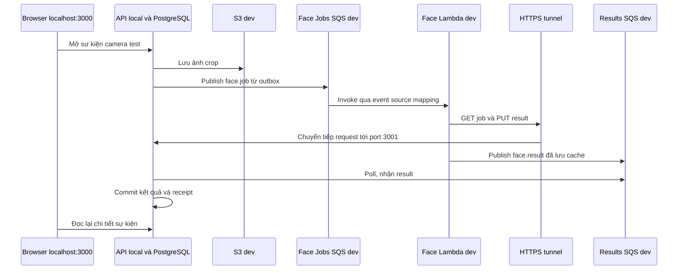

# Sprint 4 — Phát triển tính năng AWS từ localhost đến staging

**Luồng làm việc:** viết và kiểm logic trên máy → nối từng dịch vụ AWS dev → chạy một sự kiện thật và xem kết quả trên UI → gửi PR → merge `main` và nghiệm thu lại trên staging. A nghiệm thu Cognito và sở hữu cả luồng notification gồm claim/outcome. B sở hữu media/Face/Deadline. C quản lý tài nguyên dùng chung và nhận cấu hình staging.

## 1. Khi nào AWS cần gọi về máy dev?

`localhost` luôn là máy đang thực thi request. Với trình duyệt của bạn, đó là laptop. Với Lambda, đó là môi trường Lambda. **Giữ UI ở `http://localhost:3000` và thêm HTTPS tunnel cho các callback cần tới API local.** Tunnel nhận request từ AWS và chuyển tiếp vào API ở `127.0.0.1:3001` qua một reverse proxy chỉ mở các route worker cần dùng.

| Tính năng                | Đường đi khi dev trên laptop                                                                                                                                  | Có cần tunnel cho API local?                                                 |
| ------------------------ | ------------------------------------------------------------------------------------------------------------------------------------------------------------- | ---------------------------------------------------------------------------- |
| **Cognito**              | Browser mở Hosted UI. Sau login, chính browser đi tới `http://localhost:3000/auth/callback`, đổi code theo PKCE và gọi API local bằng access token.           | **Không.** Dùng app client dev đã đăng ký đúng callback/sign-out localhost.  |
| **S3 media**             | API local upload ảnh bằng SDK. Browser tải ảnh từ S3 qua presigned URL API cấp sau khi kiểm quyền.                                                            | **Không.** Laptop và app container cần kết nối ra AWS.                       |
| **Face SQS/Rekognition** | API tạo job và gửi SQS. Lambda đọc job context và lưu kết quả qua API nội bộ. Lambda gửi `face.result` lên Results. API local tự poll Results và cập nhật DB. | **Có** cho hai HTTP callback của Lambda. SQS Results được pull từ trong app. |
| **Deadline**             | API gọi `StartExecution`. Step Functions chờ, rồi invoke Lambda. Lambda `POST` command vào API của B để quyết định dựa trên DB.                               | **Có** cho callback Lambda khi API nằm trên laptop.                          |
| **SNS/Connect Sender**   | API tạo notification job. Lambda gọi API claim, rồi gửi SNS email/SMS hoặc gọi Connect. Lambda gửi outcome lên Results để API local xử lý.                    | **Có** cho claim. SNS/Connect dùng SDK của Lambda để gửi ra ngoài.           |



Trong Lambda, Rekognition đọc crop từ S3 giữa bước `GET` context và `PUT` result. Route `PUT` lưu kết quả để retry dùng lại cùng payload. Bước cuối apply nghiệp vụ diễn ra ở Results consumer của backend. [Worker Face](../services/aws-workers/face/handler.py) · [Backend Face callback](../apps/orchestrator/src/cloud-queue/cloud-queue.controller.ts)

## 2. Chuẩn bị trên localhost

1. Dùng nhánh có thay đổi của bạn, Node 22, pnpm theo `package.json`, Docker Compose, `.env` local đã điền. Chạy `pnpm install --frozen-lockfile`, `pnpm --filter @cam/contracts build` rồi làm phần **Dev Local** trong hướng dẫn review/test. Xác nhận API `http://localhost:3001/api/v1/health` và web `http://localhost:3000/login` hoạt động. Dùng camera, user và DB test đủ để tái hiện từ UI. [Dev onboarding](DEV_ONBOARDING.md) · [Lệnh và ca test](test/SPRINT4_AWS_REVIEW_TEST_LOCAL_TO_STAGING.md)
2. Viết logic trước với mock hoặc fixture G0. A có thể thử claim/outcome qua mock backend và sender dry-run. B có thể thử deadline đến hạn, ack và race trong DB test. Face worker có test mock Rekognition và backend. Khi một phần UI cần dữ liệu tạm, dùng DB/fixture local và ghi rõ đó là ca local. [Hợp đồng G0](../aws/sprint4/00_HOP_DONG_G0.md) · [Fixture](../aws/sprint4/contracts/README.md)
3. Nếu PR chỉ chạm **Cognito** hoặc **S3**, bật riêng phần đó trong `.env` và giữ Face transport khớp DB local. Với Cognito, dùng pool/client/domain dev, callback `http://localhost:3000/auth/callback` và sign-out `http://localhost:3000`. B liên kết `(issuer, sub)` của user test trong DB local. Với S3, đặt `STORAGE_PROVIDER=s3` và đặt `S3_BUCKET` cùng `STORAGE_BUCKET` về bucket dev. Dùng credential AWS dev cho orchestrator. Chạy `docker compose up -d --no-deps --force-recreate orchestrator` rồi xem kết quả trên web local. `docker compose restart` giữ env cũ. [Cognito local](../aws/sprint4/05_SETUP_COGNITO.md)
4. Nếu test **Face qua SQS**, nhận từ C tên bucket dev, ba queue URL Face Jobs/Notification Jobs/Results, Face function/alias, app client Cognito dev và quyền cần dùng. Điền cấu hình trong `.env` theo Dev onboarding. `AWS_PROFILE` trên laptop dành cho AWS CLI. Compose của repo truyền credential SDK qua `AWS_ACCESS_KEY_ID`, `AWS_SECRET_ACCESS_KEY`, `AWS_SESSION_TOKEN` khi dùng credential tạm. Dùng `INTERNAL_SERVICE_TOKEN` dev dài ít nhất 32 ký tự và bàn giao qua kênh bí mật của nhóm. C giữ mapping worker của queue test tạm dừng trong lúc chuẩn bị nếu đã có dữ liệu chờ.

   ```powershell
   aws --profile camerai-lab --region ap-southeast-1 sts get-caller-identity --query Account --output text
   pnpm argus status
   pnpm argus cloud
   pnpm argus status
   docker compose ps
   Invoke-RestMethod 'http://localhost:3001/api/v1/auth/config' | Select-Object provider
   ```

   `pnpm argus cloud` dùng trên nhánh có công cụ Argus. Nó đổi `.env`, đồng bộ migration/mode PostgreSQL dev và tạo lại container. Sau chuyển đổi, cần thấy `cognito`, `s3`, `sqs` và Results consumer bật. C tạo tài nguyên và cấu hình AWS riêng. Nếu hai máy dùng hai DB khác nhau, mỗi lượt end-to-end dùng queue/Lambda thử riêng hoặc dành trọn bộ dev dùng chung cho một DB tại một thời điểm. Hai consumer khác DB cùng đọc Results có thể lấy nhầm job của nhau. [Cấu hình Argus](DEV_ONBOARDING.md)

## 3. Cho Lambda dev gọi API local qua HTTPS

### 3.1 Mở reverse proxy cho đúng callback

Dùng **Caddy trên máy host** và một trong hai tunnel là Cloudflare Quick Tunnel hoặc ngrok đã cấu hình. Kiểm `caddy version` và `cloudflared --version` hoặc `ngrok version`. Ba terminal bên dưới dùng PowerShell 7. Ví dụ dùng cổng API publish `3001` và cổng proxy `8787`. Nếu đổi cổng API, kiểm bằng `docker compose port orchestrator 3001` rồi sửa `reverse_proxy` trong mẫu.

**Terminal 1.** Lưu tệp Caddy riêng trong `artifacts/` rồi chạy foreground. Mẫu này giữ nguyên path khi chuyển tiếp, chấp nhận `GET` context và `PUT` result. Bản mẫu chỉ mở route Face.

```powershell
New-Item -ItemType Directory -Force artifacts | Out-Null
@'
{
    admin off
    persist_config off
}

http://:8787 {
    bind 127.0.0.1

    @faceContext {
        method GET
        path_regexp faceContext ^/api/v1/internal/cloud/face-jobs/[a-fA-F0-9-]{36}$
    }
    handle @faceContext {
        reverse_proxy 127.0.0.1:3001
    }

    @faceResult {
        method PUT
        path_regexp faceResult ^/api/v1/internal/cloud/face-jobs/[a-fA-F0-9-]{36}/result$
    }
    handle @faceResult {
        reverse_proxy 127.0.0.1:3001
    }

    handle {
        respond 404
    }
}
'@ | Set-Content -LiteralPath artifacts/DevCloud.Caddyfile -Encoding utf8NoBOM
caddy validate --config artifacts/DevCloud.Caddyfile --adapter caddyfile
caddy run --config artifacts/DevCloud.Caddyfile --adapter caddyfile
```

Khi B đã có endpoint Deadline hoặc Claim, thêm matcher `method POST` và khối `handle` vào cùng site trước fallback. Chỉ bật route đã triển khai trong lượt test. Backend tiếp tục xác thực `X-Internal-Token`. [Caddy request matchers](https://caddyserver.com/docs/caddyfile/matchers) · [Caddy handle](https://caddyserver.com/docs/caddyfile/directives/handle)

```caddyfile
@deadline {
    method POST
    path_regexp deadline ^/api/v1/internal/events/[a-fA-F0-9-]{36}/deadline$
}
handle @deadline {
    reverse_proxy 127.0.0.1:3001
}

@senderClaim {
    method POST
    path_regexp senderClaim ^/api/v1/internal/notifications/[a-fA-F0-9-]{36}/claim$
}
handle @senderClaim {
    reverse_proxy 127.0.0.1:3001
}
```

Validate lại cấu hình sau khi sửa, rồi dừng và chạy lại Caddy từ Terminal 1.

### 3.2 Lấy URL HTTPS và kiểm tra đường đi

**Terminal 2.** Chạy một công cụ tunnel tới proxy `8787`. Giữ terminal mở trong thời gian test.

```powershell
cloudflared tunnel --url http://127.0.0.1:8787
```

Hoặc dùng ngrok đã kết nối tài khoản. Tắt ghi payload/header đầy đủ trong dashboard nếu dùng tính năng Traffic Inspector.

```powershell
ngrok http http://127.0.0.1:8787 --inspect=false
```

Lấy HTTPS origin được in ra. Quick Tunnel tạo URL tạm có thể đổi khi mở lại. Giữ UI ở localhost, Cognito callback ở localhost và giữ proxy chỉ phục vụ worker. Với deadline dài hoặc nhiều người test, dùng hostname dev ổn định của nhóm hoặc Dev EC2 để callback vẫn tới được sau thời gian chờ. [Cloudflare Quick Tunnel](https://developers.cloudflare.com/tunnel/get-started/quick-tunnels/) · [ngrok CLI](https://ngrok.com/docs/gateway/agent/cli)

**Terminal 3.** Kiểm tunnel bằng UUID mới chưa có job. Mục đích là chứng minh đúng route, guard và quyền truy cập. Kiểm `401` có code `INVALID_INTERNAL_TOKEN`, `404` có token đúng và body báo `Face job missing or stale`. Route không được cấu hình như `/api/v1/health` phải trả `404` từ proxy.

```powershell
$tunnelOrigin = (Read-Host 'HTTPS origin do tunnel in ra').TrimEnd('/')
$tunnelUri = [uri]$tunnelOrigin
if (-not $tunnelUri.IsAbsoluteUri -or $tunnelUri.Scheme -ne 'https' -or $tunnelUri.AbsolutePath -ne '/' -or $tunnelUri.Query -or $tunnelUri.Fragment -or $tunnelUri.UserInfo) {
  throw 'Chi dien HTTPS origin, khong kem path hoac query'
}
$probeId = [guid]::NewGuid()
$probeUrl = "$tunnelOrigin/api/v1/internal/cloud/face-jobs/$probeId"
$noToken = Invoke-WebRequest $probeUrl -SkipHttpErrorCheck -MaximumRedirection 0
if ($noToken.StatusCode -ne 401 -or $noToken.Content -notmatch 'INVALID_INTERNAL_TOKEN') { throw 'Callback chua den dung guard' }
$devToken = Read-Host -MaskInput 'INTERNAL_SERVICE_TOKEN cua API DEV local'
try {
  $withToken = Invoke-WebRequest $probeUrl -Headers @{ 'X-Internal-Token' = $devToken } -SkipHttpErrorCheck -MaximumRedirection 0
  if ($withToken.StatusCode -ne 404 -or $withToken.Content -notmatch 'Face job missing or stale') { throw 'Token hoac backend DEV chua khop' }
} finally {
  Remove-Variable devToken
}
$blocked = Invoke-WebRequest "$tunnelOrigin/api/v1/health" -SkipHttpErrorCheck -MaximumRedirection 0
if ($blocked.StatusCode -ne 404) { throw 'Proxy dang mo route ngoai danh sach callback' }
```

### 3.3 Nối Lambda và queue vào lượt dev

1. Xác nhận đúng function **Dev** được giao và lưu cấu hình trước khi đổi để còn khôi phục. Khi dùng tài nguyên dùng chung, gửi C HTTPS origin, tên queue và alias để áp dụng cấu hình. Nếu worker là phần bạn vừa viết, build/upload ZIP dev đã qua unit test. Face dùng `python services/aws-workers/build.py` theo [README worker](../services/aws-workers/README.md). Deadline/Sender dùng package của PR tương ứng khi đã có handler.
2. Trong **Lambda → Functions → hàm dev → Configuration → Environment variables**, đặt `INTERNAL_API_BASE_URL=https://<host-tunnel>/api/v1` và `INTERNAL_SERVICE_TOKEN` bằng token app local, đồng bộ `S3_BUCKET` và `APPLICATION_RESULTS_QUEUE_URL` khi worker cần. Backend code thêm `/internal/...` vào base URL. Giữ `AWS_REGION` do Lambda cấp và dùng execution role để truy cập AWS. Lambda gọi HTTPS công khai được khi có đường ra internet. Hàm gắn VPC cần kiểm cấu hình egress. [Lambda env](https://docs.aws.amazon.com/lambda/latest/dg/configuration-envvars.html) · [Lambda VPC internet access](https://docs.aws.amazon.com/lambda/latest/dg/configuration-vpc-internet.html)
3. Nếu trigger/workflow gọi alias, **publish version từ `$LATEST` rồi cập nhật alias dev**. Xem ARN thực tế trong **Configuration → Triggers** hoặc Task của Step Functions. Bật mapping từ đúng queue dev tới hàm/alias đã xác nhận. Với SQS, bật `ReportBatchItemFailures` nếu worker trả `batchItemFailures`. Mỗi khi tunnel đổi URL, cập nhật version/alias dev trước lần gửi mới. [Lambda aliases](https://docs.aws.amazon.com/lambda/latest/dg/configuration-aliases.html) · [SQS partial batch response](https://docs.aws.amazon.com/lambda/latest/dg/services-sqs-errorhandling.html)
4. Invoking Face với `{"Records":[]}` chỉ xác nhận handler chạy. Muốn thấy Lambda thật đi qua tunnel, hãy tạo job từ ứng dụng và theo dõi callback, receipt và UI theo mục 4.

## 4. Nhìn thấy thay đổi ngay trên giao diện

### Face và S3

1. Mở `http://localhost:3000/login`, đăng nhập user dev có camera. Bật nguồn Frigate test nếu ca cần video. B chuẩn bị collection registry khớp **UUID chủ camera trong DB app**, version và bucket dev. Baseline Face hiện dùng prefix theo `REKOGNITION_COLLECTION_PREFIX` (mặc định dev `camerai-s4-dev-owner-<ownerUuid>`; staging dùng `argusai-staging-owner-<ownerUuid>` theo migration [0023_rekognition_collection_prefix.sql](../db/migrations/0023_rekognition_collection_prefix.sql)). Có thể thử collection rỗng để thấy `UNKNOWN` khi ảnh có một mặt hợp lệ (ở fast path `REKOGNITION_SKIP_DETECT_FACES=true`, Lambda trả `UNKNOWN` với 0 API call Rekognition khi `collection_face_count == 0`). Ca `KNOWN` cần FaceId đã index, mapping đúng owner và known face đang active. Dùng [runbook Rekognition](SPRINT4_STAGING_TIEN_DO_VA_RUNBOOK.md#32-sửa-trigger-face-và-chuẩn-bị-collection) để chuẩn bị registry theo phiên bản code đang chạy.
2. Tạo **event mới** có camera, track và crop qua luồng camera dev. Sau migration [0024_face_track_once_pipeline.sql](../db/migrations/0024_face_track_once_pipeline.sql), DB **không còn trigger `cloud_face_intent` tự động trên `INSERT events`**. Thay vào đó, `FaceRecognitionCoordinatorService` điều phối qua Best-Shot Quality Gate cục bộ (`POST /face/assess`, yêu cầu model YuNet/SFace có sẵn trong `services/ai-service/models`) và `FaceSessionCacheService` (embedding/spatial-appearance Re-ID); khi ảnh đạt chất lượng và cache miss, Orchestrator gọi `CloudQueueService.enqueueFaceJob` tạo dòng `cloud_jobs` với khóa duy nhất `(event_id, revision)` cho `PERSON_DETECTED` hoặc `RESTRICTED_ZONE` (khi DB ở `sqs`), upload best-shot lên S3 và đẩy SQS.
   - **Lưu ý khi test dev:** Nếu lặp lại cùng một người trên cùng camera trong TTL cache (`FACE_SESSION_CACHE_TTL_MS=300000` ms = 5 phút), track mới có thể hit local session cache (`provider=local-session-cache`) và **không tạo `cloud_jobs` / không gọi Lambda**; muốn ép gọi Lambda mỗi lần trong lúc test, có thể tạm đặt `FACE_SESSION_CACHE_ENABLED=false` và `FACE_SPATIAL_REID_ENABLED=false`. Khi cần rollback về hành vi gửi ngay lúc tạo event (`revision=1`, không qua Quality Gate/Session Cache), đặt `FACE_TRACK_OPTIMIZATION_ENABLED=false`. Xem chi tiết kiến trúc tại [Báo cáo tối ưu Face Track-Once](reports/FACE_TRACK_ONCE_OPTIMIZATION_REPORT.md).
   - Lấy `eventId`, quan sát `cloud_jobs` theo `(event_id, revision)`. Có job `SENT` nghĩa đã tới SQS. Kiểm S3 có crop thật và log Lambda thấy job (mặc định `REKOGNITION_SKIP_DETECT_FACES=true` chạy 0 hoặc 1 lệnh Rekognition). Với lỗi `404` ở lookup, xác nhận Lambda đang gọi đúng DB tạo job và đúng collection version.
3. Kiểm `cached_result`, dẫn tới `cloud_result_receipts` sau khi orchestrator poll Results. Mở **chi tiết sự kiện** trên dashboard, tải lại nếu chưa cập nhật. Xem trường **Nhận diện người** và mục kết quả AI. Với luồng media, mở ảnh sự kiện để kiểm URL được cấp cho đúng user. Lấy ảnh màn hình với dữ liệu test và ghi `eventId/jobId/resultId`. [Truy vấn theo event và các ca Face](test/SPRINT4_AWS_REVIEW_TEST_LOCAL_TO_STAGING.md#42-chạy-luồng-thật-một-lần-trước-các-ca-lỗi) · [UI chi tiết sự kiện](../apps/web/src/components/events/EventDetailModal.tsx)

### Deadline và Sender khi PR đã có code

- **B — Deadline.** Triển khai endpoint trước và bật route `POST /api/v1/internal/events/<eventId>/deadline` trong proxy. B triển khai workflow Dev trong phạm vi được cấp và xác nhận orchestrator có quyền `states:StartExecution`. B chọn driver `stepfunctions` khi reader/driver đã có và kiểm một deadline chỉ dùng một driver. Tạo hai event có hạn ngắn hợp lệ. Ack event thứ nhất trước hạn, để event thứ hai hết hạn. Quan sát execution history, receipt DB rồi tải lại hai event trên UI. Kỳ vọng `NO_OP` cho event đã ack và một lần escalation cho event chưa ack. Giữ tunnel chạy tới lúc action hoàn tất.
- **A — Sender.** A deploy đường tạo intent, claim/outcome và worker có `SENDER_DRY_RUN=true` và giữ claim ở mode dry-run. Mở route `POST /api/v1/internal/notifications/<notificationId>/claim`. Tạo một intent qua event test. Sau claim, theo dõi Results consumer và trạng thái `SKIPPED` trong app, với `providerCalled=false`. Sau khi dry-run qua đủ vòng, thử một email thật tới hộp thư test đã xác nhận. Đối chiếu `providerId`, trạng thái `SENT` và thư đến. SMS/Connect dùng số test khi dịch vụ đã sẵn sàng. [Quy tắc deadline và thông báo](../aws/sprint4/00_HOP_DONG_G0.md)

Nếu checkout còn thiếu API/handler, ghi rõ phần nào đang chạy bằng mock. Baseline hiện có Face Lambda, S3 và Cognito. Enrollment Rekognition, Deadline Lambda và cả đường claim/outcome/Sender đầy đủ vẫn cần PR tương ứng. Tạo tunnel hoặc tạo Lambda rỗng chỉ giúp kiểm đường kết nối ở phần đã có code. [Tiến độ staging](SPRINT4_STAGING_TIEN_DO_VA_RUNBOOK.md#1-tiến-độ)

## 5. Nếu không dùng được tunnel

| Tình huống                                                       | Cách chạy để tiếp tục                                                                                                                                                                                                                                                    |
| ---------------------------------------------------------------- | ------------------------------------------------------------------------------------------------------------------------------------------------------------------------------------------------------------------------------------------------------------------------ |
| Chỉ sửa UI/backend hoặc cần test lỗi xác định được               | Dùng JWT/MinIO/BullMQ và mock worker/provider trong local với fixture G0. Xem UI/DB local, giữ unit/integration test để kiểm contract.                                                                                                                                   |
| Chỉ cần AWS client Cognito/S3                                    | Nối client dev tương ứng và xem trên Web local. Hai luồng này chưa cần mở callback Lambda.                                                                                                                                                                               |
| Mạng chặn tunnel, laptop phải tắt hoặc nhiều người cần cùng test | C triển khai đúng commit thử lên **Dev App EC2** rồi cung cấp HTTPS dev. Chạy web/API/DB và Results consumer của lượt test trên bản dev đó. C trỏ Lambda dev về `https://<domain-dev>/api/v1`, cùng token, bucket và queue của bản dev. Mở URL dev trong browser để xem. |
| Tunnel trả `301/302`, trang login hoặc OTP                       | Worker cần endpoint API HTTPS trực tiếp. Kiểm cấu hình host/path và lớp auth ở tunnel. Nếu dùng cơ chế Access của nhóm cần có machine auth mà worker hỗ trợ. Face worker hiện gửi `X-Internal-Token` và từ chối redirect.                                                |
| `502`, timeout hoặc ngắt khi đang chạy                           | Kiểm API local port `3001`, Caddy port `8787`, process tunnel, URL alias và egress Lambda. Với bước chờ dài, chuyển qua Dev EC2 hoặc hostname ổn định.                                                                                                                   |
| `401 INVALID_INTERNAL_TOKEN` khi Lambda đã invoke                | Callback đến đúng guard. So token dev trong container và **version đang được alias gọi**. Recreate app nếu đã đổi `.env` và publish version Lambda mới nếu đổi Lambda env.                                                                                               |
| `404 Face job missing or stale` với job thật                     | Kiểm job/envelope ở DB, collection version, owner và API đang trỏ đúng máy đã tạo job. `404` có token trong phép thử UUID chưa tồn tại là kết quả mong đợi.                                                                                                              |
| Có kết quả cache nhưng UI chưa đổi                               | Kiểm Lambda publish đúng Results queue, một consumer đúng DB đang bật, receipt và quyền đọc event của browser. Kiểm DLQ và dùng cùng IDs để tìm log.                                                                                                                     |

## 6. Từ dev tới staging

1. **Chốt lượt dev.** Ghi commit, mode, alias version, event/job/result hoặc execution/attempt ID, kết quả UI và test đã chạy. Người chạy đối chiếu job/execution còn chờ của phiên thử. Khôi phục alias/mapping Dev trong phạm vi đã được giao hoặc gửi cấu hình khôi phục cho C nếu dùng tài nguyên chung. Giữ tunnel tới khi callback đã xử lý xong rồi dừng tunnel và Caddy. Với app Compose local, `pnpm argus local` và `pnpm argus status` để trở về chế độ local sau khi xử lý công việc đang chờ.
2. **Gửi PR.** PR chứa code, migration mới, hợp đồng và template/workflow nếu tính năng cần triển khai chúng. Dùng CI và checklist reviewer. Địa chỉ tunnel ở cấu hình dev của phiên test. Staging có domain, token, DB, bucket và queue riêng. [Hướng dẫn review và test](test/SPRINT4_AWS_REVIEW_TEST_LOCAL_TO_STAGING.md)
3. **C chuẩn bị staging.** Tạo tài nguyên/role còn thiếu theo runbook, cập nhật `/camerai/staging/runtime-env` khi code đã đọc biến và đặt env của worker staging. `INTERNAL_API_BASE_URL=https://argusai-staging.duckdns.org/api/v1`. `INTERNAL_SERVICE_TOKEN` của worker trùng token API staging. CD hiện đóng gói Face. Nếu PR thêm Deadline/Sender, đưa ZIP, checksum, version và alias của chúng vào quy trình release. [Runbook provisioning và CD staging](SPRINT4_STAGING_TIEN_DO_VA_RUNBOOK.md#8-đưa-thay-đổi-vào-đúng-đường-cd)
4. **Merge và nghiệm thu lại.** `PR → CI xanh → merge main → CI push main → CD → staging`. CD deploy app qua SSM, chạy migration, cập nhật alias Face và smoke theo workflow. So `version` từ `/api/v1/health` với release cần thử, sau đó chạy lại cùng thao tác trên **UI staging** với user/camera/fixture staging. Với Face ghi một chuỗi event/job/result/receipt. Với Deadline/Sender ghi execution hoặc attempt/outcome và trạng thái UI. Test gửi thật chỉ dùng người nhận đã thống nhất cho lượt test. [CI/CD source of truth](CI_CD_STAGING_SOURCE_OF_TRUTH.md) · [Ma trận nghiệm thu](test/SPRINT4_AWS_REVIEW_TEST_LOCAL_TO_STAGING.md#6-ma-trận-nghiệm-thu-chức-năng)
