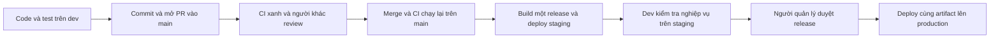

# CameraAI — Quy trình Dev, Staging và Production

| Môi trường | Địa chỉ                                                                       | Dùng để làm gì                                                                                                            | Ai thao tác                                                           |
| ---------- | ----------------------------------------------------------------------------- | ------------------------------------------------------------------------------------------------------------------------- | --------------------------------------------------------------------- |
| Dev        | `http://localhost:3000`                                                       | Viết code, chạy test, xem giao diện. Tính năng cloud gọi tài nguyên AWS dev từ laptop hoặc dùng worker dev riêng khi cần. | Mỗi dev                                                               |
| Staging    | Chưa có domain. Tên đề xuất `camerai-staging.duckdns.org`, tùy tên còn trống. | Kiểm tra bản tích hợp đã qua review và CI với dữ liệu thử. Một bản chạy tại một thời điểm.                                | Dev kiểm thử, CD triển khai, người quản lý hạ tầng quản lý tài nguyên |
| Production | `https://camerai-dev.duckdns.org`                                             | Phục vụ bản đã được nghiệm thu. Tên miền hiện tại có chữ `dev` nhưng thuộc production.                                    | Người quản lý production duyệt phát hành và phục hồi                  |



Nhóm dùng một nhánh `main` được bảo vệ và các nhánh tính năng ngắn. Staging nhận bản **sau khi merge**, production nhận bản **sau khi duyệt**. Review PR dựa trên kiểm thử dev và CI. Nếu một PR cần thử AWS trước khi merge, chạy trên tài nguyên AWS dev đã được cấp. [Quy ước Git hiện có](GIT_WORKFLOW.md)

## 1. Dựng staging lần đầu

### 1.1 Chốt thông tin triển khai

Người quản lý hạ tầng ghi lại AWS account ID, Region, GitHub `OWNER/REPO`, EC2 ID, domain, kho image, bucket và role của từng môi trường. Kiểm tra account và Region trên AWS Console trước khi tạo tài nguyên. Ví dụ bên dưới dùng `ap-southeast-1` và các tên trong hướng dẫn CD hiện có. Mẫu CD dùng chung một registry và một kho release. Nếu nhóm tách AWS account, cấu hình quyền đọc hoặc sao chép artifact sang account đích và kiểm tra digest ở đích trước khi chạy mẫu. Quyền runtime, dữ liệu và cấu hình của ba môi trường luôn được cấp riêng. [Chuẩn bị thông tin triển khai](../../aws/CD_INTEGRATION_GUIDE.md#4-chặng-1--chốt-thông-tin-triển-khai) · [Tách môi trường AWS](https://docs.aws.amazon.com/wellarchitected/latest/security-pillar/sec_securely_operate_multi_accounts.html)

### 1.2 Tạo EC2 và domain cho staging

1. Trong **AWS Console → EC2 → Launch instances**, tạo máy `camerai-staging` Linux x86_64, ví dụ Ubuntu 24.04, với ổ EBS mã hóa. Mẫu build dùng `linux/amd64`. Đặt tag `Environment=staging` và gắn instance profile staging có quyền Systems Manager. Dùng subnet có đường ra Internet cho cách dựng Caddy công khai bên dưới.
2. Trong **Security Groups**, cho phép TCP 80/443 tới máy staging để cấp HTTPS, mở dashboard và nhận callback từ Lambda khi dùng cloud. Truy cập quản trị qua **Systems Manager → Session Manager**. PostgreSQL `5432`, Redis `6379` và API `3001` ở trong mạng Compose. Kết nối MQTT/Frigate/AI edge đi qua đường mạng riêng. Nếu container lấy AWS credentials qua instance profile, bật IMDSv2 và kiểm tra hop limit `2` theo cấu hình mạng Docker.
3. Trong **EC2 → Elastic IPs**, cấp và gắn một IP ổn định cho staging. Trong **Duck DNS**, tạo một tên riêng như `camerai-staging` nếu còn trống và cập nhật IPv4 thành IP staging. Giữ bản ghi `camerai-dev.duckdns.org` trỏ production. Kiểm tra lại bản ghi A. EC2, EBS và IPv4 công khai có chi phí, kể cả Elastic IP đang giữ mà chưa gắn.
4. Kiểm tra **Systems Manager → Fleet Manager** báo máy staging `Online`. Vào Session Manager, cài Docker Engine, Compose plugin, AWS CLI v2, `curl`, `jq`, `unzip` và `util-linux`. Chạy `docker version`, `docker compose version`, `aws --version`. Tạo thư mục triển khai và thư mục video theo mục 6.1 của hướng dẫn CD.
5. Khi container Caddy đã lên ở mục 2, kiểm tra `https://<domain-staging>/login` từ máy khác. DNS phải trỏ đúng IP và HTTPS phải hợp lệ trước khi thử callback Lambda hoặc Cognito. Nếu dashboard mở được nhưng API gọi `localhost`, kiểm tra build argument tại mục 2.2.

[Cài Docker trên Ubuntu](https://docs.docker.com/engine/install/ubuntu/) · [EC2 và SSM trong repo](../../aws/CD_INTEGRATION_GUIDE.md#61-hai-máy-riêng) · [Elastic IP](https://docs.aws.amazon.com/AWSEC2/latest/UserGuide/elastic-ip-addresses-eip.html) · [Duck DNS](https://www.duckdns.org/spec.jsp) · [Caddy Automatic HTTPS](https://caddyserver.com/docs/automatic-https)

Kiểm tra DNS và HTTPS từ PowerShell. Thay tên ví dụ nếu nhóm chọn tên khác. Lệnh thứ hai dùng sau khi deploy Caddy.

```powershell
Resolve-DnsName camerai-staging.duckdns.org -Type A
curl.exe --fail --show-error https://camerai-staging.duckdns.org/login
```

### 1.3 Tạo kho lưu trữ và quyền triển khai

1. Trong **ECR → Private repositories**, tạo `camerai/web` và `camerai/orchestrator`. Bật immutable tags, giữ lại image từng release còn dùng và bản cần rollback. ECR giữ image ứng dụng, còn EC2 chạy các image này.
2. Trong **S3 → Buckets**, chuẩn bị bucket release, bucket backup và bucket ảnh staging. Bật Block Public Access và mã hóa. Đặt retention riêng cho ảnh thử, backup và release. Bucket ảnh dùng với Rekognition phải cùng Region. Chỉ pipeline build được ghi prefix release. Giữ artifact theo release ID và chặn ghi đè/xóa release còn dùng.
3. Trong **IAM → Identity providers**, thêm GitHub OIDC với provider `https://token.actions.githubusercontent.com` và audience `sts.amazonaws.com`. Tạo role build, role deploy staging và role deploy production riêng. Trust policy phải kiểm tra `aud` và `sub` khớp repo/nhánh hoặc đúng GitHub Environment. Lấy định dạng subject thực tế của repo theo tài liệu GitHub. Role staging dùng SSM với đúng EC2 staging, role production dùng đúng EC2 production. Chỉ cấp quyền cập nhật Lambda khi nối CD cho worker, theo tên function/alias của từng môi trường.
4. Trong **SSM → Parameter Store**, tạo `/camerai/staging/runtime-env` kiểu `SecureString`. Điền dotenv theo mục 6.2 của hướng dẫn CD. Dùng `APP_DOMAIN` là hostname, `WEB_ORIGIN` là URL HTTPS, DB/Redis là tên service trong Compose. Bắt đầu với `FACE_JOB_TRANSPORT=bullmq` và `APPLICATION_RESULTS_CONSUMER_ENABLED=false`, khớp mode mặc định của DB sạch. Tắt kênh gửi thông báo thật. Chọn cấu hình JWT hoặc Cognito theo tính năng cần thử. Với Cognito, dùng app client của staging, callback `https://<domain-staging>/auth/callback` và logout URL của staging. Tạo tài khoản thử riêng, với mật khẩu thử riêng khi dùng JWT.
5. Trên EC2, tạo `/etc/camerai/deploy.conf` theo mục 6.3, điền `APP_ENV=staging`, Region, registry và bucket đã tạo. Đặt quyền file cho root. Instance role đọc đúng parameter runtime của nó. EC2 và Lambda lấy AWS credentials từ role, dev dùng danh tính AWS dev của mình.

[ECR, S3 và bảng quyền](../../aws/CD_INTEGRATION_GUIDE.md#5-chặng-2--tạo-kho-images-release-và-iam) · [Cấu hình EC2 và Parameter Store](../../aws/CD_INTEGRATION_GUIDE.md#62-parameter-store-runtime-config) · [GitHub OIDC](https://docs.github.com/en/actions/how-tos/secure-your-work/security-harden-deployments/oidc-in-aws) · [Lab Cognito](../../aws/labs/05_COGNITO.md)

## 2. Hoàn thiện CI/CD trong repository

Tách thành các PR có thể kiểm chứng theo thứ tự dưới đây. Tại thời điểm soạn, checkout có `.github/workflows/ci.yml` và hướng dẫn CD dạng mẫu. Các file `deploy/`, `tools/cd/` và workflow CD cần được thêm vào repo khi triển khai.

### 2.1 PR 1 — Làm CI xanh trên cấu hình sạch

1. Trong `docker-compose.yml`, chuyển các khai báo bắt buộc `AWS_ACCESS_KEY_ID` và `AWS_SECRET_ACCESS_KEY` ra khỏi Compose local mặc định. Nếu cần truyền credentials vào container dev-cloud, dùng cấu hình riêng cho đường chạy đó. Compose nội suy biến trước khi ghép file, nên gắn thêm override vẫn lỗi nếu file cơ sở còn `${VAR:?...}`. Kiểm tra với `docker compose --env-file .env.example config --quiet` trên shell sạch. CI cũng dùng mẫu này để kiểm tra Compose.
2. Giữ các job hiện có trong `ci.yml`. Thêm job `face-worker` dùng Python 3.12, chạy các lệnh dưới đây. Job này chạy bằng dữ liệu test và có thể chạy trên PR trước khi cấp quyền AWS cho CD.

```powershell
python -m pip install -r services/aws-workers/face/requirements.txt
python -m unittest discover -s services/aws-workers/face -p "test_*.py"
```

3. Sửa job `ci-ok` để mọi job bắt buộc phải có `result=success`. Cho phép riêng `commitlint` có `result=skipped` ngoài PR. Sau khi thêm job `face-worker`, dùng đoạn dưới đây thay job tổng hợp và thụt toàn bộ đoạn hai dấu cách bên dưới `jobs:`.

```yaml
ci-ok:
  name: CI xanh
  runs-on: ubuntu-latest
  needs: [secret-scan, node, python, training, openapi, database, docker, commitlint, face-worker]
  if: always()
  env:
    CI_RESULTS: ${{ toJSON(needs) }}
    CI_EVENT: ${{ github.event_name }}
  steps:
    - name: Check mandatory jobs
      run: |
        jq -e --arg event "$CI_EVENT" '
          all(to_entries[];
            .value.result == "success" or
            (.key == "commitlint" and $event != "pull_request" and .value.result == "skipped")
          )
        ' <<< "$CI_RESULTS"
```

4. Trong **GitHub → Settings → Branches hoặc Rulesets**, bảo vệ `main` bằng PR, ít nhất một người duyệt và status check **CI xanh**. Bỏ quyền push trực tiếp theo quy trình nhóm và yêu cầu duyệt lại khi diff thay đổi. Điền username thật trong `CODEOWNERS`. Bổ sung quyền review cho `deploy/`, `tools/cd/` và `services/aws-workers/` bên cạnh `.github/` và `infra/`. Dùng một PR thử để kiểm tra job đỏ chặn merge và các job bắt buộc đều thực sự chạy. Nếu gói repo thiếu branch protection, người có quyền merge kiểm tra review và CI trước mỗi lần merge và ghi rõ đây là bước kiểm soát thủ công.

[CI hiện có](../../.github/workflows/ci.yml) · [CODEOWNERS hiện có](../../.github/CODEOWNERS) · [Nội suy Docker Compose](https://docs.docker.com/reference/compose-file/interpolation/) · [Protected branches](https://docs.github.com/en/repositories/configuring-branches-and-merges-in-your-repository/managing-protected-branches/about-protected-branches)

### 2.2 PR 2 — Đóng gói ứng dụng và tự deploy staging

1. Từ hướng dẫn CD mục 7–10, tạo `deploy/compose.yml`, `deploy/Caddyfile`, `tools/cd/migrate.mjs`, `tools/cd/deploy-host.sh`, `tools/cd/request-deploy.sh`, `.github/workflows/cd.yml` và `.github/workflows/deploy-environment.yml`. Lưu script shell với LF. Ở lượt đầu giữ job `package` và `staging` trong `cd.yml`. Dùng mẫu Caddy chuyển `/api/*` vào Orchestrator và phần còn lại vào Web.
2. Thêm `ARG NEXT_PUBLIC_API_BASE_URL` trong stage `build` của `apps/web/Dockerfile` trước `RUN pnpm --filter @cam/web build`. Truyền `/api/v1` khi build image. Thêm hai lệnh `COPY` dưới đây vào stage `production` của `apps/orchestrator/Dockerfile` trước `USER node` để service `migrate` tìm được runner và SQL.

```dockerfile
COPY --from=build /workspace/db/migrations /workspace/db/migrations
COPY --from=build /workspace/tools/cd/migrate.mjs /workspace/apps/orchestrator/cd-migrate.mjs
```

Trong cùng PR, thêm build target `production` của Web và Orchestrator vào job `docker` của CI, bên cạnh build AI hiện có. Dùng `push: false` và cùng build argument `/api/v1` cho Web để kiểm tra cách đóng gói mà CD sẽ dùng.

3. Cài bản đã review của `deploy-host.sh` tại `/opt/camerai/deploy-host.sh` trên EC2 staging, owner `root`, mode `700`. Chạy `sudo bash -n /opt/camerai/deploy-host.sh`. Script tải release qua S3, kiểm checksum, pull image theo digest, backup DB, chạy migration và smoke test. Bắt đầu với DB staging sạch. Dùng một migration runner và cùng Compose project name giữa các release để giữ đúng volume.
4. Trong **GitHub → Settings → Environments**, tạo `staging`, giới hạn deploy từ `main`. Trong **Secrets and variables → Actions**, đặt repo variables `AWS_REGION`, `AWS_ACCOUNT_ID`, `AWS_BUILD_ROLE_ARN`, `RELEASE_BUCKET`. Tại environment `staging`, đặt `AWS_DEPLOY_ROLE_ARN`, `EC2_INSTANCE_ID` và `APP_URL`. Mật khẩu/token ứng dụng được nạp từ Parameter Store khi chạy.
5. Giữ điều kiện CD chỉ nhận CI thành công của sự kiện `push` vào `main` của đúng repo. Checkout theo `github.event.workflow_run.head_sha`. Tạo `release_id` theo mẫu `<sha>-<run_id>-<run_attempt>`. Publish image Web/API và lưu **digests** trong `release.env`. Lưu bundle và checksum vào `releases/<release_id>/` trên S3. Với gói nhỏ trong mẫu, có thể đổi hai lệnh upload sang `aws s3api put-object` với `--if-none-match '*'` và thực thi cùng điều kiện ở bucket policy của prefix release. Giữ concurrency của CD và khóa deploy trên máy để tránh hai lượt cập nhật đè lên nhau.
6. Merge một PR nhỏ. Trong **Actions → CI**, kiểm tra run trên commit vừa merge. Trong **Actions → CD**, mở `package` để lấy release ID, rồi mở `staging` để lấy SSM Command ID. Trên trình duyệt, mở `/login`, đăng nhập bằng tài khoản test, kiểm tra `/api/v1/auth/config` và `/api/v1/health`. `version` phải bằng release ID. Kiểm tra thêm một thao tác đọc hoặc ghi dữ liệu test để xác nhận DB thực sự dùng được. Chạy lại với một commit khác để xác minh deploy lần hai giữ dữ liệu và migration đã áp dụng.

[Mẫu Compose, Dockerfile và runner](../../aws/CD_INTEGRATION_GUIDE.md#7-chặng-4--thêm-các-file-deploy-vào-repository) · [Mẫu workflow](../../aws/CD_INTEGRATION_GUIDE.md#10-chặng-7--tạo-workflow-cd) · [GitHub workflow_run](https://docs.github.com/en/actions/reference/workflows-and-actions/events-that-trigger-workflows#workflow_run) · [Chặn ghi đè trên S3](https://docs.aws.amazon.com/AmazonS3/latest/userguide/conditional-writes.html)

### 2.3 PR 3 — Nối các dịch vụ cloud vào release và staging

Áp dụng cho tính năng Rekognition đầu tiên. Tạo tài nguyên qua Console ở lượt thử hoặc dùng mẫu SAM do nhóm quản lý. Nếu đã tạo qua Console, lưu danh sách và cấu hình để dựng lại, rồi lên kế hoạch đưa tài nguyên vào quản lý bằng template. [Thiết kế tài nguyên Sprint 4](../../aws/sprint4/04_NGUOI_C_HA_TANG_VAN_HANH.md#6-tạo-bộ-aws-dùng-chung-nối-code-ab)

1. Tạo bucket ảnh và ba SQS Standard queue riêng `face-jobs`, `notification-jobs`, `results`, kèm DLQ tương ứng. Code yêu cầu cả ba queue URL khi chọn SQS, kể cả khi chưa dùng notification. Giữ dữ liệu thử và tài khoản/camera thử trong staging. Có đường mạng riêng từ EC2 staging tới MQTT và Frigate thử.
2. Tạo `camerai-staging-face` trong **Lambda → Create function** với Python 3.12, x86_64, handler `handler.lambda_handler`. Gắn execution role staging cho SQS đầu vào/đầu ra, S3 crop, Rekognition theo collection và CloudWatch Logs. Bật trigger sau khi API đã sẵn sàng. Với timeout ban đầu `120` giây, đặt visibility của face jobs ít nhất `720` giây, batch size `1`, bật `ReportBatchItemFailures`. Trigger đọc `face-jobs`. Orchestrator đọc `results` và ghi DB.
3. Bổ sung vào job `package` lệnh `python services/aws-workers/build.py`, chạy trên checkout mới và đúng SHA đang build Web/API. Upload file `services/aws-workers/.build/face.zip` vào `releases/<release_id>/face.zip`, ghi key và SHA-256 của ZIP vào thông tin release. Job deploy của mỗi môi trường lấy ZIP của release đó, xác minh checksum rồi cập nhật đúng Lambda đích.
4. Dùng function riêng mỗi môi trường và một alias ổn định cho trigger. Trong job deploy, ghi lại alias/version cũ, cập nhật code, chờ Lambda cập nhật xong, xác minh `CodeSha256`, sau đó publish version và chuyển alias. Nếu code **và cấu hình** vẫn giống version đang chạy, dùng lại version đó. Kiểm tra lại alias sau deploy và ghi version vào summary. Release có thay đổi contract giữa API và worker cần được thử tương thích trong lúc chuyển bản. Khi thay đổi không tương thích, tạm dừng nguồn job staging, xử lý job đang chạy/chờ theo kế hoạch đã review, cập nhật cả hai đầu rồi mới bật lại.

Sau khi ZIP đã có trong bucket release cùng Region, lệnh cập nhật dưới đây chạy trong bước deploy với role của môi trường. `FACE_FUNCTION_NAME` lấy từ cấu hình môi trường, `RELEASE_BUCKET` và `RELEASE_ID` lấy từ release đang deploy. Ví dụ dùng key `face.zip` theo đúng đường dẫn mà job build đã publish.

```bash
aws lambda update-function-code \
  --function-name "$FACE_FUNCTION_NAME" \
  --s3-bucket "$RELEASE_BUCKET" \
  --s3-key "releases/$RELEASE_ID/face.zip" \
  --query '{Function:FunctionName,CodeSha256:CodeSha256}'
aws lambda wait function-updated-v2 --function-name "$FACE_FUNCTION_NAME"
```

5. Đặt `INTERNAL_API_BASE_URL=https://<domain-staging>/api/v1` ở Lambda. Đặt `INTERNAL_SERVICE_TOKEN` khớp API staging qua cấu hình bí mật. Lambda và API dùng cùng `S3_BUCKET` và `APPLICATION_RESULTS_QUEUE_URL`. Ở API, đặt `STORAGE_PROVIDER=s3`, `AWS_REGION`, đủ ba queue URL, `FACE_JOB_TRANSPORT=sqs` và `APPLICATION_RESULTS_CONSUMER_ENABLED=true`. Trước khi đổi mode, dừng Orchestrator staging và xử lý job BullMQ đang chờ. Trên DB staging đã chạy migration `0018`, đổi `cloud_transport_mode` sang `sqs` theo hướng dẫn worker. Khởi động lại và xác minh API hoạt động trước khi bật trigger.
6. Tạo collection và registry đúng owner theo worker. Với collection trống, ảnh có đúng một mặt cho ca **Người lạ**. Ca **Người quen** cần `IndexFaces` và mapping `FaceId → known_face_id` hoạt động đúng owner. Kiểm tra riêng việc đăng ký/xóa người quen trên giao diện trước khi công nhận tính năng hoàn chỉnh. Checkout hiện tại vẫn dùng adapter AI local trong module đăng ký. Với ca camera, tạo sự kiện mới có `track_id` truy cập được snapshot Frigate.

[Build, môi trường, quyền Lambda và cách đổi DB mode](../../services/aws-workers/README.md) · [SQS trigger và DLQ](https://docs.aws.amazon.com/lambda/latest/dg/services-sqs-configure.html) · [Cập nhật mã Lambda](https://docs.aws.amazon.com/cli/latest/reference/lambda/update-function-code.html) · [Lambda alias](https://docs.aws.amazon.com/lambda/latest/dg/configuration-aliases.html) · [Adapter đăng ký hiện tại](../../apps/orchestrator/src/known-faces/known-faces.module.ts)

### 2.4 PR 4 — Bật cổng phát hành production

1. Kiểm kê production hiện có trước khi gắn pipeline. Xác nhận máy phục vụ `camerai-dev.duckdns.org`, proxy đang dùng, Compose project, volumes chạy thật, phiên bản schema/migration và cách tạo backup. Thử phục hồi một bản backup vào DB thử riêng. Nếu DB hiện có schema nhưng chưa có lịch sử `cd_schema_migrations`, đối chiếu và lập baseline trước. Bố trí kế hoạch chuyển service/volume nếu dùng Compose project khác. Giữ nguyên DNS đang phục vụ production trong khi dựng staging.
2. Tạo `/camerai/production/runtime-env` và `deploy.conf` production, với `APP_DOMAIN=camerai-dev.duckdns.org`, `WEB_ORIGIN=https://camerai-dev.duckdns.org` và toàn bộ tài nguyên runtime production. Cài script đã thử ở staging. Nếu production cần cloud, chuẩn bị function/alias, queue và cấu hình riêng trước khi đưa release cần chúng lên.
3. Trong GitHub, tạo Environment `production`, chỉ cho deploy từ `main`, điền vars đích production và cấu hình **Required reviewers**. Dùng người duyệt có trách nhiệm với production, bật chặn tự duyệt nếu phù hợp. Job production phụ thuộc job staging thành công và dùng đúng `release_id` của cùng run. Chỉ duyệt sau khi có evidence nghiệp vụ ở mục 4. Nếu gói GitHub hiện tại thiếu Required reviewers, giữ quyền production ở người quản lý hạ tầng. Người đó gọi deploy script qua SSM và cập nhật Lambda production từ cùng ZIP nếu release có worker. Giữ job tự deploy production ở trạng thái chưa bật cho đến khi có cổng duyệt phù hợp.
4. Thử một release nhỏ qua toàn bộ luồng. Kiểm tra trường hợp CD đang chờ duyệt và production vẫn chạy release cũ. Sau khi duyệt, đối chiếu đúng digest Web/API và checksum ZIP từ staging. Xác minh HTTPS, login, API health, thao tác chính và log. Lưu link CI/CD, release ID, người duyệt và kết quả sau deploy.
5. Diễn tập rollback trên staging. Dùng release trước đã thành công để phục hồi Web/API và chuyển Lambda alias về version tương ứng khi cần. Kiểm tra migration đã commit có tương thích với bản trước. Nếu schema không tương thích, người quản lý và dev xử lý bằng migration sửa tiếp hoặc phương án phục hồi dữ liệu đã được kiểm chứng. Kiểm tra SSM trước khi chạy lại một lượt bị timeout vì lệnh trên máy có thể vẫn đang chạy.

[Baseline migration](../../aws/CD_INTEGRATION_GUIDE.md#73-toolscdmigratemjs) · [Rollback trong repo](../../aws/CD_INTEGRATION_GUIDE.md#13-rollback-và-xử-lý-lỗi) · [Quyền và giới hạn của GitHub Environments](https://docs.github.com/en/actions/how-tos/deploy/configure-and-manage-deployments/manage-environments)

## 3. Quy tắc làm việc theo vai trò

### 3.1 Mọi dev — từ code đến PR

1. Mở issue hoặc nhận task đã có. Ghi tiêu chí đạt và xác định tính năng thuộc luồng local hay cần AWS. Nếu có thay đổi tài nguyên, quyền, source camera, schema hoặc secret, ghi vào issue ngay từ đầu.
2. Bắt đầu từ `origin/main`. Tạo nhánh `feat/us-xx-ten-tinh-nang` hoặc `fix/us-xx-ten-loi`. Chạy local theo hướng dẫn onboarding và nạp dữ liệu thử khi cần.
3. Trước khi push, tự xem `git diff`, chạy test sát phần sửa và các kiểm tra liên quan. Commit theo Conventional Commits. Thêm đúng các file cần commit, gồm cả cập nhật `.env.example` nếu có biến mới. Dùng placeholder cho biến bí mật.
4. Mở PR vào `main` bằng mẫu repo. Điền issue, thay đổi, bước tái hiện, kết quả mong đợi, ảnh chụp khi đổi UI và các mục cấu hình/migration liên quan. Ghi rõ ca nào đã chạy local, ca nào đã chạy AWS dev và ca nào sẽ chạy staging.
5. Sửa theo phản hồi. Chỉ merge khi **CI xanh** và người khác đã review bản mới nhất. Reviewer kiểm tra những thay đổi ảnh hưởng môi trường triển khai cùng người quản lý hạ tầng. Sau merge, dev theo dõi CI/CD và tự kiểm thử bản trên staging.

Ví dụ các thao tác cơ bản trên PowerShell. Thay tên nhánh và nội dung commit bằng task thực tế.

```powershell
git fetch origin
git switch -c feat/us-xx-event-filter origin/main
pnpm --filter @cam/web test
git status --short
git diff
```

Sau khi stage các file cần đưa vào PR, kiểm tra và commit:

```powershell
git diff --cached
git commit -m "feat(web): add event filter"
git push -u origin HEAD
```

[Local onboarding](../DEV_ONBOARDING.md) · [Mẫu PR](../../.github/pull_request_template.md) · [Quy ước branch và commit](GIT_WORKFLOW.md)

### 3.2 Dev tính năng không cloud

- Dùng local Compose, JWT/MinIO/BullMQ theo cấu hình dev phù hợp và tài khoản mẫu local. Thử ca chính và ca lỗi trực tiếp trên dashboard. Với sự kiện camera, dùng video mẫu qua MediaMTX/Frigate hoặc dữ liệu MQTT mẫu tùy bước cần kiểm tra. Nếu test đòi snapshot thật, dùng sự kiện có `track_id` hợp lệ.
- Giữ API contract và migration theo quy ước repo. Nếu sửa API, cập nhật specs/generated contracts và ghi lệnh tái hiện FE/BE. Nếu sửa DB, thêm migration mới và thử nâng cấp trên dữ liệu dev.
- Sau CD staging, mở đúng release, chạy lại ca nghiệp vụ có ảnh hưởng và ghi evidence. Nếu PR không thêm cấu hình thì ghi `Thay đổi cấu hình: không` trong bàn giao.

### 3.3 Dev tính năng liên quan cloud

- Trước khi code, ghi dịch vụ cần dùng, Region, ai gọi dịch vụ, thao tác IAM cần thiết, tài nguyên, ngưỡng hoặc timeout, chi phí phát sinh theo lượt thử và cách dọn dữ liệu. Người quản lý hạ tầng cấp quyền dev hoặc cấp tài nguyên ban đầu. Dev tự tạo thêm tài nguyên trong phạm vi đã được cấp khi cần. Mỗi dev dùng tài khoản thử, collection, prefix hoặc queue phù hợp với mức cách ly của luồng. Một Results Queue chỉ phục vụ một cụm Orchestrator dùng chung DB, tránh hai dev với hai DB giành kết quả của nhau.
- Chạy code trên laptop với tài nguyên **AWS dev**. Ví dụ, thử adapter hoặc hàm `recognize()` với S3 và collection dev. Kiểm tra ca thành công, ca nghiệp vụ âm tính và lỗi quyền/dịch vụ. Với worker xử lý queue, thử thêm retry, trùng message và DLQ theo mức thay đổi. Test mock đi cùng CI. Kết quả AWS dev được ghi vào PR kèm SHA và cách chạy lại.
- Ghi cấu hình cần bàn giao theo mẫu ở mục 4, gồm điểm đọc biến, nơi đặt, thứ tự bật và phụ thuộc. Khi pipeline staging đã cấu hình xong, tiếp tục tự kiểm thử những lần sửa logic. Khi cần dịch vụ hay quyền mới, cập nhật issue/PR để người quản lý hạ tầng chuẩn bị staging trước lượt ghép.

[Lab Rekognition](../../aws/labs/03_REKOGNITION.md) · [Các ca worker và DB](../../services/aws-workers/README.md#nghiệm-thu)

### 3.4 Người quản lý hạ tầng và production

- Quản lý quyền và tài nguyên theo môi trường. Review PR có thay đổi workflow, IAM, schema triển khai hoặc cấu hình mới. Cấp quyền đọc log staging để dev tự điều tra. Điền giá trị thực vào hệ thống lưu cấu hình của từng môi trường.
- Khi có thay đổi cấu hình, kiểm tra tên biến, Region, target IDs, network, role, migration và thứ tự bật theo mục 4. Phối hợp tạo tài nguyên hoặc áp dụng template trước khi bật job/trigger. Kiểm tra secrets đã được nạp mà không đưa giá trị vào log hoặc PR.
- Duyệt đúng release có kết quả staging đạt. So sánh release ID, digests, ZIP checksum và phụ thuộc. Theo dõi smoke test production sau deploy. Nếu release thất bại, ghi tình trạng thực tế, giữ bằng chứng và thực hiện phương án rollback đã thử.

## 4. Mẫu bàn giao trong PR và kiểm tra phát hành

Dev điền mẫu dưới đây trong PR trước khi merge. Sau khi CD xong, cập nhật phần staging bằng release thực tế. Với PR có tính năng cloud, người quản lý hạ tầng dùng danh sách này để chuẩn bị cấu hình cho staging và production.

```markdown
### Tính năng và bản build

- Issue/PR
- Commit đã test và link CI
- Ca đã chạy trên localhost hoặc AWS dev, kết quả và cách chạy lại

### Cấu hình cần cấp

| Biến hoặc tài nguyên | Ai đọc | Cần cho staging | Cần cho production | Bí mật? | Điều kiện hoặc quyền |
| --- | --- | --- | --- | --- | --- | --- |
| S3_BUCKET | API và Face Lambda | Bucket ảnh staging | Bucket ảnh production | Không | Cùng Region với Rekognition |
| INTERNAL_SERVICE_TOKEN | API và Face Lambda | Token riêng staging | Token riêng production | Có | Hai đầu cùng giá trị trong từng môi trường |

- Migration, backup và thứ tự bật
- Cần tạm dừng job hoặc thay đổi quyền nào
- Cách quay lại phiên bản trước và điều kiện tương thích DB

### Nghiệm thu staging

- Link CD, release ID, commit SHA, URL, digests và Lambda version nếu có
- Tài khoản test theo tên, thời gian thử và các thao tác đã chạy
- Kết quả dự kiến/thực tế, ảnh chụp hoặc log đã lược dữ liệu nhạy cảm
- Event ID / job ID / result ID nếu có
- Người xác nhận và vấn đề đang mở
```

**Dev kiểm tra staging** bằng cách mở `/api/v1/health` và đối chiếu release ID trước khi chạy ca test. Với Rekognition, chọn một sự kiện camera mới và lần theo event → `cloud_jobs` → S3 → log Lambda → `cloud_result_receipts` → chi tiết sự kiện trên dashboard. Bắt đầu từ điểm đầu tiên thiếu dữ liệu. `PREPARING` thường cần xem snapshot, registry và S3. `SENT` chưa có kết quả thì kiểm tra trigger, CloudWatch và DLQ. Kết quả đã tới queue nhưng UI chưa hiện thì kiểm tra consumer, DB receipt và đúng owner/event. [Truy vấn kiểm tra có sẵn](../../services/aws-workers/README.md#chẩn-đoán-và-thử-lại)

**Người duyệt production** đối chiếu evidence với chính release đang chờ. Nếu staging thất bại, cập nhật PR hoặc mở PR sửa, ghi ca tái hiện và kiểm tra trên release mới. Nếu chưa định phát hành một bản, kết thúc lượt đang chờ duyệt để release staging kế tiếp được chạy. Nếu lệnh deploy đã gửi qua SSM, kiểm tra trạng thái lệnh trước khi hủy hoặc thử lại. [Concurrency của GitHub Actions](https://docs.github.com/en/actions/how-tos/write-workflows/choose-when-workflows-run/control-workflow-concurrency)

## 5. Tiêu chí hoàn thành thiết lập

- [ ] Một dev chạy local từ cấu hình mẫu với thông tin xác thực AWS để trống. Một dev khác gọi được Rekognition thật từ laptop bằng quyền AWS dev.
- [ ] PR có CI đỏ bị chặn tại bước merge. PR hợp lệ được người khác review và merge.
- [ ] CI trên commit đã merge tự phát hành một release sang staging. Một dev xác minh đúng version, tự chạy ca giao diện và lưu evidence.
- [ ] Với tính năng cloud đã bật, một ca được theo dõi từ camera hoặc nguồn thử đã định tới DB và dashboard. Release ghi cả Lambda version và ZIP checksum.
- [ ] Production chờ người có trách nhiệm duyệt. Sau khi duyệt, bản chạy tại `camerai-dev.duckdns.org` khớp artifact đã nghiệm thu trên staging.
- [ ] Nhóm đã thử rollback ứng dụng và phục hồi backup DB thử. Người quản lý biết lấy log, nhận diện release và chuyển về bản phù hợp khi cần.

## 6. Ví dụ từ lúc sửa code đến production

### 6.1 Tính năng đơn giản — đổi nhãn trên dashboard

Giả sử issue `US-42` yêu cầu đổi nhãn kết quả `UNKNOWN` từ **Người lạ** thành **Chưa nhận diện được người này**. Ca kiểm thử dùng một sự kiện có kết quả `UNKNOWN` đã chuẩn bị sẵn. Thay đổi này nằm ở giao diện và dùng dữ liệu mẫu local.

| Bước                    | Ai làm                   | Làm gì và quan sát gì                                                                                                                                                                                   |
| ----------------------- | ------------------------ | ------------------------------------------------------------------------------------------------------------------------------------------------------------------------------------------------------- |
| 1. Code trên dev        | Lan                      | Tạo `feat/us-42-unknown-label` từ `origin/main`. Sửa nhãn trong `EventDetailModal.tsx`, mở dashboard `localhost:3000` rồi so sánh chi tiết một sự kiện `UNKNOWN` và một sự kiện `KNOWN`.                |
| 2. Commit và PR         | Lan                      | Chạy `pnpm --filter @cam/web test`, commit `feat(web): clarify unknown face label` và push. Mở PR vào `main`, đính kèm ảnh trước/sau và ghi `Thay đổi cấu hình: không`.                                 |
| 3. Review và merge      | Minh                     | Dùng dữ liệu mẫu để kiểm tra lại hai trạng thái. Sau khi CI xanh và review đạt, Minh merge PR.                                                                                                          |
| 4. Kiểm tra staging     | Lan                      | Mở lượt CD của commit vừa merge, lấy release ID. Đối chiếu `version` ở `/api/v1/health` trên staging. Đăng nhập, mở sự kiện `UNKNOWN` và `KNOWN`, rồi ghi kết quả cùng release ID vào PR.               |
| 5. Phát hành production | Người quản lý production | Đối chiếu PR và release đang chờ duyệt. Duyệt đúng bộ artifact staging đã kiểm tra. Sau deploy, kiểm tra health và một ca nghiệp vụ được phép tại `camerai-dev.duckdns.org`, rồi ghi kết quả phát hành. |

[Màn hình chi tiết sự kiện](../../apps/web/src/components/events/EventDetailModal.tsx)

### 6.2 Nếu thay đổi nằm ở Rekognition

Ví dụ Minh sửa cách worker xử lý ảnh có nhiều khuôn mặt. Trên dev, Minh chạy test worker rồi thử ảnh có một mặt và ảnh có nhiều mặt với Rekognition thật bằng tài nguyên AWS dev. Trong PR, Minh ghi kết quả hai ca và nêu rõ có thay đổi cấu hình hay quyền hay không. Sau merge, Minh đối chiếu release ID và phiên bản Lambda staging, tạo sự kiện camera mới và kiểm tra trường hợp nhiều mặt hiển thị **Chưa xác định được**. Người quản lý production kiểm tra bằng chứng này trước khi phát hành cùng ZIP đã thử. Nếu PR thêm biến mới, Minh điền mẫu bàn giao ở mục 4 để người quản lý chuẩn bị cấu hình từng môi trường trước khi deploy.

## 7. Xử lý tình huống thường gặp

### 7.1 Hai người sửa cùng chỗ và PR báo conflict

Giả sử trong lúc Lan đổi nhãn, Minh đã merge một thay đổi thêm mã dịch cho cùng nhãn. Lan cập nhật nhánh của mình, đọc cả hai thay đổi rồi áp dụng câu chữ mới vào cấu trúc dịch mà Minh vừa thêm. Giữ lại hành vi của cả hai PR.

Trên nhánh tính năng cá nhân đã lưu công việc, chạy:

```powershell
git status
git fetch origin
git rebase origin/main
```

Nếu Git dừng, mở file báo conflict, sửa nội dung và xóa các dòng đánh dấu `<<<<<<<`, `=======`, `>>>>>>>`. Sau đó chạy:

```powershell
git add -- apps/web/src/components/events/EventDetailModal.tsx
git rebase --continue
```

Lặp lại nếu có conflict ở commit tiếp theo. Dùng `git rebase --abort` nếu cần quay về trạng thái trước khi bắt đầu. Khi hoàn tất, chạy lại test và thử trên localhost. Nếu nhánh cá nhân đã push trước đó, dùng `git push --force-with-lease` để cập nhật cùng PR. Với nhánh nhiều người cùng push, phối hợp với họ trước khi viết lại lịch sử. Chờ CI và review lại bản mới. Nếu conflict nằm ở migration đã merge, giữ migration đã áp dụng và đưa phần thay đổi của mình vào migration mới. [Quy ước xử lý conflict](GIT_WORKFLOW.md#8-merge-conflicts)

### 7.2 CI đỏ hoặc phát hiện lỗi trước khi merge

Mở job đỏ trong **GitHub Actions** và đọc lỗi đầu tiên. Tái hiện trên nhánh hiện tại, sửa và push commit mới lên **cùng PR**. Ví dụ, nhãn `UNKNOWN` đúng nhưng nhãn `KNOWN` bị đổi ngoài ý muốn. Khôi phục nhãn `KNOWN`, thử cả hai ca và đợi CI chạy lại. Nếu lỗi đến từ runner hoặc dịch vụ tạm thời và diff vẫn giữ nguyên, chạy lại job lỗi rồi xác minh kết quả.

### 7.3 Staging lỗi sau khi merge

- **Lỗi tính năng.** Giữ release ở staging và chưa duyệt production. Ghi release ID và cách tái hiện, tạo nhánh `fix/` từ `origin/main`, mở PR sửa rồi kiểm tra lại trên release mới. Nếu lỗi làm staging ngừng hoạt động hoặc chặn cả nhóm, người quản lý có thể khôi phục release staging trước đó hoặc nhóm mở PR revert để sửa trạng thái `main`.
- **Lỗi triển khai hoặc cấu hình.** Ví dụ Lambda staging trỏ nhầm Results Queue. Người quản lý hạ tầng sửa cấu hình đúng môi trường và chạy lại quy trình triển khai theo release đã chọn. Dev đối chiếu phiên bản đang chạy và thử lại ca nghiệp vụ. Nếu lượt SSM báo timeout, kiểm tra lệnh trên máy trước khi triển khai lại.
- **Staging đang chạy release khác.** Đối chiếu `/api/v1/health` và trang Actions trước khi lấy bằng chứng. Ghi kết quả cho release thật sự đã thử. Nếu bản mới thay bản đang chờ duyệt, kiểm tra lại trên bản mới trước khi duyệt phát hành bản đó.

### 7.4 Production lỗi sau khi phát hành

Người quản lý production xác định đang chạy release nào và lỗi ảnh hưởng đến đâu. Nếu cần phục hồi ngay, dùng release đã biết chạy tốt, kiểm tra tương thích với DB hiện tại và đưa Web/API cùng Lambda về các phiên bản tương ứng. Sau đó kiểm tra lại tác vụ bị ảnh hưởng. Rollback ứng dụng vẫn giữ các migration đã áp dụng, nên khi schema cũ và mới không tương thích cần phương án migration sửa tiếp hoặc phục hồi DB đã kiểm chứng.

Sau khi ổn định, dev mở PR `fix/` để đưa bản sửa đi lại qua CI và staging. Nếu `main` còn chứa tính năng khác chưa được nghiệm thu, người duyệt kiểm tra **toàn bộ** release ứng viên trước khi phát hành. Nếu cần một hotfix chỉ gồm bản đang chạy và bản sửa khẩn, cần luồng phát hành riêng từ commit production với cùng bước kiểm tra và duyệt. Workflow mẫu trong file hiện chỉ phát hành commit từ `main`. [Hướng dẫn rollback](../../aws/CD_INTEGRATION_GUIDE.md#13-rollback-và-xử-lý-lỗi)
