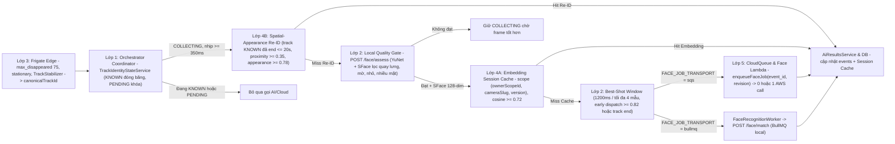

# Báo cáo kỹ thuật: Tối ưu hóa nhận diện khuôn mặt 5 lớp "Recognize Once, Track Continuously"

- **Nhánh triển khai:** `feat/face-track-once-optimization` (baseline từ PR #47 [`2306b1a`](../../db/migrations/0023_rekognition_collection_prefix.sql), tích hợp tại commit `6711117`)
- **Ngày báo cáo:** 22/11/2026
- **Phạm vi:** Edge Frigate + AI Service (`POST /face/assess`) + Orchestrator (Layers 1–4 & `CloudQueueService`) + PostgreSQL (`0024_face_track_once_pipeline.sql`) + AWS Face Lambda (`services/aws-workers/face/handler.py`)

> **Đối chiếu thực nghiệm 22/11/2026:** Báo cáo này mô tả thiết kế ban đầu. Kết quả chạy video/AWS, ảnh giao diện và giới hạn còn lại nằm trong [báo cáo kiểm thử](../test/FACE_TRACK_ONCE_2026-11-22/REPORT.md). Code sau kiểm thử lấy crop từ frame hiện tại với box mới, chạy lấy mẫu song song với lưu media, tính cửa sổ Best-Shot từ mẫu hợp lệ đầu tiên, và đánh giá Quality Gate trước Spatial Re-ID. Khi có mặt rõ, Spatial Re-ID phải vượt thêm kiểm tra SFace với khuôn mặt đã cache. Các con số “0/1 call” bên dưới là mục tiêu thiết kế, không thay thế bằng chứng E2E của từng video.

---

## 1. Tóm tắt & Bối cảnh

Trước bản tối ưu này, đường ống nhận diện khuôn mặt M1 hoạt động theo kiểu **"phát hiện event mới là gửi cloud ngay"**, dẫn đến bốn điểm nghẽn lớn về chi phí AWS Rekognition, độ trễ và chất lượng kết quả:

1. **Gửi ảnh quá sớm ngay tại `type=new` / `INSERT events`:** Trigger PostgreSQL `cloud_face_intent` (trong [`0018_aws_queue_pipeline.sql`](../../db/migrations/0018_aws_queue_pipeline.sql)) chèn ngay bản ghi `cloud_jobs` khi `events` được tạo ở mode `sqs`, hoặc `MqttConsumerService` đẩy ngay vào BullMQ khi `isCreated === true`. Tại thời điểm mới xuất hiện ở rìa khung hình, đối tượng thường quay lưng, cúi đầu, bị mờ chuyển động hoặc crop chưa ổn định.
2. **Đứt track gây gọi lại Rekognition nhiều lần cho cùng một người:** Khi người dùng bị che khuất thoáng qua, quay góc hoặc đứng yên khiến Frigate kết thúc track cũ và sinh `track_id` mới, hệ thống coi đó là một sự kiện mới hoàn toàn và lặp lại toàn bộ chu trình upload S3 → SQS → Lambda → Rekognition.
3. **Thiếu cổng lọc chất lượng cục bộ (Local Quality Gate):** Mọi crop đều được upload S3 và đẩy qua Lambda kể cả ảnh quay lưng, mờ, mặt nhỏ hoặc có nhiều mặt, gây lãng phí API call chỉ để nhận lại `UNDETERMINED`.
4. **Gọi thừa `DetectFaces` và `DescribeCollection` trong Face Lambda:** Mỗi lượt xử lý trong [`handler.py`](../../services/aws-workers/face/handler.py) thực hiện tới **3 AWS Rekognition API calls** (`DetectFaces` + `DescribeCollection` + `SearchFacesByImage`), kể cả khi collection của chủ camera đang rỗng hoặc ảnh đã được kiểm tra mặt hợp lệ.

Kiến trúc mới **"Recognize Once, Track Continuously"** chuyển luồng xử lý sang mô hình **5 lớp liên hoàn**, đảm bảo:

- Chỉ gửi lên AWS Rekognition (hoặc local `/face/match`) **tối đa 1 best-shot rõ mặt nhất cho mỗi track**, đóng băng vĩnh viễn trạng thái `KNOWN` suốt vòng đời track.
- Tái nhận diện cục bộ trong phiên ngắn bằng **SFace embedding** và **Spatial-Appearance Re-ID** có kiểm soát chặt chẽ chống **tailgating** (tuyệt đối không dùng camera-wide cooldown mù quáng).
- Cắt giảm xuống còn **0 hoặc 1 AWS Rekognition API call** ở Face Lambda.
- Giữ nguyên hợp đồng `queue-v1.schema.json`, cô lập tenant/owner từ PR #47 (`REKOGNITION_COLLECTION_PREFIX`, `S3_EXPIRE_7D_TAG`), và có công tắc rollback tức thời không cần hạ migration.

---

## 2. Kiến trúc 5 lớp "Recognize Once, Track Continuously"

| Lớp       | Thành phần chính                                                                           | Nơi chạy         | Trách nhiệm cốt lõi                                                                                 |
| --------- | ------------------------------------------------------------------------------------------ | ---------------- | --------------------------------------------------------------------------------------------------- |
| **Lớp 1** | `TrackIdentityStateService`, `FaceRecognitionCoordinatorService`                           | Orchestrator     | State machine theo `(cameraSlug, trackId)`, đóng băng `KNOWN`, chống trùng in-flight, retry có hạn  |
| **Lớp 2** | `FaceQualityAssessor` (`POST /face/assess`), `FaceQualityGateClient`, Best-Shot window     | AI Service & Orc | Lọc ảnh quay lưng/mờ/nhỏ/nhiều mặt bằng YuNet+SFace cục bộ; chọn best-shot trong cửa sổ 1.2 s       |
| **Lớp 3** | `infra/frigate/config.example.yml`, `FrigateConfigService`, `TrackStabilizer`, `bridge.py` | Edge Frigate     | Kéo dài `max_disappeared: 75`, bật `stationary`, ổn định `canonicalTrackId` qua two-stage tracker   |
| **Lớp 4** | `FaceSessionCacheService`                                                                  | Orchestrator     | Session cache SFace (`>= 0.72`) và Spatial-Appearance Re-ID (`<= 20 s`) cô lập theo scope & version |
| **Lớp 5** | `0024_face_track_once_pipeline.sql`, `CloudQueueService`, Face Lambda `handler.py`         | DB, Orc & AWS    | Bỏ trigger `cloud_face_intent`, khóa `(event_id, revision)`, Lambda 0-call (rỗng) / 1-call path     |

### 2.1 Sơ đồ tổng quan 5 lớp (`flowchart LR`)



### 2.2 Sơ đồ tuần tự chi tiết (`sequenceDiagram`)

```mermaid
sequenceDiagram
    autonumber
    participant FRG as Frigate + TrackStabilizer
    participant MQT as MqttConsumerService
    participant CRD as FaceRecognitionCoordinator
    participant AI as AI Service (/face/assess)
    participant CACHE as FaceSessionCacheService
    participant CQ as CloudQueueService (SQS/S3)
    participant LMB as Face Lambda (handler.py)
    participant DB as PostgreSQL (AiResultsService)

    FRG->>MQT: frigate/camerai/frames (canonicalTrackId) + frigate/events (new/update/end)
    MQT->>DB: INSERT/UPDATE events (dedup_key = frigate:camera:track)
    MQT->>CRD: handleTrackEvent(messageType, event, after, isCreated, camera)

    alt Track ở trạng thái KNOWN hoặc PENDING_RECOGNITION
        CRD->>CACHE: Cập nhật lastBox (hoặc markTrackEnded nếu type=end)
        Note over CRD: Không gọi Quality Gate hay Cloud
    else Đủ nhịp lấy mẫu (>= 350ms)
        CRD->>FRG: GET /api/events/{trackId}/snapshot.jpg?crop=1&quality=100
        CRD->>CRD: computeAppearanceSignature(cropBuffer) -> vector 128 chiều
        CRD->>CACHE: matchBySpatialAppearance(scope, box, appearanceSignature)
        alt Hit Spatial-Appearance Re-ID (track KNOWN vừa end <= 20s)
            CACHE-->>CRD: knownFaceId + similarity
            CRD->>DB: AiResultsService.submit(KNOWN, provider=local-session-cache)
        else Miss Re-ID -> Gọi Local Quality Gate
            CRD->>AI: POST /face/assess (includeEmbedding=true, timeout 2000ms)
            AI-->>CRD: {passed, qualityScore, rejectionReason, embeddingBase64, gateStatus}
            alt Không đạt Quality Gate
                CRD->>CRD: recordGateRejected(), giữ track tiếp tục thu thập mẫu
            else Đạt Quality Gate -> Kiểm tra Embedding Session Cache
                CRD->>CACHE: matchByEmbedding(scope, embedding >= 0.72)
                alt Hit Embedding Cache
                    CACHE-->>CRD: knownFaceId + similarity
                    CRD->>DB: AiResultsService.submit(KNOWN, provider=local-session-cache)
                else Miss Cache -> Best-Shot Window (1200ms / 4 mẫu / early >= 0.82 / end)
                    CRD->>CQ: enqueueFaceJob(eventId, revision, imageBuffer)
                    CQ->>CQ: Upload best-shot S3 + INSERT/UPDATE cloud_jobs (PENDING)
                    CQ->>LMB: SQS face.job -> GET /internal/cloud/face-jobs/{jobId}
                    LMB->>LMB: Fast path (REKOGNITION_SKIP_DETECT_FACES=true)
                    Note over LMB: collection_face_count == 0 -> 0 call AWS (UNKNOWN); ngược lại -> 1 call SearchFacesByImage
                    LMB->>CQ: PUT /result + SQS face.result
                    CQ->>DB: applyResult() -> AiResultsService.submit + cloud_result_receipts
                    CQ->>CRD: onRecognitionResult() -> cập nhật TrackState & upsertKnown vào SessionCache
                end
            end
        end
    end
```

---

## 3. Chi tiết triển khai theo từng lớp

### 3.1 Migration PostgreSQL `0024_face_track_once_pipeline.sql`

File [`db/migrations/0024_face_track_once_pipeline.sql`](../../db/migrations/0024_face_track_once_pipeline.sql) thực hiện chuyển giao quyền điều phối job từ SQL trigger sang tầng ứng dụng:

- `DROP TRIGGER IF EXISTS cloud_face_intent ON events;` và `DROP FUNCTION IF EXISTS cloud_enqueue_face();`: gỡ bỏ trigger tự động chèn `cloud_jobs` ngay lúc `INSERT INTO events` (được tạo từ `0018_aws_queue_pipeline.sql`).
- `ALTER TABLE cloud_jobs ADD COLUMN IF NOT EXISTS revision integer NOT NULL DEFAULT 1 CHECK (revision >= 1);`: hỗ trợ nhiều lượt đánh giá chất lượng tuần tự trên cùng một `event_id` (ví dụ `UNDETERMINED` retry hoặc `UNKNOWN` recheck).
- `DROP INDEX IF EXISTS cloud_one_face_job;` và `CREATE UNIQUE INDEX cloud_one_face_job_revision ON cloud_jobs(event_id, revision) WHERE kind = 'face.job';`: thay ràng buộc cứng 1 job/event thành tối đa 1 job cho mỗi cặp `(event_id, revision)`.

### 3.2 Lớp 1: Track Identity State Machine & Coordinator

- [`TrackIdentityStateService`](../../apps/orchestrator/src/face-recognition/track-identity-state.service.ts):
  - Quản lý `TrackRecord` theo khóa `"{cameraSlug}:{trackId}"`, tối đa `MAX_TRACK_RECORDS = 5000` bản ghi và tự dọn sau `FACE_TRACK_STATE_TTL_MS` (`120000 ms`).
  - Năm trạng thái trong vòng đời: `COLLECTING` → `PENDING_RECOGNITION` → `KNOWN` | `UNKNOWN` | `UNDETERMINED`.
  - **Đóng băng `KNOWN`:** khi đã xác định `KNOWN`, mọi message `update` / `end` tiếp theo đều tăng `frozenKnownSkips` và không bao giờ gửi lại cloud.
  - **Khóa in-flight `PENDING_RECOGNITION`:** mọi message đến trong lúc job đang chạy trên SQS/BullMQ đều bị bỏ qua (`pendingSkips`) để không bắn trùng job.
  - **Chính sách retry hữu hạn:**
    - `UNDETERMINED`: cho phép tối đa `FACE_UNDETERMINED_MAX_RETRIES = 2` lần retry khi đã qua cooldown `FACE_UNDETERMINED_RETRY_COOLDOWN_MS = 4000 ms` và điểm chất lượng mới cao hơn lần đã gửi (`qualityScore > dispatchedQualityScore`, không retry bằng ảnh fail-open).
    - `UNKNOWN`: chỉ cho phép tối đa **1 lần recheck** (`FACE_UNKNOWN_ALLOW_SINGLE_RECHECK = true`, đánh dấu cờ `unknownRecheckUsed`) nếu điểm chất lượng tăng ít nhất `FACE_UNKNOWN_RECHECK_MIN_QUALITY_GAIN = 0.15` (`qualityScore >= dispatchedQualityScore + 0.15`, không áp dụng khi `failOpenApplied = true`).
- [`FaceRecognitionCoordinatorService`](../../apps/orchestrator/src/face-recognition/face-recognition-coordinator.service.ts):
  - Được [`MqttConsumerService`](../../apps/orchestrator/src/ingestion/mqtt-consumer.service.ts) gọi ở cuối `handleMessage` sau khi đồng bộ event/media/SSE.
  - Bỏ qua event đã `RESOLVED`/`CLOSED` và các event mới không thuộc `PERSON_DETECTED` hoặc `RESTRICTED_ZONE`.
  - Giãn nhịp lấy mẫu theo `FACE_MIN_SAMPLE_INTERVAL_MS = 350 ms` để tránh kéo snapshot liên tục ở tần suất quá dày.
  - Tích lũy `BestShotCandidate` tốt nhất trong cửa sổ `FACE_BEST_SHOT_WINDOW_MS = 1200 ms` (tối đa `FACE_BEST_SHOT_MAX_SAMPLES = 4` mẫu); bắn ngay nếu `qualityScore >= 0.82` (`FACE_BEST_SHOT_EARLY_DISPATCH_SCORE`), hoặc hết cửa sổ `setTimeout` (`ensureWindowTimer`), hoặc khi nhận `type=end` mà track vẫn còn `COLLECTING` với `bestShot` hợp lệ.
  - Ở nhánh BullMQ, đính kèm `imageBase64` vào job của [`FaceRecognitionWorker`](../../apps/orchestrator/src/face-recognition/face-recognition.worker.ts) để worker dùng đúng ảnh best-shot thay vì gọi lại snapshot tại thời điểm muộn hơn.
  - Khi `FACE_TRACK_OPTIMIZATION_ENABLED=false`, chạy `handleLegacyDispatch` (chỉ dispatch 1 lần lúc `isCreated=true`, `revision=1`) để rollback an toàn.

### 3.3 Lớp 2: Local Face Quality Gate (`POST /face/assess`)

- Endpoint mới `POST /face/assess` ([`face.py`](../../services/ai-service/app/routers/face.py), [`api/openapi-ai-service.yaml`](../../api/openapi-ai-service.yaml), [`packages/contracts/src/generated/ai-service.ts`](../../packages/contracts/src/generated/ai-service.ts)):
  - Yêu cầu header `X-Internal-Token` (`authenticate`) và dùng chung `BoundedSemaphore(face_max_concurrent)` (`503 PROVIDER_UNAVAILABLE` khi quá tải slot).
  - [`FaceQualityAssessor`](../../services/ai-service/app/services/face_quality.py) nạp model cục bộ **YuNet** và **SFace** **độc lập với `FACE_PROVIDER`**, nên Quality Gate hoạt động ngay cả khi `FACE_PROVIDER=rekognition`.
  - Quy trình đánh giá trên từng crop (`JPEG`, `PNG`, `WEBP`; scale detection tối đa `_MAX_DETECT_DIM = 640.0`):
    1. Kiểm tra `face_quality_gate_enabled`: nếu `false` trả `passed=True, gateStatus="DISABLED"`.
    2. Decode ảnh và kiểm tra giới hạn bytes/pixels → lỗi trả `IMAGE_DECODE_FAILED`.
    3. Nạp model nếu thiếu → suy giảm an toàn `passed=False, gateStatus="UNAVAILABLE", rejectionReason="MODEL_UNAVAILABLE"`.
    4. Đếm mặt YuNet: `0` mặt → `NO_FACE_DETECTED`; `> 1` mặt → `MULTIPLE_FACES`.
    5. Kích thước tối thiểu: rộng hoặc cao `< 60 px` (`FACE_GATE_MIN_FACE_PX`) → `FACE_TOO_SMALL`.
    6. Độ tin cậy detection: `< 0.75` (`FACE_GATE_MIN_DETECTION_SCORE`) → `LOW_DETECTION_SCORE`.
    7. Độ sắc nét Laplacian trên ROI mặt: `< 45.0` (`FACE_GATE_MIN_SHARPNESS`) → `BLURRY`.
    8. Tỉ lệ góc quay yaw / pitch tính từ 5 điểm landmark YuNet: `> 0.45` (`FACE_GATE_MAX_YAW_RATIO` / `FACE_GATE_MAX_PITCH_RATIO`) → `EXTREME_POSE`.
    9. Tính điểm tổng hợp `qualityScore` trong `[0.0, 1.0]`: `0.30 * det_score + 0.20 * size_score + 0.25 * sharp_score + 0.25 * pose_score`.
    10. Nếu đạt và `includeEmbedding=True`: align + trích xuất vector **SFace 128 chiều** (`embeddingBase64`, `embeddingDim=128`) gửi kèm cho Lớp 4.
- Phía Orchestrator, [`FaceQualityGateClient`](../../apps/orchestrator/src/face-recognition/face-quality-gate.client.ts) áp dụng timeout `2000 ms` và chính sách `FACE_QUALITY_GATE_FAIL_OPEN=true` (nếu AI Service unavailable/timeout thì vẫn cho qua với `qualityScore=0, failOpenApplied=true` để không mất khả năng nhận diện; có thể đổi sang `false` nếu muốn fail-closed).

### 3.4 Lớp 3: Frigate Tracker & Edge Track Stabilizer

- [`infra/frigate/config.example.yml`](../../infra/frigate/config.example.yml) và [`FrigateConfigService`](../../apps/orchestrator/src/frigate/frigate-config.service.ts):
  - `detect.max_disappeared: 75` (giữ track sống qua 75 frame = **15 giây** ở `fps: 5` trước khi Frigate phát `type=end`).
  - `detect.stationary`: `interval: 50`, `threshold: 50` (và `max_frames.default: 3000` trong `config.example.yml`) để người đứng yên/ngồi lâu không bị rơi mất track.
- [`TrackStabilizer`](../../infra/frigate/frame-metadata/track_stabilizer.py) tích hợp vào [`bridge.py`](../../infra/frigate/frame-metadata/bridge.py) (bật mặc định qua `FRIGATE_TRACK_STABILIZER_ENABLED=true`):
  - Thuật toán hai vòng lấy cảm hứng từ ByteTrack theo từng camera (`max_lost_seconds=15.0`, `max_lost_tracks_per_camera=64`, `max_cameras=64`):
    - Giữ nguyên `canonicalTrackId` cho mọi `active` track đang chạy — không bao giờ cướp ID của track còn hoạt động.
    - **Stage 1 (High IoU):** ứng viên có `score >= 0.70` khớp với vị trí hiện tại hoặc vị trí dự đoán theo vận tốc EMA (`_predict_box`) của track đã mất với `IoU >= 0.30`.
    - **Stage 2 (Secondary):** khớp theo `IoU >= 0.15` hoặc đồng thời `area_ratio >= 0.35` và `dist_ratio <= 0.60`.
  - Gắn trường `canonicalTrackId` vào từng object trong `frigate/camerai/frames`; phía Orchestrator, [`FrigateDetectionTrackerService`](../../apps/orchestrator/src/frigate/frigate-detection-tracker.service.ts) giữ ánh xạ `canonicalTrackId` qua `CanonicalPreservingFrameBuffer`.

### 3.5 Lớp 4: Session Cache & Spatial-Appearance Re-ID

[`FaceSessionCacheService`](../../apps/orchestrator/src/face-recognition/face-session-cache.service.ts) quản lý các bucket cô lập chặt theo **`(ownerScopeId, cameraSlug)`** kèm **`collectionVersion`** (giới hạn `MAX_ENTRIES_PER_CAMERA = 64`, `MAX_TOTAL_ENTRIES = 2000`, TTL mặc định `300000 ms` = 5 phút). Khi `collectionVersion` thay đổi (do thêm/xóa người quen), toàn bộ bucket cũ tự động bị xóa sạch.

1. **Nhánh 4A — Local SFace Embedding Match (`matchByEmbedding`):**
   - Dùng chính vector SFace 128 chiều đã trích xuất ở `POST /face/assess` (không cần chạy thêm mô hình nào khác).
   - So cosine similarity với các entry `KNOWN` còn hạn trong bucket; đạt ngưỡng `>= 0.72` (`FACE_SESSION_CACHE_SIMILARITY_THRESHOLD`) sẽ tạo `SubmitAiResultDto` với `provider: 'local-session-cache'`, `cacheHit: true`, `matchMethod: 'embedding'` và nộp thẳng `AiResultsService.submit`.
2. **Nhánh 4B — Spatial-Appearance Re-ID (`matchBySpatialAppearance`):**
   - Chỉ kích hoạt cho track đang `COLLECTING` khi trong cùng bucket tồn tại một track `KNOWN` **đã kết thúc (`endedAt !== null`)** trong vòng `20000 ms` (`FACE_SPATIAL_REID_MAX_GAP_MS`).
   - Phải thỏa **đồng thời hai ngưỡng**:
     - Gần về không gian & tỉ lệ box: `computeBoxProximity(box, entry.lastBox) >= 0.35` (`FACE_SPATIAL_REID_MIN_PROXIMITY_SCORE`, kết hợp IoU và khoảng cách tâm chuẩn hóa có hiệu chỉnh `sizeRatio`).
     - Tương đồng ngoại hình: `cosineSimilarity` giữa hai chữ ký histogram RGB 128 chiều vùng trên/dưới (`computeAppearanceSignature` dùng `sharp` resize `24x24`) `>= 0.78` (`FACE_SPATIAL_REID_MIN_APPEARANCE_SIMILARITY`).
   - Khi hit, gán ngay `KNOWN` (`matchMethod: 'spatial-appearance'`), tiết kiệm cả Quality Gate lẫn AWS Rekognition.

### 3.6 Lớp 5: Cloud Queue & Face Lambda Fast Path

- [`CloudQueueService`](../../apps/orchestrator/src/cloud-queue/cloud-queue.service.ts):
  - `enqueueFaceJob(input)`: chèn `cloud_jobs` với `ON CONFLICT(event_id, revision) WHERE kind='face.job' DO NOTHING`. Khi coordinator truyền sẵn best-shot `imageBuffer`, hàm upload trực tiếp lên S3 (`owners/{owner}/cameras/{camera}/events/{event}/face/{jobId}.jpg`, gắn tag `S3_EXPIRE_7D_TAG` hoặc `retain: true`), kiểm tra `REKOGNITION_COLLECTION_PREFIX`, ghi `envelope`, chuyển trạng thái sang `PENDING` và gọi `wakeLoop()` để đẩy SQS gần như tức thời.
  - `faceContext(id)`: trả thêm `collection_face_count` đếm từ `cloud_face_mappings` JOIN `known_faces WHERE is_active = true`.
  - `cacheFaceResult` & `applyResult`: xác thực khớp `revision` giữa `face.job` và `face.result`, và gọi `coordinator.onRecognitionResult(faceNotification)` sau khi commit DB thành công.
- [`services/aws-workers/face/handler.py`](../../services/aws-workers/face/handler.py):
  - Biến mới `REKOGNITION_SKIP_DETECT_FACES` (mặc định `"true"`).
  - **0-call fast path:** nếu `collection_face_count == 0`, trả ngay `UNKNOWN`, `confidence=1.0`, `similarity=None`, `policy="empty-collection-v1"`, `model="rekognition"` mà **không gọi bất kỳ AWS Rekognition API nào**.
  - **1-call fast path:** bỏ qua `DetectFaces` và `DescribeCollection`, chỉ gọi 1 lần `search_faces_by_image(CollectionId=..., Image=..., FaceMatchThreshold=0, MaxFaces=1, QualityFilter="NONE")`, lấy `FaceModelVersion` trực tiếp từ response. Nếu Rekognition ném `ClientError` `InvalidParameterException` (không tìm thấy mặt), map ngay sang `UNDETERMINED` / `NO_FACE_DETECTED` (`error=None`) để không kích hoạt SQS retry vô ích. Các `ClientError` khác vẫn raise để SQS retry / đẩy DLQ.
  - **Legacy fallback (`REKOGNITION_SKIP_DETECT_FACES=false`):** giữ nguyên `_recognize_legacy` gọi `detect_faces`, tận dụng `collection_face_count` (hoặc gọi `describe_collection` nếu `None`), rồi `search_faces_by_image`.

### 3.7 Tổng hợp 39 file thay đổi trên nhánh `feat/face-track-once-optimization` (tới commit `6711117`)

| Nhóm / Lớp                          | Đường dẫn file                                                                                                                                                                                                                                                                                                                                                                                                                                                                                                                                                                                                                                                                                                                                                                                                                                                                                                                                                                                                                                                                                                                                                                                                                                                                                                                                                      | Vai trò                                                                                               |
| ----------------------------------- | ------------------------------------------------------------------------------------------------------------------------------------------------------------------------------------------------------------------------------------------------------------------------------------------------------------------------------------------------------------------------------------------------------------------------------------------------------------------------------------------------------------------------------------------------------------------------------------------------------------------------------------------------------------------------------------------------------------------------------------------------------------------------------------------------------------------------------------------------------------------------------------------------------------------------------------------------------------------------------------------------------------------------------------------------------------------------------------------------------------------------------------------------------------------------------------------------------------------------------------------------------------------------------------------------------------------------------------------------------------------- | ----------------------------------------------------------------------------------------------------- |
| **DB & Env & Infra**                | [`db/migrations/0024_face_track_once_pipeline.sql`](../../db/migrations/0024_face_track_once_pipeline.sql), [`.env.example`](../../.env.example), [`docker-compose.yml`](../../docker-compose.yml)                                                                                                                                                                                                                                                                                                                                                                                                                                                                                                                                                                                                                                                                                                                                                                                                                                                                                                                                                                                                                                                                                                                                                                  | Migration bỏ trigger, thêm `revision`; 20 env var mới; mount stabilizer                               |
| **Lớp 3 (Frigate Edge)**            | [`infra/frigate/config.example.yml`](../../infra/frigate/config.example.yml), [`infra/frigate/frame-metadata/track_stabilizer.py`](../../infra/frigate/frame-metadata/track_stabilizer.py), [`bridge.py`](../../infra/frigate/frame-metadata/bridge.py), [`test_bridge.py`](../../infra/frigate/frame-metadata/test_bridge.py)                                                                                                                                                                                                                                                                                                                                                                                                                                                                                                                                                                                                                                                                                                                                                                                                                                                                                                                                                                                                                                      | `max_disappeared: 75`, `stationary`, two-stage `TrackStabilizer`                                      |
| **Lớp 2 (AI Service & Contract)**   | [`services/ai-service/app/config.py`](../../services/ai-service/app/config.py), [`models/face.py`](../../services/ai-service/app/models/face.py), [`routers/face.py`](../../services/ai-service/app/routers/face.py), [`services/face_quality.py`](../../services/ai-service/app/services/face_quality.py), [`tests/test_face.py`](../../services/ai-service/tests/test_face.py), [`tests/test_face_quality.py`](../../services/ai-service/tests/test_face_quality.py), [`api/openapi-ai-service.yaml`](../../api/openapi-ai-service.yaml), [`packages/contracts/src/generated/ai-service.ts`](../../packages/contracts/src/generated/ai-service.ts)                                                                                                                                                                                                                                                                                                                                                                                                                                                                                                                                                                                                                                                                                                                | Endpoint `POST /face/assess`, YuNet/SFace Quality Gate & OpenAPI contracts                            |
| **Lớp 1, 2-client, 3-orc, 4 (Orc)** | [`face-track-optimization.config.ts`](../../apps/orchestrator/src/face-recognition/face-track-optimization.config.ts), [`face-quality-gate.client.ts`](../../apps/orchestrator/src/face-recognition/face-quality-gate.client.ts), [`track-identity-state.service.ts`](../../apps/orchestrator/src/face-recognition/track-identity-state.service.ts), [`face-session-cache.service.ts`](../../apps/orchestrator/src/face-recognition/face-session-cache.service.ts), [`face-recognition-coordinator.service.ts`](../../apps/orchestrator/src/face-recognition/face-recognition-coordinator.service.ts), [`face-recognition.worker.ts`](../../apps/orchestrator/src/face-recognition/face-recognition.worker.ts), [`face-recognition.module.ts`](../../apps/orchestrator/src/face-recognition/face-recognition.module.ts), [`cloud-queue.service.ts`](../../apps/orchestrator/src/cloud-queue/cloud-queue.service.ts), [`mqtt-consumer.service.ts`](../../apps/orchestrator/src/ingestion/mqtt-consumer.service.ts), [`ingestion.module.ts`](../../apps/orchestrator/src/ingestion/ingestion.module.ts), [`frigate-config.service.ts`](../../apps/orchestrator/src/frigate/frigate-config.service.ts), [`frigate-detection-tracker.service.ts`](../../apps/orchestrator/src/frigate/frigate-detection-tracker.service.ts) + 10 spec test (`apps/orchestrator/test/*`) | State machine, Quality Gate client, Session Cache, Spatial Re-ID, Coordinator, CloudQueue & Ingestion |
| **Lớp 5 (Face Lambda)**             | [`services/aws-workers/face/handler.py`](../../services/aws-workers/face/handler.py), [`services/aws-workers/face/test_handler.py`](../../services/aws-workers/face/test_handler.py)                                                                                                                                                                                                                                                                                                                                                                                                                                                                                                                                                                                                                                                                                                                                                                                                                                                                                                                                                                                                                                                                                                                                                                                | `REKOGNITION_SKIP_DETECT_FACES`, 0-call empty collection, 1-call search                               |

---

## 4. So sánh Trước vs Sau & Đảm bảo an toàn bảo mật

### 4.1 So sánh số lần gọi AWS Rekognition theo kịch bản

| Kịch bản thực tế                                                      | Trước tối ưu (`0018` + legacy Lambda)                                           | Sau tối ưu (`feat/face-track-once-optimization`)                                                                     |
| --------------------------------------------------------------------- | ------------------------------------------------------------------------------- | -------------------------------------------------------------------------------------------------------------------- |
| **Người đi quay lưng / mờ / mặt quá nhỏ (< 60 px)**                   | **2–3 calls/track** (`DetectFaces` → `DescribeCollection`, đôi khi cả `Search`) | **0 AWS call** — bị chặn ngay tại Layer 2 (`POST /face/assess`)                                                      |
| **Người quen đứng yên hoặc di chuyển lâu trong phòng (1 track)**      | 3 calls lúc `type=new`, thêm **3 calls mỗi lần đứt track**                      | **1 call duy nhất** (`SearchFacesByImage`) nếu miss cache; toàn bộ vòng đời track sau đó bị đóng băng `KNOWN`        |
| **Đứt track ngắn (≤ 15–20 s) do che khuất / đứng yên**                | Sinh event mới → **+3 calls** mỗi lần đứt                                       | **0 AWS call** — giữ track nhờ `max_disappeared: 75` / `TrackStabilizer` hoặc khớp Spatial-Appearance Re-ID (Lớp 4B) |
| **Người quen rời khung rồi quay lại cùng camera trong 5 phút**        | Sinh track mới → **+3 calls**                                                   | **0 AWS call** — hit SFace Embedding Session Cache (`>= 0.72`, Lớp 4A)                                               |
| **Người lạ đi sát ngay sau người quen (Tailgating) trên cùng camera** | 3 calls cho người quen + 3 calls cho người lạ                                   | Người quen **1 call** (hoặc 0 nếu cache hit); người lạ tạo track độc lập và **vẫn bị gọi 1 call kiểm tra `UNKNOWN`** |
| **Chủ camera chưa đăng ký mặt nào (`collection_face_count == 0`)**    | **2 calls/event** (`DetectFaces` + `DescribeCollection`)                        | **0 AWS call** — Lambda fast path trả thẳng `UNKNOWN` (`empty-collection-v1`)                                        |
| **Người lạ khung đầu hơi nghiêng/mờ rồi quay rõ mặt hơn**             | Đã chốt ngay lúc `type=new` (không đánh giá lại nếu khung đầu lọt `UNKNOWN`)    | Tối đa **1 lần** ở đầu track + tối đa **1 recheck** nếu `qualityScore` cải thiện `>= +0.15`                          |

### 4.2 Cơ chế chống Tailgating (Không dùng camera-wide cooldown mù quáng)

Hệ thống **tuyệt đối không** dùng khóa thời gian theo camera (ví dụ _"camera vừa nhận ra A thì 30 giây sau bỏ qua mọi track mới"_), vì kẻ gian đi ngay sau người quen sẽ bị bỏ lọt thành `KNOWN`. Thay vào đó, [`FaceSessionCacheService`](../../apps/orchestrator/src/face-recognition/face-session-cache.service.ts) và [`FaceRecognitionCoordinatorService`](../../apps/orchestrator/src/face-recognition/face-recognition-coordinator.service.ts) áp dụng 4 hàng rào độc lập:

1. **Tách riêng `TrackRecord` theo từng `trackId`:** Người lạ đi sau luôn có `trackId` mới ở trạng thái `COLLECTING`, không bao giờ kế thừa trạng thái `KNOWN` của track khác.
2. **Spatial-Appearance Re-ID chỉ chạy khi track `KNOWN` cũ đã kết thúc (`endedAt !== null`) trong 20 giây:** Nếu người quen A vẫn đang đứng trong khung hình (track của A chưa `end`), bất kỳ track B mới nào xuất hiện cùng lúc **không thể** khớp qua nhánh Re-ID này. Khi track A vừa kết thúc ngắn hạn, track B phải thỏa **cả hai** điều kiện: vị trí/tỉ lệ khung hình khớp (`proximityScore >= 0.35`) **VÀ** màu sắc trang phục vùng trên/dưới khớp (`appearanceSimilarity >= 0.78`).
3. **Embedding Session Cache bắt buộc có mặt rõ khớp sinh trắc học:** Nếu miss Re-ID, ảnh crop phải vượt qua Quality Gate có đúng 1 khuôn mặt rõ (`MULTIPLE_FACES` bị từ chối nếu xuất hiện cả 2 người trong crop) và vector SFace 128 chiều phải đạt cosine `>= 0.72` với người quen trong bucket.
4. **Cô lập scope & tự hủy khi đổi collection:** Bucket cache được tách theo `(ownerScopeId, cameraSlug)` và gắn `collectionVersion`; ngay khi chủ nhà xóa hoặc sửa người quen (`collectionVersion` tăng), bucket cũ bị xóa bỏ hoàn toàn.

---

## 5. Cấu hình biến môi trường & Cơ chế Rollback

### 5.1 Bảng biến môi trường mới & giá trị mặc định

#### Orchestrator (khai báo trong [`.env.example`](../../.env.example) và [`face-track-optimization.config.ts`](../../apps/orchestrator/src/face-recognition/face-track-optimization.config.ts))

| Biến môi trường                               | Mặc định | Ý nghĩa                                                                       |
| --------------------------------------------- | -------- | ----------------------------------------------------------------------------- |
| `FACE_TRACK_OPTIMIZATION_ENABLED`             | `true`   | Công tắc tổng bật/tắt pipeline Lớp 1–4 (`false` → `handleLegacyDispatch`)     |
| `FACE_QUALITY_GATE_ENABLED`                   | `true`   | Bật/tắt gọi `POST /face/assess` từ Orchestrator                               |
| `FACE_QUALITY_GATE_FAIL_OPEN`                 | `true`   | Khi Quality Gate timeout/503/unavailable, cho qua (`true`) hay chặn (`false`) |
| `FACE_QUALITY_GATE_TIMEOUT_MS`                | `2000`   | Timeout HTTP tới `POST /face/assess` (ms)                                     |
| `FACE_BEST_SHOT_WINDOW_MS`                    | `1200`   | Cửa sổ tích lũy chọn ảnh tốt nhất cho track `COLLECTING` (ms)                 |
| `FACE_BEST_SHOT_MAX_SAMPLES`                  | `4`      | Số mẫu tối đa trước khi dispatch ngay dù chưa hết cửa sổ                      |
| `FACE_BEST_SHOT_EARLY_DISPATCH_SCORE`         | `0.82`   | Ngưỡng `qualityScore` để dispatch sớm không cần chờ hết cửa sổ                |
| `FACE_MIN_SAMPLE_INTERVAL_MS`                 | `350`    | Giãn cách tối thiểu giữa 2 lần lấy crop/đánh giá cùng một track (ms)          |
| `FACE_UNDETERMINED_MAX_RETRIES`               | `2`      | Số lần thử lại tối đa khi kết quả nhận diện trả `UNDETERMINED`                |
| `FACE_UNDETERMINED_RETRY_COOLDOWN_MS`         | `4000`   | Thời gian chờ tối thiểu giữa các lần retry `UNDETERMINED` (ms)                |
| `FACE_UNKNOWN_ALLOW_SINGLE_RECHECK`           | `true`   | Cho phép tối đa 1 lần kiểm tra lại nếu track ban đầu là `UNKNOWN`             |
| `FACE_UNKNOWN_RECHECK_MIN_QUALITY_GAIN`       | `0.15`   | Mức tăng `qualityScore` tối thiểu để kích hoạt recheck cho `UNKNOWN`          |
| `FACE_SESSION_CACHE_ENABLED`                  | `true`   | Bật/tắt SFace Embedding Session Cache (Lớp 4A)                                |
| `FACE_SESSION_CACHE_TTL_MS`                   | `300000` | Thời gian sống cache người quen trong phiên (ms, mặc định 5 phút)             |
| `FACE_SESSION_CACHE_SIMILARITY_THRESHOLD`     | `0.72`   | Ngưỡng cosine tối thiểu cho Embedding Session Cache                           |
| `FACE_SPATIAL_REID_ENABLED`                   | `true`   | Bật/tắt Spatial-Appearance Re-ID cho track vừa đứt (Lớp 4B)                   |
| `FACE_SPATIAL_REID_MAX_GAP_MS`                | `20000`  | Khoảng thời gian tối đa sau khi track `KNOWN` kết thúc để được Re-ID (ms)     |
| `FACE_SPATIAL_REID_MIN_PROXIMITY_SCORE`       | `0.35`   | Ngưỡng tương đồng vị trí/tỉ lệ bounding box tối thiểu                         |
| `FACE_SPATIAL_REID_MIN_APPEARANCE_SIMILARITY` | `0.78`   | Ngưỡng cosine histogram RGB tối thiểu cho trang phục/ngoại hình               |
| `FACE_TRACK_STATE_TTL_MS`                     | `120000` | Thời gian giữ `TrackRecord` sau lần cập nhật cuối (ms)                        |

#### AI Service, Frigate Bridge & AWS Face Lambda

| Thành phần         | Biến môi trường                    | Mặc định | Nơi đọc & Ý nghĩa                                                                                          |
| ------------------ | ---------------------------------- | -------- | ---------------------------------------------------------------------------------------------------------- |
| **AI Service**     | `FACE_QUALITY_GATE_ENABLED`        | `true`   | [`config.py`](../../services/ai-service/app/config.py) — bật/tắt gate bên phía FastAPI                     |
| **AI Service**     | `FACE_GATE_MIN_FACE_PX`            | `60`     | [`config.py`](../../services/ai-service/app/config.py) — kích thước mặt tối thiểu (px)                     |
| **AI Service**     | `FACE_GATE_MIN_DETECTION_SCORE`    | `0.75`   | [`config.py`](../../services/ai-service/app/config.py) — điểm YuNet tối thiểu                              |
| **AI Service**     | `FACE_GATE_MIN_SHARPNESS`          | `45.0`   | [`config.py`](../../services/ai-service/app/config.py) — phương sai Laplacian tối thiểu                    |
| **AI Service**     | `FACE_GATE_MAX_YAW_RATIO`          | `0.45`   | [`config.py`](../../services/ai-service/app/config.py) — tỉ lệ quay ngang tối đa                           |
| **AI Service**     | `FACE_GATE_MAX_PITCH_RATIO`        | `0.45`   | [`config.py`](../../services/ai-service/app/config.py) — tỉ lệ ngẩng/cúi tối đa                            |
| **Frigate Bridge** | `FRIGATE_TRACK_STABILIZER_ENABLED` | `true`   | [`bridge.py`](../../infra/frigate/frame-metadata/bridge.py) — bật gắn `canonicalTrackId`                   |
| **Face Lambda**    | `REKOGNITION_SKIP_DETECT_FACES`    | `"true"` | [`handler.py`](../../services/aws-workers/face/handler.py) — `"true"` fast path 0/1 call; `"false"` legacy |

### 5.2 Cơ chế Rollback nhanh (không cần hạ migration `0024`)

Vì `0024_face_track_once_pipeline.sql` giữ nguyên tương thích với `revision = 1` mặc định, có thể tắt từng lớp hoặc toàn bộ tối ưu chỉ bằng cấu hình biến môi trường:

1. **Rollback toàn bộ Lớp 1–4 ở Orchestrator:** đặt `FACE_TRACK_OPTIMIZATION_ENABLED=false` và recreate container `orchestrator`. Coordinator chuyển ngay về `handleLegacyDispatch`, tạo 1 job (`revision=1`) tại `isCreated=true` thông qua `CloudQueueService.enqueueFaceJob` (SQS) hoặc BullMQ mà không cần khôi phục trigger SQL `cloud_face_intent`.
2. **Rollback riêng Face Lambda:** đặt `REKOGNITION_SKIP_DETECT_FACES=false` trong cấu hình env của Lambda (publish version mới và trỏ lại alias `:live`) để quay lại luồng `DetectFaces` + `DescribeCollection` + `SearchFacesByImage`.
3. **Tắt từng lớp độc lập để khoanh vùng sự cố:** đặt `FACE_SPATIAL_REID_ENABLED=false`, `FACE_SESSION_CACHE_ENABLED=false`, `FACE_QUALITY_GATE_ENABLED=false`, hoặc `FRIGATE_TRACK_STABILIZER_ENABLED=false`.

---

## 6. Kết quả kiểm thử thực tế

Tất cả các kiểm tra dưới đây đã được thực thi và đối chiếu trực tiếp trên nhánh `feat/face-track-once-optimization` tại commit `6711117` (trước khi thêm các cập nhật tài liệu này):

| Hạng mục kiểm tra                                                                                                     | Kết quả thực tế                                                                                                                                                                                                                                                                                                        |
| --------------------------------------------------------------------------------------------------------------------- | ---------------------------------------------------------------------------------------------------------------------------------------------------------------------------------------------------------------------------------------------------------------------------------------------------------------------- |
| `pnpm check:all` (`check:secrets`, `format:check`, `lint`, `typecheck`, `test`, `test:tools`, `api:lint`, `check:ai`) | **Exit 0** (`check:secrets` sạch; `format:check` sạch; `lint` 0 error / 190 warning sẵn có ở orchestrator; `typecheck` đạt ở `contracts`, `orchestrator`, `web`)                                                                                                                                                       |
| `pnpm test` (`apps/orchestrator`)                                                                                     | **85/85 suites, 632/632 tests passed** (bao gồm 4 spec mới + 6 spec cập nhật cho Lớp 1–4)                                                                                                                                                                                                                              |
| `pnpm test` (`apps/web`)                                                                                              | **81/81 files, 368/368 tests passed**                                                                                                                                                                                                                                                                                  |
| `pnpm test:tools`                                                                                                     | **15 suites: 116 passed, 0 failed, 1 skipped** (bài smoke test POSIX `bash`/`jq`/`curl` bỏ qua trên Windows)                                                                                                                                                                                                           |
| `pnpm api:lint` (`api/openapi.yaml`, `api/openapi-ai-service.yaml`)                                                   | **Hợp lệ** (0 error, 6 warning có sẵn)                                                                                                                                                                                                                                                                                 |
| `pnpm check:ai` (`ruff check .`, `ruff format --check .`, `pytest`)                                                   | `ruff` **62 files passed**; `pytest` **147/147 passed**, tổng coverage **91.74%** (`face_quality.py` **99%**, `models/face.py` **100%**)                                                                                                                                                                               |
| `pnpm --filter @cam/contracts build` & `pnpm --filter @cam/orchestrator build`                                        | **Passed** (exit 0)                                                                                                                                                                                                                                                                                                    |
| Face Lambda (`services/aws-workers/face`: `unittest` + `coverage` + `ruff`)                                           | **18/18 tests passed**; `handler.py` đạt **100% branch coverage** (`141 Stmts, 0 Miss, 44 Branch, 0 BrPart`)                                                                                                                                                                                                           |
| Frigate Frame Metadata (`infra/frigate/frame-metadata/test_bridge.py` + `ruff`)                                       | **19/19 tests passed**; `ruff check` & `ruff format --check` đạt trên `services/aws-workers/face` và `infra/frigate/frame-metadata` (8 files)                                                                                                                                                                          |
| DB Integration (`cloud-queue.integration.spec.ts` trên PostgreSQL Testcontainers)                                     | **1/1 suite, 5/5 tests passed** (xác minh `0024` bỏ trigger auto-insert và `enqueueFaceJob` theo `(event_id, revision)`). Ngoài ra `ai-results-db.integration.spec.ts` (23/23 tests) cùng 4 suite DB khác đạt; 3 suite không liên quan (`mqtt-db` lệch log cũ, `wellness-db`, `telegram-db`) lỗi sẵn từ `origin/main`. |

> **Giới hạn kiểm chứng:** Đợt kiểm thử trên `6711117` xác minh đầy đủ ở mức unit test, branch coverage, OpenAPI/contracts, lint/format và PostgreSQL Testcontainers integration. Chưa thực hiện đo đạc end-to-end trên stream camera thật kết hợp AWS Rekognition Staging/Production sau khi gộp 5 lớp.

---

## 7. Tài liệu luồng cũ đã cập nhật & Lưu ý triển khai Staging/Production

### 7.1 Danh sách tài liệu liên quan đã đồng bộ

- [`docs/architecture/DATA_FLOW.md`](../architecture/DATA_FLOW.md) — cập nhật Luồng 1, Luồng 2, Ngân sách độ trễ và bảng Xử lý lỗi theo kiến trúc 5 lớp.
- [`services/aws-workers/README.md`](../../services/aws-workers/README.md) — cập nhật migration `0024`, quy trình `enqueueFaceJob`, `collection_face_count`, fast path `REKOGNITION_SKIP_DETECT_FACES=true`, và SQL chẩn đoán có cột `revision`.
- [`docs/SPRINT4_DEV_CLOUD_LOCALHOST_TO_STAGING.md`](../SPRINT4_DEV_CLOUD_LOCALHOST_TO_STAGING.md) — cập nhật mục 4 ("Face và S3") về việc bỏ trigger `cloud_face_intent`, lưu ý Session Cache khi test lặp, và rollback `FACE_TRACK_OPTIMIZATION_ENABLED=false`.
- [`docs/sprint-2/PLAN_US-10_PERSON_CROP_FACE_MATCH.md`](../sprint-2/PLAN_US-10_PERSON_CROP_FACE_MATCH.md) — bổ sung khung ghi chú ở đầu trang đánh dấu bản Sprint 2 là tham chiếu lịch sử.

### 7.2 Lưu ý triển khai Staging / Production

1. **Chạy migration `0024_face_track_once_pipeline.sql` trước khi khởi chạy Orchestrator mới (và tránh chạy song song bản cũ):** Vì `0024` drop trigger `cloud_face_intent`, nếu còn instance Orchestrator cũ (vốn dựa vào trigger DB để chèn `face.job` ở mode `sqs`) chạy chung DB sau khi migrate, instance cũ sẽ không tạo được `face.job`.
2. **Build & deploy lại gói ZIP Face Lambda:** Chạy `python services/aws-workers/build.py` để đóng gói `handler.py` mới, publish version và cập nhật alias `:live`. Mặc định `REKOGNITION_SKIP_DETECT_FACES` đã là `"true"` (có thể khai báo tường minh trong Lambda env vars); lưu ý mọi bản Orchestrator chưa nâng cấp gửi `collection_face_count=None` vẫn tương thích (Lambda sẽ gọi 1 lần `SearchFacesByImage`).
3. **Đồng bộ mount `track_stabilizer.py` cho Frigate:** [`docker-compose.yml`](../../docker-compose.yml) đã bổ sung mount `./infra/frigate/frame-metadata/track_stabilizer.py:/opt/camerai-frame-metadata/track_stabilizer.py:ro`. Với các máy Edge/Staging dùng compose riêng, cần thêm mount tương tự và recreate container `frigate` (không chỉ `restart`) để bridge nạp được module mới.
4. **Đảm bảo model YuNet & SFace hiện diện trên `ai-service` kể cả khi `FACE_PROVIDER=rekognition`:** Quality Gate `POST /face/assess` cần `face_detection_yunet_2023mar.onnx` và `face_recognition_sface_2021dec.onnx` (checksum cố định trong [`services/ai-service/model-manifest.json`](../../services/ai-service/model-manifest.json), tải và verify qua `python services/ai-service/scripts/fetch_models.py --output-dir services/ai-service/models`). Nếu thiếu model, `ai-service` trả `gateStatus="UNAVAILABLE"` (`MODEL_UNAVAILABLE`) và Orchestrator sẽ rơi về fail-open nếu `FACE_QUALITY_GATE_FAIL_OPEN=true`.
5. **Kết nối mạng Orchestrator → AI Service & truyền env Compose:** Nếu tách App EC2 và Edge EC2, cần bảo đảm App EC2 gọi được `AI_SERVICE_URL` endpoint `/face/assess` kèm `AI_INTERNAL_TOKEN` (trong phạm vi `FACE_QUALITY_GATE_TIMEOUT_MS=2000 ms`). Ngoài ra, trong [`docker-compose.yml`](../../docker-compose.yml) hiện tại, container `orchestrator` đọc toàn bộ biến `FACE_*` qua `env_file: .env`, còn container `ai-service` đang dùng mặc định trong [`Settings`](../../services/ai-service/app/config.py) cho `FACE_QUALITY_GATE_ENABLED` và `FACE_GATE_*` (cần bổ sung vào `environment:` của `ai-service` nếu muốn ghi đè các ngưỡng Quality Gate qua Docker Compose).
