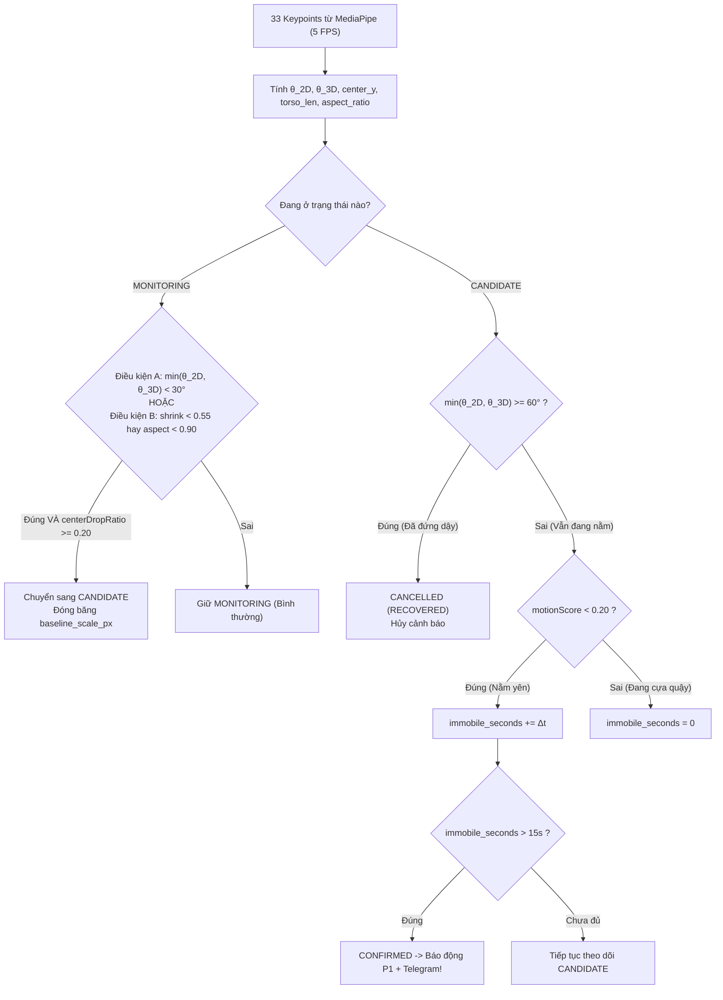

# GIẢI THÍCH TRỰC QUAN CÁC CÔNG THỨC TOÁN HỌC TRONG THUẬT TOÁN PHÁT HIỆN TÉ NGÃ (MODULE M2a)

> **Mục tiêu tài liệu:** Diễn giải từng công thức toán học trong `pose_geometry.py` và `fall_tracker.py` theo cách **dễ hiểu, trực quan, kèm ví dụ tính toán bằng số cụ thể** để phục vụ viết báo cáo và trả lời phản biện trước hội đồng.  
> **Tài liệu liên quan:**
>
> - [BAO_CAO_AI_TE_NGA_GIUA_KY.md](./BAO_CAO_AI_TE_NGA_GIUA_KY.md)
> - [CHUNG_MINH_NGUONG_VA_THUAT_TOAN_TE_NGA.md](./CHUNG_MINH_NGUONG_VA_THUAT_TOAN_TE_NGA.md)

---

## MỤC LỤC

1. [Quy ước hệ tọa độ ảnh & Các điểm khớp đầu vào](#1-quy-ước-hệ-tọa-độ-ảnh--các-điểm-khớp-đầu-vào)
2. [Công thức 1: Góc nghiêng thân 2D ($\theta_{2D}$)](#2-công-thức-1-góc-nghiêng-thân-2d-theta_2d)
3. [Công thức 2: Góc nghiêng thân 3D ($\theta_{3D}$) — Bắt ca ngã dọc trục camera](#3-công-thức-2-góc-nghiêng-thân-3d-theta_3d--bắt-ca-ngã-dọc-trục-camera)
4. [Công thức 3: Tỷ lệ hạ trọng tâm (`centerDropRatio`)](#4-công-thức-3-tỷ-lệ-hạ-trọng-tâm-centerdropratio)
5. [Công thức 4: Tỷ lệ co ngắn thân (`torso_shrink_ratio`) & Tỷ lệ khung bao (`aspect_ratio`)](#5-công-thức-4-tỷ-lệ-co-ngắn-thân-torso_shrink_ratio--tỷ-lệ-khung-bao-aspect_ratio)
6. [Công thức 5: Chỉ số chuyển động chuẩn hóa (`motionScore`)](#6-công-thức-5-chỉ-số-chuyển-động-chuẩn-hóa-motionscore)
7. [Sơ đồ tổng hợp: 5 công thức phối hợp với nhau như thế nào?](#7-sơ-đồ-tổng-hợp-5-công-thức-phối-hợp-với-nhau-như-thế-nào)

---

## 1. Quy ước hệ tọa độ ảnh & Các điểm khớp đầu vào

Camera của hệ thống có độ phân giải $W \times H$ (trong các ví dụ bên dưới ta lấy chuẩn Full HD: **$W = 1920\text{ px}$**, **$H = 1080\text{ px}$**).

```text
(0, 0) ──────────────────────────► Trục X (sang phải, tối đa W = 1920)
  │
  │        ● S (Trung điểm 2 vai: khớp 11 & 12)
  │        │
  │        │  <── Trục thân người
  │        │
  │        ● H (Trung điểm 2 hông: khớp 23 & 24)
  ▼
Trục Y (hướng XUỐNG DƯỚI, tối đa H = 1080)
```

- **Quy đổi từ tọa độ MediaPipe $(x, y) \in [0, 1]$ sang pixel:**
  $$X_{\text{px}} = x \cdot W, \qquad Y_{\text{px}} = y \cdot H$$
  _(Lý do phải nhân $W$ và $H$ riêng: Vì ảnh chữ nhật $1920 \neq 1080$. Nếu không nhân về pixel mà tính góc trực tiếp trên hệ $[0, 1]$, góc nghiêng sẽ bị méo gần gấp đôi!)_
- **Trung điểm vai ($S$) và Trung điểm hông ($H$):**
  $$S = \left(\frac{S_{\text{trái},x} + S_{\text{phải},x}}{2},\; \frac{S_{\text{trái},y} + S_{\text{phải},y}}{2}\right), \qquad H = \left(\frac{H_{\text{trái},x} + H_{\text{phải},x}}{2},\; \frac{H_{\text{trái},y} + H_{\text{phải},y}}{2}\right)$$
  _(Nếu nằm nghiêng làm 1 bên vai/hông bị mặt sàn che khuất `visibility < 0.30`, hệ thống tự động lấy bên còn lại nhìn rõ.)_

---

## 2. Công thức 1: Góc nghiêng thân 2D ($\theta_{2D}$)

### Ý nghĩa trực quan

Đo xem **lưng người đang dựng đứng hay nằm ngang** so với mặt sàn trên mặt phẳng ảnh:

- $\theta_{2D} \approx 90^\circ$: Đứng thẳng.
- $\theta_{2D} < 30^\circ$: Thân người gần như nằm ngang mặt sàn (**nghi ngờ ngã**).

### Công thức

$$\vec{v} = (v_x, v_y) = (S_x - H_x,\; S_y - H_y)$$
$$\theta_{2D} = \operatorname{atan2}(|v_y|, |v_x|) \times \frac{180}{\pi}$$

```text
Khi ĐỨNG THẲNG:                  Khi NGÃ NẰM NGANG:
    S                                  |v_y| = 30
    │  |v_y| = 300               S ─────────────── H
    │                                  |v_x| = 280
    H  (|v_x| = 5)               => θ_2D ≈ 6.1° (< 30°)
=> θ_2D ≈ 89.0°
```

### Ví dụ minh họa bằng số

- **Trường hợp A (Đang đứng):** Vai $S = (960, 300)$, Hông $H = (965, 600)$
  - $|v_x| = |960 - 965| = 5\text{ px}$
  - $|v_y| = |300 - 600| = 300\text{ px}$
  - $\theta_{2D} = \operatorname{atan2}(300, 5) \approx \mathbf{89.05^\circ}$ $\rightarrow$ Đứng bình thường.
- **Trường hợp B (Ngã nằm ngang sàn):** Vai $S = (700, 780)$, Hông $H = (980, 810)$
  - $|v_x| = |700 - 980| = 280\text{ px}$
  - $|v_y| = |780 - 810| = 30\text{ px}$
  - $\theta_{2D} = \operatorname{atan2}(30, 280) \approx \mathbf{6.12^\circ} < 30^\circ$ $\rightarrow$ **Khớp điều kiện góc ngã!**

---

## 3. Công thức 2: Góc nghiêng thân 3D ($\theta_{3D}$) — Bắt ca ngã dọc trục camera

### Tại sao cần công thức này?

Khi người **ngã thẳng đầu về phía camera** (hoặc ngã ngửa ra sau dọc theo hướng nhìn ống kính), trên ảnh 2D phẳng ta vẫn thấy vai nằm ngay phía trên hông, nên $\theta_{2D}$ vẫn rất lớn ($\sim 85^\circ$), thuật toán 2D sẽ bị **mù hoàn toàn**.

### Ý nghĩa trực quan

Tận dụng **trục chiều sâu $Z$** do MediaPipe ước lượng (độ gần/xa so với camera) để đo độ nghiêng thân trong không gian 3 chiều:

- Độ lệch ngang thực sự trên mặt sàn là cạnh huyền của $v_x$ (trái–phải) và $v_z$ (gần–xa camera).

### Công thức

$$v_z = |z_S - z_H| \cdot W$$
$$v_{\text{horiz\_3d}} = \sqrt{|v_x|^2 + v_z^2}$$
$$\theta_{3D} = \operatorname{atan2}\big(|v_y|,\; \max(1.0,\; v_{\text{horiz\_3d}})\big) \times \frac{180}{\pi}$$

Sau đó lấy góc nhỏ hơn giữa 2D và 3D để xét ngã:
$$\theta_{\text{eff}} = \min(\theta_{2D}, \theta_{3D})$$

### Ví dụ minh họa bằng số (Ca ngã thẳng về phía camera)

- Trên ảnh 2D ($W = 1920$): Vai $S = (960, 620)$, Hông $H = (965, 700)$.
  - $|v_x| = 5\text{ px}$, $|v_y| = 80\text{ px}$.
  - Nếu chỉ dùng 2D: $\theta_{2D} = \operatorname{atan2}(80, 5) = \mathbf{86.42^\circ}$ $\rightarrow$ **Bỏ sót!**
- Nhưng trục sâu $Z$ của MediaPipe đo được: $z_S = -0.35$ (vai chúc gần camera), $z_H = -0.05$ (hông ở xa hơn).
  - $v_z = |-0.35 - (-0.05)| \times 1920 = 0.30 \times 1920 = \mathbf{576\text{ px}}$
  - $v_{\text{horiz\_3d}} = \sqrt{5^2 + 576^2} \approx \mathbf{576.02\text{ px}}$
  - $\theta_{3D} = \operatorname{atan2}(80,\; 576.02) \approx \mathbf{7.91^\circ}$
- Kết quả cuối: $\theta_{\text{eff}} = \min(86.42^\circ,\; 7.91^\circ) = \mathbf{7.91^\circ} < 30^\circ$ $\rightarrow$ **Bắt trúng ca ngã dọc!**

---

## 4. Công thức 3: Tỷ lệ hạ trọng tâm (`centerDropRatio`)

### Tại sao cần công thức này?

Chỉ dựa vào góc thân $< 30^\circ$ là **chưa đủ**, vì nếu ai đó đã **nằm sẵn trên sàn từ đầu** (hoặc đang tập chống đẩy) thì góc thân cũng $< 30^\circ$. Ta cần kiểm tra xem người đó **có vừa bị rơi/hạ trọng tâm đột ngột từ trên cao xuống hay không**.

### Ý nghĩa trực quan

Đo xem **trọng tâm thân người hiện tại tụt xuống thấp hơn bao nhiêu** so với tư thế trung bình trong $4\text{ giây}$ trước đó, và **chia cho chiều cao của chính người đó** (để công thức đúng với cả người đứng gần camera lẫn đứng xa camera).

### Công thức

1. Trọng tâm thân người ở mỗi frame (chỉ lấy tọa độ dọc $Y$):
   $$C_y = \frac{S_y + H_y}{2}$$
2. Tỷ lệ hạ trọng tâm so với cửa sổ lịch sử (ít nhất 5 frame gần nhất trong tối đa $4\text{ giây}$):
   $$\text{centerDropRatio} = \frac{C_{y,\text{now}} - \operatorname{median}(C_{y,\text{history}})}{\max(10.0,\; \operatorname{median}(H_{\text{bbox,history}}))}$$
   _(Ngưỡng kích hoạt: **`centerDropRatio >= 0.20`**, tức trọng tâm rơi xuống ít nhất $20\%$ chiều cao người.)_

### Ví dụ minh họa bằng số

Giả sử trong $1\text{ giây}$ vừa qua (5 frame), người đang đứng bình thường:

- Chiều cao bounding box lịch sử: $H_{\text{bbox,history}} \approx [502, 498, 500, 501, 499]$ $\rightarrow$ $\operatorname{median} = \mathbf{500\text{ px}}$.
- Trọng tâm $C_y$ lịch sử: $[450, 448, 452, 450, 451]$ $\rightarrow$ $\operatorname{median} = \mathbf{450\text{ px}}$.

So sánh 2 tình huống ở frame hiện tại:

- **Tình huống A (Đi bộ / nhún chân nhẹ):** $C_{y,\text{now}} = 465\text{ px}$
  $$\text{centerDropRatio} = \frac{465 - 450}{500} = \frac{15}{500} = \mathbf{0.03} < 0.20 \quad (\text{Bình thường})$$
- **Tình huống B (Ngã xuống sàn):** Vai tụt xuống $780$, hông tụt xuống $810$ $\rightarrow$ $C_{y,\text{now}} = \frac{780 + 810}{2} = 795\text{ px}$
  $$\text{centerDropRatio} = \frac{795 - 450}{500} = \frac{345}{500} = \mathbf{0.69} \ge 0.20 \quad (\text{Rơi } 69\% \text{ chiều cao} \rightarrow \text{KÍCH HOẠT!})$$

---

## 5. Công thức 4: Tỷ lệ co ngắn thân (`torso_shrink_ratio`) & Tỷ lệ khung bao (`aspect_ratio`)

### Ý nghĩa trực quan

Đây là **lớp bảo vệ thứ hai** cho các ca ngã dọc hoặc bị che khuất chiều sâu $Z$:

1. **`torso_shrink_ratio` (Co ngắn thân do phối cảnh):** Khi nhìn thẳng từ trước, thân người lúc đứng dài $300\text{ px}$; nhưng khi ngã gập/ngã chúi về phía camera, độ dài đoạn vai–hông chiếu lên ảnh 2D bị **co ngắn lại rõ rệt**.
2. **`aspect_ratio` (Độ bẹp của khung bao):** Người đứng luôn **cao hơn rộng** ($H_{\text{bbox}} / W_{\text{bbox}} > 1.5$); khi ngã nằm ra sàn, khung bao **bẹp xuống, rộng hơn cao** ($H_{\text{bbox}} / W_{\text{bbox}} < 0.90$).

### Công thức

$$\text{torso\_len} = \sqrt{(S_x - H_x)^2 + (S_y - H_y)^2}$$
$$\text{torso\_shrink\_ratio} = \frac{\text{torso\_len}_{\text{now}}}{\max(10.0,\; \operatorname{median}(\text{torso\_len}_{\text{history}}))} < 0.55$$
$$\text{aspect\_ratio} = \frac{H_{\text{bbox}}}{W_{\text{bbox}}} < 0.90$$

### Ví dụ minh họa bằng số

- **Ví dụ `torso_shrink_ratio`:**
  - Khi đứng thẳng: $S = (960, 300), H = (965, 600) \Rightarrow \text{torso\_len}_{\text{history}} = \sqrt{5^2 + 300^2} \approx \mathbf{300.04\text{ px}}$.
  - Khi ngã chúi về phía camera: $S = (960, 620), H = (965, 700) \Rightarrow \text{torso\_len}_{\text{now}} = \sqrt{5^2 + 80^2} \approx \mathbf{80.16\text{ px}}$.
  - Tỷ lệ co ngắn:
    $$\text{torso\_shrink\_ratio} = \frac{80.16}{300.04} \approx \mathbf{0.27} < 0.55 \quad (\text{Thân bị co ngắn } 73\% \rightarrow \text{Bắt ngã dọc!})$$
- **Ví dụ `aspect_ratio`:**
  - Đứng: Khung bao cao $500\text{ px}$, rộng $160\text{ px}$ $\Rightarrow \text{aspect\_ratio} = \frac{500}{160} = \mathbf{3.125} \ge 0.90$.
  - Ngã nằm ngang: Khung bao cao $180\text{ px}$, rộng $450\text{ px}$ $\Rightarrow \text{aspect\_ratio} = \frac{180}{450} = \mathbf{0.40} < 0.90$.

---

## 6. Công thức 5: Chỉ số chuyển động chuẩn hóa (`motionScore`)

### Tại sao cần công thức này?

Sau khi đã nghi ngờ ngã (`CANDIDATE`), hệ thống không báo động ngay mà phải theo dõi xem nạn nhân **có nằm bất động thật hay chỉ đang cúi nhặt đồ rồi đứng dậy**.

### Ý nghĩa trực quan

Đo **tốc độ dịch chuyển trung vị của 10 khớp cơ thể chính** (2 vai, 2 khuỷu tay, 2 hông, 2 đầu gối, 2 mắt cá) giữa 2 frame liên tiếp, chuẩn hóa theo **chiều cao người** và **khoảng thời gian $\Delta t$**.

- Đơn vị: **số lần chiều cao cơ thể dịch chuyển trong 1 giây** (_body-heights/second_).
- Dùng `median` để nếu 1–2 khớp bị giật nhiễu (ví dụ đầu gối bị che), chỉ số chung vẫn ổn định.

### Công thức

Với mỗi cặp khớp $k$ cùng nhìn rõ ở cả frame $t-1$ và frame $t$ (yêu cầu $\ge 6/10$ cặp):
$$d_k = \sqrt{\big((x_k^{(t)} - x_k^{(t-1)}) \cdot W\big)^2 + \big((y_k^{(t)} - y_k^{(t-1)}) \cdot H\big)^2}$$
$$\text{motionScore} = \frac{\operatorname{median}(d_k)}{\text{baseline\_scale\_px} \cdot \Delta t}$$
_(Trong đó $\text{baseline\_scale\_px}$ là chiều cao bbox lúc đứng được đóng băng khi bắt đầu `CANDIDATE`; ở `5 FPS` thì $\Delta t = 0.2\text{ giây}$. Ngưỡng bất động trong `.env`: **`motionScore < 0.20`**.)_

### Ví dụ minh họa bằng số

Giả sử người cao $\text{baseline\_scale\_px} = 500\text{ px}$, camera chạy `5 FPS` ($\Delta t = 0.2\text{ s}$):

- **Tình huống A (Nằm bất động thật, chỉ có nhiễu rung nhẹ của MediaPipe):**
  - Khoảng cách dịch chuyển các khớp giữa 2 frame chỉ dao động quanh $6 - 10\text{ px}$, $\operatorname{median}(d_k) = \mathbf{8\text{ px}}$.
    $$\text{motionScore} = \frac{8}{500 \times 0.2} = \frac{8}{100} = \mathbf{0.08} < 0.20$$
    $\rightarrow$ Coi là **bất động**, bộ đếm thời gian cộng thêm $+0.2\text{ s}$.
    _(Lưu ý: Nếu giữ ngưỡng cũ `0.05` trong `config.py`, mức nhiễu `0.08` này đã bị reset về `0s`! Đây là lý do thực tế phải đặt `0.20`.)_
- **Tình huống B (Người cử động tay chân hoặc đang đứng dậy):**
  - Các khớp dịch chuyển mạnh, $\operatorname{median}(d_k) = \mathbf{45\text{ px}}$ trong $0.2\text{ s}$.
    $$\text{motionScore} = \frac{45}{500 \times 0.2} = \frac{45}{100} = \mathbf{0.45} \ge 0.20$$
    $\rightarrow$ Có chuyển động thật, **reset bộ đếm bất động về `0s`**.

---

## 7. Sơ đồ tổng hợp: 5 công thức phối hợp với nhau như thế nào?


