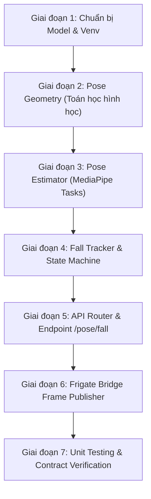

# Kế hoạch chi tiết triển khai US-16 — Phát hiện tư thế nằm/ngã bất thường bằng Pose (Module 2a)

> **Mã công việc:** US-16 (Epic 4, FR-DET-M2-01, FR-DET-M2-02, Jira AAC-30 / AAC-13)  
> **Ước lượng:** 5 Story Points · Sprint 3  
> **Tài liệu tham chiếu:** [PLAN_US-16_US-17_POSE_FALL_E2E.md](PLAN_US-16_US-17_POSE_FALL_E2E.md), [DEPENDENCY_BASELINE.md](DEPENDENCY_BASELINE.md), [openapi-ai-service.yaml](../../api/openapi-ai-service.yaml)  
> **Nhánh thực hiện:** `feat/US-16-US-17-pose-fall`

---

## 1. Trả lời câu hỏi trọng tâm: Có cần train model không?

> [!IMPORTANT]
> **KHÔNG CẦN TRAIN MODEL CHO US-16 / MODULE 2a.**

### Lý do:

1. **Model đã có sẵn từ Google MediaPipe:**
   - Dự án sử dụng mô hình pre-trained chính thức của Google: **MediaPipe Pose Landmarker Lite** (`pose_landmarker_lite.task`, float16 v1).
   - Checksum và URL đã được cố định bất biến trong `services/ai-service/model-manifest.json` (`sha256: 59929e1d1ee95287735ddd833b19cf4ac46d29bc7afddbbf6753c459690d574a`).
   - Model này chạy trực tiếp trên CPU và chỉ có nhiệm vụ trích xuất **33 tọa độ khớp xương (landmarks)** của người.
2. **Logic phát hiện ngã là Rule-based Geometry (Thuật toán hình học):**
   - Tiêu chí nằm/ngã của US-16 dựa trên quan trắc cơ thể người:
     - Góc nghiêng trục thân so với phương ngang $< 30^\circ$.
     - Trọng tâm hạ thấp đột ngột $\ge 0.20$ so với median của 10 frame hợp lệ trước đó.
   - Toàn bộ được hiện thực bằng code thuật toán trong AI Service, **không sử dụng model phân loại ngã cần huấn luyện**.
     _(Lưu ý: Chỉ có Module 3 YOLO Fire/Smoke ở US-18 mới cần huấn luyện dataset riêng)._

---

## 2. Tiêu chí nghiệm thu (Acceptance Criteria) của US-16

| ID         | Điều kiện (Given / When)                                                       | Kết quả mong đợi (Then)                                                                                                                    |
| :--------- | :----------------------------------------------------------------------------- | :----------------------------------------------------------------------------------------------------------------------------------------- |
| **AC16-1** | Chuỗi frame Frigate chứa `person`; MediaPipe Pose trích xuất 33 keypoints      | Hệ thống tính tỉ lệ `aspectRatio` (height/width), góc trục thân `torsoAngleDeg` so với phương ngang, và độ cao trọng tâm `centerHeight`.   |
| **AC16-2** | Góc trục thân $< 30^\circ$ VÀ trọng tâm hạ thấp đột ngột so với 10 frame trước | Đánh dấu trạng thái `CANDIDATE` FALL, khởi tạo `episodeId` (UUIDv5) và bắt đầu đếm thời gian.                                              |
| **AC16-3** | Không trích xuất được pose (bị che khuất, ra khỏi khung hình, visibility thấp) | Giữ trạng thái candidate tối đa 5 giây rồi hủy (`CANCELLED`, reason `MISSING_TIMEOUT`); **tuyệt đối không tạo cảnh báo từ dữ liệu thiếu**. |

---

## 3. Danh sách các công việc cụ thể cần thực hiện



### Giai đoạn 1: Chuẩn bị Artifact & Môi trường AI

1. Tải model artifact `pose_landmarker_lite.task` vào thư mục `artifacts/models/`:
   ```powershell
   python services/ai-service/scripts/fetch_models.py --output-dir artifacts/models
   ```
2. Cài đặt môi trường AI Python 3.11 theo lockfile đã chốt:
   ```powershell
   $env:CAMERAI_VENV = 'artifacts/ai-dev-311'
   pnpm setup:ai
   pnpm check:ai
   ```
3. Chạy smoke test xác thực MediaPipe load model thành công.

---

### Giai đoạn 2: Toán học & Hình học Pose (`services/ai-service/app/services/pose_geometry.py`)

Hiện thực các hàm toán học thuần túy (AC16-1):

- **Tọa độ chuẩn hóa $\to$ Pixel:** Chuyển đổi tọa độ landmark từ crop ROI ngược về hệ tọa độ pixel ảnh gốc (`x_px = x * W`, `y_px = y * H`).
- **Trung điểm vai & hông:**
  - $S = (\text{landmark}_{11} + \text{landmark}_{12}) / 2$
  - $H = (\text{landmark}_{23} + \text{landmark}_{24}) / 2$
- **Trục thân & Góc nghiêng:**
  - Vector $\vec{v} = S - H = (v_x, v_y)$.
  - $\text{torsoAngleDeg} = \text{atan2}(|v_y|, |v_x|) \times \frac{180}{\pi} \in [0^\circ, 90^\circ]$.
- **Độ cao trọng tâm đại diện thân:**
  - $C = (S + H) / 2$.
  - $\text{centerHeight} = 1 - (C_y / H_{\text{img}})$.
- **Tỉ lệ Bounding Box:**
  - $\text{aspectRatio} = \text{height\_px} / \text{width\_px}$.
- **Độ dịch chuyển chuyển động:**
  - Tính khoảng cách dịch chuyển Euclidean của các cặp landmark (vai, hông, khuỷu, gối, cổ chân) để phục vụ tính `motionScore`.

---

### Giai đoạn 3: Pose Estimator Wrapper (`services/ai-service/app/services/pose_estimator.py`)

- Sử dụng Google MediaPipe Tasks `vision.PoseLandmarker`:
  - Khởi tạo chế độ `RunningMode.IMAGE`, CPU execution.
  - Tải từ file model cục bộ `artifacts/models/pose_landmarker_lite.task`.
- Tiền xử lý ảnh:
  - Nhận full-frame JPEG/PNG.
  - Crop vùng ROI người từ `personBoundingBox` với **padding 10%** (clamp trong biên ảnh).
- Kiểm tra Quality Gate:
  - Bắt buộc vai và hông phải có visibility $\ge 0.60$.
  - Nếu không đủ điều kiện, trả về `pose_available = False`, `reason = LOW_VISIBILITY` hoặc `NO_POSE`.
- Chuyển đổi 33 landmarks từ hệ tọa độ crop về hệ tọa độ full-frame pixel.

---

### Giai đoạn 4: State Machine & Fall Tracker (`services/ai-service/app/services/fall_tracker.py`)

Hiện thực logic bám sát AC16-2 và AC16-3:

- **Khóa định danh track:** Tuple `(cameraSlug, sourceSessionId, trackId)`.
- **Ring buffer 10 frame hợp lệ trước đó:**
  - Lưu tối đa 10 frame pose hợp lệ gần nhất.
  - Chỉ khi đủ 10 frame trước mới tính baseline:
    - $\text{baseline\_center\_y} = \text{median}(C_{y\_prev10})$.
    - $\text{scale\_prev} = \text{median}(\text{bbox\_height\_prev10})$.
- **Điều kiện kích hoạt `CANDIDATE` (AC16-2):**
  - $\text{centerDropRatio} = (C_{y\_now} - \text{baseline\_center\_y}) / \text{scale\_prev} \ge 0.20$.
  - Góc thân $\text{torsoAngleDeg} < 30.0^\circ$ (strictly $< 30^\circ$).
  - Ngoài vùng nghỉ (`inRestArea == False`).
  - Khi thỏa mãn: chuyển trạng thái sang `CANDIDATE`, đóng băng baseline, sinh `episodeId` (UUIDv5 URL namespace với string `[cameraSlug, sourceSessionId, trackId, candidateStartedAt]`), ghi nhận `candidateStartedAt`.
- **Xử lý thiếu Pose / Che khuất (AC16-3):**
  - Khi frame không trích xuất được pose hợp lệ:
    - `poseAvailable = False`, `reason = NO_POSE`.
    - Giữ trạng thái `CANDIDATE` tối đa 5 giây (`FALL_MISSING_POSE_GRACE_SECONDS = 5`).
    - Reset bộ đếm bất động về 0, không được tính thời gian mù vào xác nhận.
  - Nếu thiếu pose liên tục quá 5 giây: chuyển sang `CANCELLED`, `reason = MISSING_TIMEOUT`.
- **Hủy khi đứng dậy:**
  - Nếu quan sát thấy pose hợp lệ có góc thân $\ge 60.0^\circ \to$ chuyển sang `CANCELLED`, `reason = RECOVERED`.
- **Background Sweeper:**
  - Timer ngầm (mỗi 250ms) quét danh sách track trong RAM.
  - Nếu track đang ở `CANDIDATE` mà quá 5 giây không nhận thêm bất kỳ frame nào $\to$ tự động hủy candidate (`MISSING_TIMEOUT`).

---

### Giai đoạn 5: API Router & Schemas (`services/ai-service/app/routers/pose.py`)

- Tạo Pydantic model cho `FallResponse` và `FallInferenceError` khớp với [openapi-ai-service.yaml](../../api/openapi-ai-service.yaml).
- Viết router `POST /pose/fall` (operationId: `evaluateFall`):
  - Nhận form-data: `image`, `trackId`, `cameraSlug`, `frameTimestamp`, `frameId`, `sourceSessionId`, `personBoundingBox`, `inRestArea`, `zoneConfigVersion`.
  - Xác thực header `X-Internal-Token`.
  - Gọi `FallTrackerRegistry.get_tracker(cameraSlug, sourceSessionId, trackId).evaluate_frame(...)`.
  - Trả về HTTP 200 với đầy đủ các trường evidence (`torsoAngleDeg`, `centerDropRatio`, `aspectRatio`, `state`, `episodeId`, v.v.).
- Đăng ký router `pose.router` vào `app/main.py`.

---

### Giai đoạn 6: Frigate Bridge Frame Publisher (`infra/frigate/frame-metadata/bridge.py`)

- Mở rộng Bridge:
  - Khi có sự kiện `person` từ Frigate 0.18, copy frame thật từ shared memory tại đúng `frame_time`.
  - Encode JPEG.
  - Đóng gói binary envelope v1 (4 bytes big-endian length + JSON header + JPEG payload).
  - Publish lên topic MQTT: `frigate/camerai/pose/frames` (`MQTT_TOPIC_POSE_FRAMES`).
  - Sampling tối đa 5 FPS/camera, có cờ `FRIGATE_POSE_FRAMES_ENABLED`.

---

### Giai đoạn 7: Unit Tests & Kiểm chứng

Viết test case tự động bao phủ 100% các tiêu chí của US-16:

1. **Test Geometry:**
   - Người đứng thẳng ($\theta \approx 85^\circ$), người ngồi ($\theta \approx 65^\circ$), người nằm ngang ($\theta \approx 10^\circ$).
   - Test biên: $\theta = 30.0^\circ$ (không tính là ngã), $\theta = 29.9^\circ$ (thỏa mãn ngã).
   - Test tỉ lệ drop: drop $< 0.20$ (không tính), drop $\ge 0.20$ (thỏa mãn).
2. **Test State Machine & Candidate:**
   - 9 frame history $\to$ chưa đủ điều kiện, chỉ `MONITORING`.
   - Đủ 10 frame trước + frame 11 ngã $\to$ chuyển `CANDIDATE` và sinh `episodeId`.
   - Người đứng dậy ($\theta \ge 60^\circ$) $\to$ `CANCELLED` (RECOVERED).
3. **Test Mất Pose (AC16-3):**
   - Đang `CANDIDATE`, mất pose ở giây thứ 2 $\to$ vẫn giữ `CANDIDATE`, `missingPoseSeconds = 2`, `immobileSeconds = 0`.
   - Mất pose đến giây thứ 5.1 $\to$ `CANCELLED` (MISSING_TIMEOUT).
   - Test Sweeper: không gửi request nào sau 5.1s $\to$ track tự động bị hủy.

---

## 4. Định nghĩa hoàn thành (DoD) cho US-16

- [ ] Model `pose_landmarker_lite.task` đã tải về và verify SHA-256.
- [ ] Code toán học trích xuất đúng 33 keypoints, tính đúng góc trục thân, trọng tâm và tỉ lệ bounding box.
- [ ] Fall tracker kích hoạt `CANDIDATE` đúng điều kiện 10 frame + góc $< 30^\circ$ + drop $\ge 0.20$.
- [ ] Mất pose tối đa 5s rồi hủy, không confirm hay alert khi thiếu dữ liệu.
- [ ] Endpoint `POST /pose/fall` hoạt động đúng contract OpenAPI, trả HTTP 200 với schema `FallResponse`.
- [ ] Toàn bộ unit test pytest của module pose pass xanh, coverage $\ge 90\%$.
