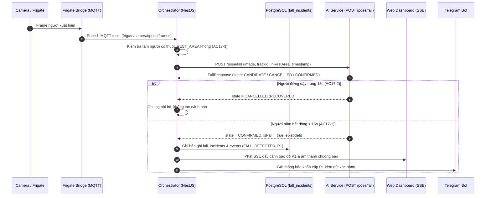

# Kế hoạch chi tiết triển khai US-17 — Xác nhận té ngã bằng ngưỡng thời gian bất động (Module 2a)

> **Mã công việc:** US-17 (Epic 4, FR-DET-M2-03, FR-DET-M2-04, FR-DET-M2-05, Jira AAC-31 / AAC-13)  
> **Ước lượng:** 3 Story Points · Sprint 3  
> **Tài liệu tham chiếu:** [PLAN_US-16_US-17_POSE_FALL_E2E.md](PLAN_US-16_US-17_POSE_FALL_E2E.md), [0013_fall_incidents.sql](../../db/migrations/0013_fall_incidents.sql), [openapi.yaml](../../api/openapi.yaml)  
> **Nhánh thực hiện:** `feat/US-16-US-17-pose-fall`

---

## 1. Trọng tâm: Có cần train model không?

> [!IMPORTANT]
> **KHÔNG CẦN TRAIN MODEL CHO US-17.**

### Lý do:
1. **AI Core đã hoàn thành ở US-16**:
   - Thuật toán MediaPipe trích xuất 33 keypoints, tính góc nghiêng thân người, phát hiện hạ thấp trọng tâm và bộ đếm bất động liên tục 15 giây đã được hoàn thiện trong AI Service (`POST /pose/fall`).
2. **US-17 là nhiệm vụ tích hợp hệ thống (System Integration & Alerting)**:
   - Kết nối camera Frigate $\to$ Frigate Bridge MQTT $\to$ Orchestrator $\to$ gọi API AI Service $\to$ lưu database và bắn cảnh báo khẩn cấp P1 lên Web Dashboard và Telegram.
   - Kiểm tra điều kiện vùng nghỉ (`REST_AREA`) để loại bỏ cảnh báo giả khi người nằm trên giường/sofa.

---

## 2. Tiêu chí nghiệm thu (Acceptance Criteria) của US-17

| ID | Điều kiện (Given / When) | Kết quả mong đợi (Then) |
| :--- | :--- | :--- |
| **AC17-1** | Một candidate FALL đang được theo dõi; tư thế bất thường duy trì liên tục $> 15$ giây VÀ dịch chuyển keypoint dưới ngưỡng chuyển động | Tạo đúng một sự kiện `FALL_DETECTED` với **Priority P1**, lưu vào `fall_incidents` và kích hoạt luồng cảnh báo khẩn cấp (SSE Web Dashboard & Telegram). |
| **AC17-2** | Một candidate FALL đang được theo dõi; người đó đứng dậy trong vòng 15 giây | Hủy candidate (`CANCELLED`, reason `RECOVERED`), **chỉ ghi log nội bộ, KHÔNG tạo cảnh báo**. |
| **AC17-3** | Người nằm trên giường/sofa trong vùng đã đánh dấu là "vùng nghỉ" (`REST_AREA`) khi phát hiện tư thế nằm | Bỏ qua, **KHÔNG tạo cảnh báo té ngã**. |

---

## 3. Kiến trúc luồng dữ liệu E2E của US-17

---

## 4. Danh sách các công việc cụ thể cần thực hiện

### Giai đoạn 1: Consumer Frame & Binary Envelope (`apps/orchestrator/src/fall-detection/`)
1. Tạo module `fall-detection.module.ts`.
2. Tạo `pose-frame.consumer.ts` lắng nghe topic `MQTT_TOPIC_POSE_FRAMES` (`frigate/camerai/pose/frames`).
3. Giải mã Binary Envelope v1:
   - Đọc 4 byte độ dài header $\to$ parse JSON header $\to$ lấy mảng bytes JPEG ảnh gốc.
   - Lọc bỏ frame quá cũ (freshness $> 1.0$ giây).
   - Kiểm tra cờ bật tính năng `M2A_ENABLED`.

### Giai đoạn 2: Bộ đánh giá vùng nghỉ (`RestAreaEvaluator`)
1. Dựa vào `camera_id`, truy vấn danh sách zone đang hoạt động có `zone_type = 'REST_AREA'`.
2. Lấy tâm điểm của `personBoundingBox` $(x + w/2, y + h/2)$ làm điểm neo (anchor).
3. Sử dụng thuật toán Point-in-Polygon (Ray casting) để kiểm tra điểm neo có nằm trong đa giác vùng nghỉ hay không:
   - Nếu `inRestArea = true`: Đánh dấu cờ truyền sang AI Service để loại trừ cảnh báo giả (AC17-3).

### Giai đoạn 3: AI Inference Client (`PoseInferenceAdapter`)
1. Tạo HTTP Client gửi `multipart/form-data` sang endpoint `http://ai-service:8000/pose/fall`:
   - Gửi file ảnh `image`, `trackId`, `cameraSlug`, `frameTimestamp`, `personBoundingBox`, `inRestArea`.
   - Đính kèm header bảo mật `X-Internal-Token`.
   - Timeout tối đa 2000ms.

### Giai đoạn 4: Điều phối & Lưu trữ sự kiện Té ngã (`FallIncidentCoordinator`)
1. **Xử lý kết quả `CONFIRMED` (AC17-1)**:
   - Kiểm tra chống trùng lặp (Dedup) theo khóa duy nhất: `(camera_id, source_session_id, track_id, episode_id)`.
   - Thực thi Database Transaction:
     - Tạo bản ghi mới trong bảng `events` với `event_type = 'FALL_DETECTED'`, `priority = 'P1'`.
     - Tạo bản ghi trong bảng `fall_incidents`.
   - Đẩy kết quả vào `AiResultsService.submit(...)` để tự động tích hợp luồng Escalation có sẵn (phát SSE lên Web và gửi tin nhắn Telegram P1).
2. **Xử lý kết quả `CANCELLED` (AC17-2)**:
   - Người đứng dậy trong 15 giây: AI Service trả về `state = 'CANCELLED', reason = 'RECOVERED'`.
   - Chỉ ghi log mức `DEBUG` trong Orchestrator, **tuyệt đối không tạo sự kiện và không phát cảnh báo**.

### Giai đoạn 5: Cấu hình môi trường & Kích hoạt hệ thống
1. Bổ sung các biến cấu hình trong `.env` và `docker-compose.yml`:
   - `M2A_ENABLED=true`
   - `FRIGATE_POSE_FRAMES_ENABLED=true`
   - `MQTT_TOPIC_POSE_FRAMES=frigate/camerai/pose/frames`
   - `FALL_IMMOBILITY_SECONDS=15` (hoặc có thể đặt 5s để test nhanh trên máy dev).
2. Đăng ký `FallDetectionModule` vào `app.module.ts`.

### Giai đoạn 6: Kiểm thử tự động & Nghiệm thu trực quan trước Camera
1. **Unit Tests (Coverage $\ge 60\%$)**:
   - Test giải mã binary envelope (frame header + JPEG).
   - Test thuật toán Point-in-Polygon cho `REST_AREA`.
   - Test xử lý state transitions: `CANDIDATE` $\to$ `CANCELLED` (không báo) và `CANDIDATE` $\to$ `CONFIRMED` (báo P1).
2. **Kịch bản nghiệm thu thực tế trước Camera**:
   - **Kịch bản 1 (Đứng/Ngồi/Cúi nhặt đồ bình thường)**: Thực hiện trước camera $\to$ Hệ thống giữ nguyên trạng thái bình thường, không báo động.
   - **Kịch bản 2 (Ngã giả vờ rồi đứng dậy ngay trong 15s)**: Ngã xuống sàn rồi đứng dậy sau 3 giây $\to$ Hệ thống hủy theo dõi, không tạo sự kiện P1.
   - **Kịch bản 3 (Ngã thật và nằm bất động $> 15$s)**: Nằm yên trên sàn $\to$ Sau 15 giây, Web Dashboard lập tức phát chuông và hiển thị thẻ đỏ: **"Cảnh báo té ngã - Mức độ ưu tiên P1"**!

---

## 5. Bảng checklist theo dõi tiến độ chi tiết

- [ ] **Task 17.1**: Cấu hình & Dây chuyền `FallDetectionModule` vào `AppModule`.
- [ ] **Task 17.2**: Xây dựng `PoseFrameConsumer` giải mã Binary Envelope v1 qua MQTT.
- [ ] **Task 17.3**: Xây dựng `RestAreaEvaluator` kiểm tra Ray-Casting Polygon vùng nghỉ `REST_AREA` (AC17-3).
- [ ] **Task 17.4**: Xây dựng `PoseInferenceAdapter` gọi API `POST /pose/fall` của AI Service.
- [ ] **Task 17.5**: Xây dựng `FallIncidentCoordinator` xử lý hủy (`CANCELLED` - AC17-2) hoặc xác nhận (`CONFIRMED` - AC17-1), ghi database `fall_incidents` và kích hoạt `AiResultsService.submit`.
- [ ] **Task 17.6**: Viết bộ Unit & Integration Tests đạt test coverage $\ge 60\%$.
- [ ] **Task 17.7**: Kích hoạt hệ thống E2E và nghiệm thu thực tế 3 kịch bản trước Camera.

