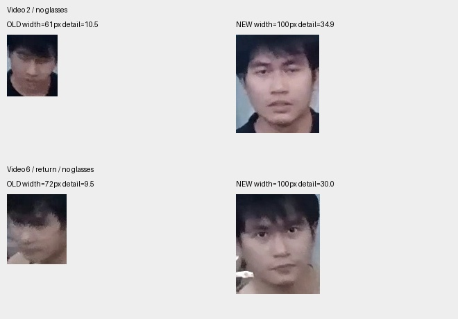

# BEST-SHOT — điều chỉnh và kiểm thử ngày 23/11/2026

Đã sửa cơ chế chốt mẫu sớm và có bằng chứng chọn ảnh rõ hơn trên Dataset_2. **Chưa đủ bằng chứng nghiệm thu các testcase nhận diện còn thiếu trong báo cáo 22/11.** Lượt này tập trung vào chọn crop; đầu nhận recognition job là bộ ghi cục bộ, không gọi AWS và không trả giả kết quả KNOWN.



Ảnh so sánh được cắt từ evidence thật, không sharpen, upscale hoặc tạo lại chi tiết. Hàng Video 2 đối chiếu crop cũ của lượt TC10 sau xóa với replay mới của cùng video; đây không phải hai ảnh cùng timestamp.

## 1. Thay đổi đã thực hiện

| Thành phần           | Trước                                           | Sau                                                                                                        |
| -------------------- | ----------------------------------------------- | ---------------------------------------------------------------------------------------------------------- |
| Cửa sổ chọn ảnh      | 1200 ms                                         | **4000 ms từ mẫu hợp lệ đầu tiên**                                                                         |
| Early dispatch       | Mẫu đầu tiên có score ≥0.82                     | **Tắt mặc định**, kể cả khi mẫu đầu đạt 0.99                                                               |
| Giới hạn mẫu         | Đủ 4 mẫu có thể gửi ngay                        | 32 mẫu; giới hạn công việc, **không rút ngắn cửa sổ**                                                      |
| Khoảng lấy mẫu       | 350 ms, phụ thuộc event update                  | **150 ms tối thiểu**, lấy mẫu tiếp từ luồng frame có timestamp; phù hợp jitter của nguồn 5 FPS             |
| Ảnh/box              | Có fallback latest.jpg cho một người            | **Yêu cầu paired JPEG/box cho cả một người**; bỏ timestamp đã đánh giá                                     |
| Face gate            | Mặt ≥60 px; Laplacian thô ≥45                   | Mặt **≥80 px**, giữ kiểm tra thô và thêm normalized sharpness **≥12**                                      |
| Điểm chất lượng      | Sharpness bão hòa ở 135, kích thước đích 120 px | ROI mặt chuẩn hóa 112×112, Gaussian 3×3 sigma 0.8; điểm detail tăng mượt; kích thước đích tối thiểu 160 px |
| Crop trung gian      | Encode lại JPEG quality 95                      | **PNG**, giữ nguyên pixel đã decode; HTTP/S3 khai báo đúng MIME                                            |
| Bridge JPEG          | OpenCV mặc định 95                              | 98; vẫn giữ giới hạn envelope 1 MiB                                                                        |
| Khi gate lỗi         | Fail-open mặc định                              | **Fail-closed mặc định**                                                                                   |
| UNKNOWN/UNDETERMINED | Có thể gửi ngay mẫu retry vừa đủ cải thiện      | Mở cửa sổ BEST-SHOT riêng cho retry; giữ giới hạn số retry và cooldown                                     |

Coordinator giữ duy nhất ảnh có qualityScore cao nhất trong cửa sổ. Mẫu fail-open vẫn được phân biệt với mẫu thực sự qua gate. Timer chờ assessment đang chạy; khi track kết thúc cũng không bỏ qua assessment đang chạy để gửi ảnh cũ sớm hơn.

Đây là **ảnh tốt nhất theo hàm chấm điểm trong cửa sổ đã quan sát**, không phải bảo đảm ảnh tốt nhất của toàn bộ tương lai của track. Track kết thúc sớm có thể chỉ cung cấp một mẫu hợp lệ. Nguồn bị mờ hoặc decoder làm hỏng ảnh vẫn là giới hạn thực tế.

Không thay model SFace, không giảm ngưỡng embedding cache 0.72, không thay collection QA. Trọng số mới: `(0.15*det + 0.40*detail/(detail+30) + 0.45*pose) * sqrt(size/target)`. Detector confidence không còn tự bù dễ dàng cho mặt nhỏ và thiếu chi tiết. Ngưỡng detail 12 hiện được kiểm tra trên bộ dữ liệu này, chưa phải một chuẩn đã hiệu chỉnh cho mọi camera.

S3 vẫn dùng đuôi key `.jpg` theo contract/kiểm tra scope hiện có của Lambda; **Content-Type phản ánh đúng byte PNG/JPEG**. Không đổi contract key của worker.

## 2. Đối chiếu lại evidence cũ

[Số đo và SHA-256 của 12 crop cũ](calibration-old-crops.json), dùng cùng model YuNet/SFace đang có trong repository:

| Crop                       | Điểm cũ | Mặt   | Laplacian thô | Detail chuẩn hóa | Gate mới                                |
| -------------------------- | ------- | ----- | ------------- | ---------------- | --------------------------------------- |
| TC06 return `r9e2f5`       | 0.8328  | 72 px | 167.7         | 9.53             | FACE_TOO_SMALL; detail cũng dưới ngưỡng |
| TC10 after-delete `vfd5rr` | 0.8583  | 61 px | 204.7         | 10.48            | FACE_TOO_SMALL; detail cũng dưới ngưỡng |

Kết quả ủng hộ nghi ngờ về early dispatch và thang điểm cũ. Laplacian thô cao không đồng nghĩa có đủ chi tiết khuôn mặt. Phép đo mới cũng không phải detector phổ quát cho ảnh bị lỗi codec: một crop hỏng có thể có cạnh rất mạnh.

## 3. Benchmark video gốc

Đã đọc 9 video gốc, lấy xấp xỉ 5 FPS và đánh giá **537 mẫu mặt**: hai Video 2, hai Video 6, hai video stress `known_face_*_stranger`, Video 9, quay lưng và cúi đầu. Hai video cuối không tìm được face run để dispatch.

[JSON kết quả](benchmark.json) · [toàn bộ ảnh so sánh](comparison.jpg). Các file `*-samples.json` giữ timestamp, frame index, score và lý do từ chối.

| Face run đầu/return đáng chú ý | Chính sách cũ                  | Chính sách mới                |
| ------------------------------ | ------------------------------ | ----------------------------- |
| Video 2 không kính             | t=1.8 s, mặt 64 px, detail 8.1 | t=4.6 s, 93 px, detail 26.3   |
| Video 2 có kính                | t=2.4 s, 65 px, detail 15.5    | t=5.6 s, 98 px, detail 57.2   |
| Video 6 không kính, đầu video  | t=0.0 s, 110 px, detail 25.1   | t=1.6 s, 110 px, detail 40.0  |
| Video 6 không kính, return     | t=31.2 s, 76 px, detail 10.1   | t=32.0 s, 113 px, detail 16.1 |

Phương pháp này dùng detector tìm mặt ở frame gốc, crop tại mật độ pixel gốc, rồi đánh giá bằng code quality gate thật. Ghép face run theo vị trí/thời gian chỉ phục vụ so sánh ảnh. **Không dùng face run để kết luận về Frigate person tracking, tailgating hoặc identity.** So sánh chính sách cũ/mới ở đây dùng cùng video gốc, không tái tạo chính xác nhiễu RTSP của đợt 22/11.

## 4. Kiểm thử qua Frigate/bridge/coordinator/AI thật

Camera QA riêng `face_best_shot_20261123`, detect 1920×1080/5 FPS, replay 30 FPS. Coordinator, state, media adapter và AI service là code thật. Chỉ thay đầu nhận job AWS bằng bộ ghi crop vào đĩa; session/spatial cache tắt để quan sát tất cả dispatch.

### Video 2 sau warm-up, CRF 12

[Kết quả](live-crf12/results.json) · [trace](live-crf12/pipeline.jsonl).

| Video      | Số mẫu hợp lệ đã so sánh | Chờ từ mẫu đầu hợp lệ | Ảnh được chọn        |
| ---------- | ------------------------ | --------------------- | -------------------- |
| Không kính | 3                        | 4171 ms               | 100 px, detail 34.88 |
| Có kính    | 7                        | 4253 ms               | 98 px, detail 72.38  |

Hai crop đã được xem trực tiếp và không có lỗi block codec rõ như lượt lossless. Đây là bằng chứng sửa chọn ảnh, **chưa phải bằng chứng AWS trả KNOWN hoặc giữ khóa KNOWN đủ 10 giây**. Lượt CRF 12 bị gián đoạn ở Video 6 có kính; file kết quả chỉ hoàn tất ba video đầu. Không coi các video còn lại là đã chạy xong.

### Video 6, encode trước rồi stream-copy có pacing

[Kết quả](live-paced/results.json) · [trace](live-paced/pipeline.jsonl).

| Video/track                        | Số mẫu hợp lệ | Mặt được chọn | Detail |
| ---------------------------------- | ------------- | ------------- | ------ |
| Không kính, lần đầu                | 8             | 108 px        | 52.98  |
| Không kính, quay lại               | 3             | 100 px        | 29.98  |
| Có kính, track đầu                 | 2             | 103 px        | 73.45  |
| Có kính, track phân mảnh tiếp theo | 1             | 104 px        | 39.71  |
| Có kính, quay lại sau đổi áo       | 7             | 124 px        | 31.17  |

Đã xem trực tiếp cả năm crop. Bản có kính còn phân mảnh thành ba track; không tính thành hai track ổn định.

Cosine SFace không kính tăng **0.2098 → 0.6655** khi đối chiếu crop cũ với crop mới, vẫn dưới **0.72**. [Đo độc lập bằng cùng model](embedding-comparison.json). Bản có kính: cosine giữa track đầu và track quay lại là **0.4053**; giữa hai track phân mảnh đầu là 0.6742. Vì vậy **case 6 chưa đạt mục tiêu embedding cache**, và tăng chất lượng crop chưa thay thế được việc đánh giá độ bền embedding theo góc mặt.

Không có cache hit thật được đo trong lượt này vì cache chủ động tắt. Không suy số AWS call được tiết kiệm từ cosine; số AWS recognition call của harness là 0 do không nối AWS.

### Các lượt chẩn đoán không dùng để nghiệm thu

Thư mục `live/` giữ lượt thử realtime CRF 0: Video 2 đầu không có mẫu, bản kính gặp timeout/503 trước khi gate sẵn sàng; các video sau có dispatch nhưng có crop **hỏng block codec**. Hai video stress lần lượt tạo 3 và 3 job cục bộ, không có kết quả identity. Không dùng những crop/đếm job này để chứng minh stress test đã đạt.

MediaMTX báo reader chậm và bỏ frame ở cả lượt lossless lẫn một số thời điểm sau đó: [log cảnh báo](rtsp-reader-warnings.txt). Runner live cuối encode trước bằng `veryfast`, rồi phát `-re -c:v copy` để giảm tranh chấp encode và pacing; vẫn không tuyên bố hạ tầng replay đã hết mọi rớt frame.

`zerolatency` tự nó chưa được chứng minh là nguyên nhân chính làm mờ trong bộ test này. Độ nén và rớt dữ liệu phải được đo riêng. [Tài liệu FFmpeg về encoder](https://ffmpeg.org/ffmpeg-codecs.html) mô tả các tùy chọn CRF/preset; CRF 0 không bảo đảm đường truyền/decoder nhận nguyên vẹn mọi frame.

## 5. Regression và kiểm tra mã

| Kiểm tra                                                   | Kết quả                                                                            |
| ---------------------------------------------------------- | ---------------------------------------------------------------------------------- |
| Coordinator/state/cache/gate/worker/MQTT/media/cloud queue | [73/73, 8 suite](backend-tests.txt)                                                |
| Regression cuối coordinator + mặc định config              | [18/18, 2 suite](backend-final-tests.txt); có phần trùng nhóm trên                 |
| Python quality gate                                        | [16/16](ai-tests.txt)                                                              |
| Bridge                                                     | [19/19](bridge-tests.txt)                                                          |
| TypeScript, build backend                                  | Exit 0; [typecheck](typecheck.txt)                                                 |
| Lint các file triển khai                                   | [0 lỗi, 29 cảnh báo](lint.txt); [lượt cuối coordinator/test](lint-final.txt) 0 lỗi |

Regression mới kiểm tra: mẫu đầu 0.99 không gửi sớm khi early dispatch tắt; đủ sample budget vẫn đợi hết cửa sổ; lấy mẫu từ frame mới khi không có event update; chặn latest fallback một người; bỏ timestamp trùng; PNG và MIME storage; nhiễu pixel có Laplacian cao nhưng detail thấp; UNKNOWN mở cửa sổ recheck; giữ assessment đang chạy khi track kết thúc.

Các lượt live bắt đầu trước bản sửa cuối cho race `end`/assessment; sửa này được kiểm bằng regression cuối. Không gọi toàn bộ các lượt live là E2E trên một build cuối duy nhất. [Hash source cuối](source-hashes.json).

## 6. Tái lập

Tại root repository, dùng Python của AI service:

```powershell
services/ai-service/.venv/Scripts/python.exe tools/scripts/face-best-shot-benchmark.py --output artifacts/best-shot-next-benchmark
node tools/scripts/face-eval-run.mjs node tools/scripts/face-best-shot-live.mjs prepare
```

`prepare` backup config Frigate trong `artifacts/face-best-shot-live`. Chỉ chạy khi Frigate không phục vụ camera khác. Live harness cần các dịch vụ dev MQTT/MediaMTX/AI và backend đã build. Khi backend dev không chạy, thiết lập endpoint authorize QA tạm thời:

```powershell
$env:MEDIAMTX_AUTH_HTTP_ADDRESS='http://host.docker.internal:18082/api/v1/mediamtx/authorize'
docker compose up -d --no-deps mediamtx
Remove-Item Env:MEDIAMTX_AUTH_HTTP_ADDRESS
docker compose --profile cv up -d --no-deps frigate ai-service
$env:FACE_BEST_SHOT_LIVE_OUTPUT='artifacts/best-shot-next-live'
node tools/scripts/face-eval-run.mjs node tools/scripts/face-best-shot-live.mjs run known_face_vid6.mp4 known_face_vid6_with_glass.mp4
docker stop camerai-frigate
node tools/scripts/face-eval-run.mjs node tools/scripts/face-best-shot-live.mjs restore
docker compose up -d --no-deps mediamtx
```

Endpoint tạm chỉ nhận đúng slug QA, action read/publish và credentials nội bộ hiện có; không tắt xác thực toàn bộ MediaMTX. `restore` từ chối ghi đè nếu config đã bị bên khác thay đổi. Nếu lệnh run lỗi, vẫn thực hiện ba lệnh cleanup cuối.

Runner nghiệm thu cũ cũng đã hỗ trợ `FACE_EVAL_OUTPUT_DIR`, `FACE_EVAL_REPLAY_FPS` (mặc định 30) và `FACE_EVAL_REPLAY_CRF` (mặc định 12). Cần đặt output mới khi chạy lại để giữ nguyên bằng chứng cũ. Runner này vẫn vừa encode vừa phát; dùng runner paced cho chẩn đoán chất lượng khi máy quá tải.

Các biến mới trong `.env.example` và defaults source là cấu hình đề xuất. Nếu `.env` triển khai đang ghim giá trị cũ, phải cập nhật trước khi chạy backend lại. Không sửa `.env` chứa secret trong lượt làm việc này.

## 7. Trạng thái bàn giao

Code đã chỉnh trong working tree, chưa commit/push. Backend build thành công; không triển khai Lambda, không enroll/delete hoặc thay collection AWS. AI service dev đã được khởi động lại với quality gate mới.

Đã dừng Frigate QA, khôi phục byte config Frigate trùng backup và trả MediaMTX về endpoint authorize gốc; endpoint QA của runner đã đóng. [Cleanup](cleanup.json). Không thay [báo cáo 22/11](../FACE_TRACK_ONCE_2026-11-22/REPORT.md).

Việc cần nghiệm thu tiếp: AWS KNOWN/khóa KNOWN trên Video 2; embedding cache và phân mảnh track ở Video 6; đúng identity/người lạ trong stress hai người; kích hoạt recheck/retry E2E thật. **Không kết luận các case này đã pass chỉ vì crop rõ hơn.**
