# Báo cáo kiểm thử đăng ký và nhận diện khuôn mặt — AWS Rekognition dev

Ngày kiểm thử: **22/11/2026**, múi giờ **Asia/Bangkok (UTC+7)**. Logs AWS dùng UTC. Nhánh: `feat/us-23-us-24-s3-face-enrollment`. Thông tin commit và môi trường: [environment.json](data/environment.json).

## 1. Kết luận theo yêu cầu

| Câu hỏi                                                           | Kết quả thực nghiệm                                                                                                                                                                                                                        |
| ----------------------------------------------------------------- | ------------------------------------------------------------------------------------------------------------------------------------------------------------------------------------------------------------------------------------------ |
| Ít nhất bao nhiêu góc để nhận ra bạn trong cả 3 video dương tính? | **1 ảnh chính diện** đã có ít nhất một lần nhận diện đúng trong từng video, ở ngưỡng similarity **90%**. Đây là tiêu chí ở mức video, không phải nhận đúng mọi khung hình.                                                                 |
| Bộ ảnh nào có hiệu quả tốt nhất trong bộ dữ liệu này?             | **3 ảnh: `know_face.png` + `known_face_left.jpg` + `known_face_right.jpg`**. Nhận đúng **63/86 cơ hội có mặt mục tiêu (73,26%)**. Các bộ 4 và 5 ảnh tốt nhất cũng đạt 63/86.                                                               |
| Có false positive không?                                          | **Không có trường hợp người lạ bị nhận nhầm là bạn trong 323 crop người lạ được kiểm tra.** Có một lỗi detector riêng: nhầm bàn tay thành khuôn mặt.                                                                                       |
| Có false negative không?                                          | Có. Bộ 3 góc tốt nhất/bộ đủ 5 ảnh bỏ sót **23/86** cơ hội: **19 UNKNOWN**, **4 UNDETERMINED**. Vì vậy ngay cả 5 góc cũng **chưa đủ để nhận đúng mọi lần xuất hiện**.                                                                       |
| Lật ngang ảnh đăng ký còn nhận ra không?                          | Có, vẫn nhận ra trong cả 3 video. Bộ 5 ảnh lật ngang đạt **62/86 (72,09%)**, so với **63/86 (73,26%)** của 5 ảnh gốc.                                                                                                                      |
| Lỗi code đã sửa?                                                  | Xử lý lựa chọn khuôn mặt khi ảnh có nhiều mặt; chuyển WebP sang JPEG; tách ExternalImageId theo từng thao tác để đăng ký lại không giành mapping của bản ghi trước; bổ sung log Lambda có ID, trạng thái, cache/retry và loại lỗi an toàn. |

**Đề xuất cho đúng bộ dữ liệu hiện có:** dùng 3 góc nêu trên, bắt buộc giữ chính diện. Nếu mục tiêu là nhận diện ổn định ở mọi tư thế/điều kiện, chưa thể nghiệm thu đạt: vẫn có các trường hợp tối, ngược sáng, mặt nhỏ, nghiêng gần sau gáy và đeo kính bị bỏ sót. Cần bổ sung ảnh mới phù hợp điều kiện camera, đặc biệt ảnh có kính; không nên hạ ngưỡng chỉ để làm đẹp số liệu.

Các tỷ lệ trên là kết quả lấy mẫu có định nghĩa tại mục 3. Chúng không phải cam kết độ chính xác cho người khác, camera khác hoặc toàn bộ mọi frame trong video.

## 2. Môi trường AWS và đường callback

- Provider đăng ký/nhận diện: **AWS Rekognition thật**, model **7.0**; không fallback sang AI local.
- Region: `ap-southeast-1`; Face Lambda: `camerai-s4-dev-face`.
- Transport thực tế: **S3 → SQS face jobs → Face Lambda → HTTPS backend cache → SQS Results → database**.
- Bucket dev: `camerai-s4-dev-media-093206112026`; ngưỡng nghiệp vụ `REKOGNITION_MATCH_THRESHOLD=0.90`.
- Caddy nghe tại `127.0.0.1:18080`, chỉ proxy `/api/v1/internal/cloud/face-jobs/*` về backend cổng 3001. Các đường khác trả **404**; face-jobs thiếu internal token trả **401**.
- Cloudflare quick tunnel đã được tạo và `INTERNAL_API_BASE_URL` đã cập nhật trên đúng Lambda dev. Sau khi máy khởi động lại làm tunnel đầu hết hiệu lực, đã tạo lại tunnel theo xác nhận của người dùng và chạy lại cả bộ job với ID mới.
- URL được xác minh cuối: `https://park-allowing-desired-submissions.trycloudflare.com/api/v1`. Quick tunnel cần tiến trình local còn chạy; URL không phải địa chỉ triển khai lâu dài.

Bằng chứng: [cấu hình Caddy](data/caddy-config.txt), [log Cloudflare](logs/cloudflared.txt), [lần cập nhật Lambda](data/lambda-update.json), [cấu hình Lambda cuối](logs/lambda-final-config.txt), [kiểm tra routing](logs/callback-routing-check.txt), [bản cập nhật code Lambda](data/lambda-code-update.json).

Giao diện được chụp ở `http://localhost:3002`, gọi backend fixture cổng 3003, dùng **JWT local với tài khoản test riêng**, cùng code ứng dụng và cùng database/AWS dev. Cấu hình đăng nhập dev chính trong `.env` vẫn là Cognito. Phần đăng nhập Cognito không nằm trong bằng chứng nghiệm thu UI của đợt này. Không thay đổi Staging/Production, tài khoản thật hay quyền IAM.

## 3. Dữ liệu, nhãn và cách đo

### 3.1 Dữ liệu đầu vào

| Video                                         |    Thời lượng | Số frame nguồn |           Lấy mẫu | Số khung hình đo |
| --------------------------------------------- | ------------: | -------------: | ----------------: | ---------------: |
| `has_known_face_no_glasses.mp4`               |     108,329 s |          3.249 |   Mỗi 2 s, từ t=0 |               55 |
| `has_known_face_with_glasses.mp4`             |      72,363 s |          2.171 |   Mỗi 2 s, từ t=0 |               37 |
| `has_known_face_with_many_stranger_faces.mp4` |       9,263 s |            277 | Mỗi 0,5 s, từ t=0 |               19 |
| `no_known_face.mp4`                           |       7,499 s |            225 | Mỗi 0,5 s, từ t=0 |               15 |
| **Tổng**                                      | **197,453 s** |      **5.922** |                   |          **126** |

Ảnh đăng ký:

| Mã góc | File                        | Ghi chú                                                       |
| ------ | --------------------------- | ------------------------------------------------------------- |
| 0      | `know_face.png`             | Chính diện, luôn có trong mọi tổ hợp                          |
| 1      | `known_face_half_left.jpg`  | Có thêm khuôn mặt trong ảnh treo phía sau; cần chọn mặt chính |
| 2      | `known_face_half_right.jpg` | Nửa nghiêng còn lại                                           |
| 3      | `known_face_left.jpg`       | Nghiêng theo tên file                                         |
| 4      | `known_face_right.jpg`      | Nghiêng theo tên file                                         |

Video có tên `no_glasses` thực tế có các đoạn đeo kính, ví dụ t=22–26 s, 84–108 s. Không diễn giải số liệu của toàn bộ file này thành số liệu riêng cho trạng thái không kính.

SHA-256, dung lượng, FPS và thời lượng: [manifest.json](data/manifest.json). Danh sách timestamp thực tế: [frames.json](data/frames.json).

### 3.2 Nhãn và đơn vị thống kê

Đã kiểm tra contact sheet ảnh nguồn và crop. Trong cảnh lớp học đông người, mặt mục tiêu là người áo xám nhạt gần giữa hình, vị trí tâm mặt khoảng x=600, y=450 ở khung hình đầu. Nhãn được gán bằng vị trí/quan sát ảnh, **không lấy điểm Rekognition để quyết định ai là bạn**. Script lưu quy tắc vị trí cố định của cảnh này để có thể kiểm toán.

Từ 126 frame có **410 đề xuất khuôn mặt**:

- **86** crop mặt mục tiêu: 44 ở video thứ nhất, 23 ở video có kính, 19 ở video đông người.
- **323** crop người lạ: 238 ở cảnh đông người và 85 ở video âm tính.
- **1** crop bàn tay bị detector nhầm là mặt, được gán riêng là đối tượng không phải mặt.

Có 11/55 frame video thứ nhất và 14/37 frame video có kính không có đề xuất mặt; nhiều frame là quay lưng, khuất mặt hoặc quá khó nhìn. Các frame này **không tự động bị tính là false negative nhận dạng** vì chưa có nhãn đầy đủ về mặt nhìn thấy được ở cấp pixel. Báo cáo không đưa ra recall riêng của detector.

### 3.3 Phương pháp đối chiếu góc mặt

1. DetectFaces trên frame; cắt từng mặt, có lề 25%, chặn theo biên ảnh.
2. DetectFaces lại trên crop, như chính sách Lambda. Crop không chứa đúng một mặt trả UNDETERMINED.
3. Đăng ký các tham chiếu hợp lệ bằng code enrollment của ứng dụng. Với góc 1, chọn mặt lớn của người dùng và kiểm tra lại crop, loại mặt trong ảnh treo.
4. SearchFacesByImage, `FaceMatchThreshold=0`, `QualityFilter=NONE`, lấy điểm từng vector. Áp ngưỡng nghiệp vụ **90%** sau đó.
5. Xét đủ **16 tổ hợp có chính diện**, cho ảnh gốc và ảnh lật ngang: tổng **32 cấu hình**. Điểm của một cấu hình là điểm cao nhất trong các ảnh thuộc cấu hình đó. Không cộng/trung bình similarity giữa các ảnh.
6. Tạo thêm **hai collection độc lập** chứa riêng `[0]` và `[0,3,4]`, tìm kiếm thật lại trên toàn bộ crop: **820 lượt đối chiếu cấu hình/crop, 0 khác biệt về quyết định KNOWN** so với bảng suy ra. Một số crop không đủ điều kiện tìm kiếm được ghi UNDETERMINED, không gọi SearchFacesByImage.

Bằng chứng: [điểm đã gán nhãn](data/labeled-scores.json), [toàn bộ 32 cấu hình](data/subset-results.csv), [kết quả theo video](data/subset-results.json), [đối chiếu collection độc lập](data/subset-live-summary.json), [chi tiết đối chiếu](data/subset-live-verification.jsonl). AWS request ID gốc được giữ trong [aws-requests.jsonl](logs/aws-requests.jsonl), detections và dữ liệu đối chiếu.

`detections-raw.jsonl` và `enrollment-raw.json` là lượt thăm dò ban đầu trước xử lý mặt trong ảnh treo. **Không dùng lượt này làm số liệu kết luận.** Số liệu chính dùng `detections.jsonl` và `enrollment.json` sau xử lý selection.

## 4. Cần bao nhiêu góc mặt?

### 4.1 Bộ tốt nhất theo số ảnh — ảnh gốc

| Số ảnh | Tổ hợp tốt nhất, luôn gồm 0 | KNOWN đúng / 86 | Bỏ sót, gồm cả UNDETERMINED | Recall vận hành |
| -----: | --------------------------- | --------------: | --------------------------: | --------------: |
|      1 | `[0]`                       |              56 |                          30 |          65,12% |
|      2 | `[0,3]`                     |              61 |                          25 |          70,93% |
|      3 | `[0,3,4]`                   |              63 |                          23 |          73,26% |
|      4 | `[0,1,3,4]`                 |              63 |                          23 |          73,26% |
|      5 | `[0,1,2,3,4]`               |              63 |                          23 |          73,26% |

Các cấu hình có cùng số ảnh có thể khác hiệu quả; bảng trên chọn cấu hình tốt nhất ở mỗi mức. Toàn bộ cấu hình nằm trong CSV để tránh hiểu rằng mọi bộ 3 ảnh đều tương đương nhau.

### 4.2 Theo từng video — 1 chính diện và đủ 5 ảnh

| Video                           | Có mặt mục tiêu trong crop | Đúng với 1 chính diện | Đúng với 5 ảnh gốc | Nhận ra ít nhất một lần?          |
| ------------------------------- | -------------------------: | --------------------: | -----------------: | --------------------------------- |
| Không kính, có cả đoạn đeo kính |                         44 |                    30 |                 32 | Có                                |
| Có kính                         |                         23 |                    11 |                 13 | Có                                |
| Có bạn và nhiều người lạ        |                         19 |                    15 |                 18 | Có                                |
| Không có bạn                    |     0; có 85 crop người lạ |           0 nhận nhầm |        0 nhận nhầm | Không nhận là bạn, đúng đối chứng |

**Tiêu chí “xuất hiện trong video thì có ít nhất một lần KNOWN”: 1 ảnh chính diện đủ trên mẫu này.**

**Tiêu chí “dùng ít ảnh nhất nhưng đạt mức tốt nhất quan sát được”: 3 góc `[0,3,4]`.**

**Tiêu chí “nhận đúng mọi lần mặt xuất hiện”: cả 5 ảnh chưa đạt.** Không có cơ sở kết luận một số lượng góc cố định sẽ tự giải quyết ánh sáng, độ phân giải và che khuất.

## 5. False positive, false negative và lỗi AI

### 5.1 Ma trận kết quả với 5 ảnh gốc

| Nhãn thực               |  KNOWN | UNKNOWN | UNDETERMINED | Tổng |
| ----------------------- | -----: | ------: | -----------: | ---: |
| Bạn                     | **63** |  **19** |        **4** |   86 |
| Người lạ                |  **0** | **299** |       **24** |  323 |
| Bàn tay, không phải mặt |  **0** |   **0** |        **1** |    1 |

- False positive nhận dạng người: **0/323** crop người lạ. Không có nghĩa là xác suất false positive ngoài bộ mẫu bằng 0.
- False negative theo tiêu chí vận hành “có bạn nhưng không nhận ra”: **23/86 = 26,74%**, gồm 19 bị phân loại UNKNOWN và 4 hệ thống từ chối kết luận. Đây là cách đo đã chủ động tính cả abstention vào bỏ sót; ma trận tách riêng để không lẫn với false negative thuần của classifier.
- `tn=324` trong file tổng hợp là “không chấp nhận là người quen” trên toàn bộ đề xuất âm, gồm cả bàn tay và abstention. Khi cần ma trận classifier thuần, dùng `tnClassifiedUnknown=299`, `fnClassifiedUnknown=19` và các cột abstention riêng.
- Các frame gần nhau và nhiều crop thuộc cùng người; không coi 323 crop là 323 người độc lập hoặc dùng chúng để suy rộng thống kê cho mọi người lạ.

### 5.2 Ví dụ bỏ sót

| Nguồn                             | Timestamp video | Điểm tốt nhất trong 5 ảnh gốc | Quan sát                                                 |
| --------------------------------- | --------------: | ----------------------------: | -------------------------------------------------------- |
| `has_known_face_no_glasses.mp4`   |            32 s |                         8,90% | Mặt rất nghiêng/nhỏ, bề ngang khoảng 26 px               |
| Cùng video                        |            38 s |                        51,68% | Thiếu sáng, mặt nghiêng; thêm ảnh không bảo đảm cứu được |
| `has_known_face_with_glasses.mp4` |            26 s |                        67,26% | Mặt nhỏ và ngược sáng                                    |
| Cùng video                        |            32 s |                         1,02% | Gần góc nhìn phía sau, chỉ còn ít đặc trưng mặt          |
| Video đông người                  |           8,5 s |                        77,85% | Crop mục tiêu nhỏ, đang có kính/che một phần             |

Đây là các trường hợp model không nhận ra đúng, **không phải lỗi API hay exception**. Không sửa bằng cách đổi nhãn hoặc hạ threshold sau khi nhìn kết quả.

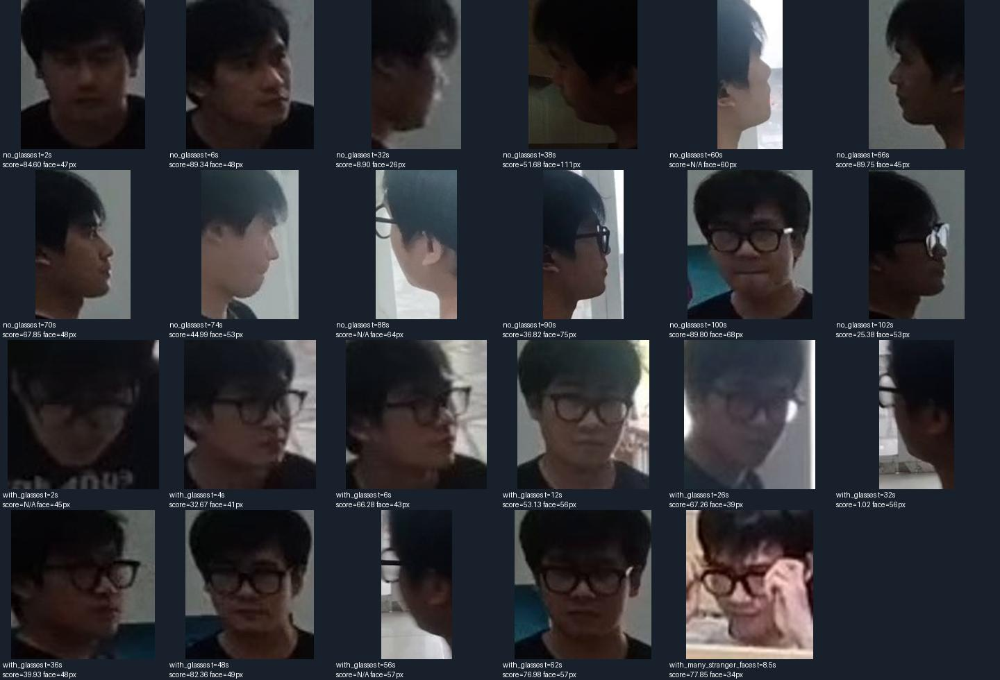

### 5.3 Lỗi detector quan sát được

Ở video thứ nhất **t=76 s**, DetectFaces trên frame trả thêm một bounding box trên **bàn tay**. Đã kiểm tra ảnh crop và gán lại thành non-face độc lập với similarity. Khi gửi riêng crop này qua Lambda thật, kết quả là **UNDETERMINED**, không bị nhận nhầm là bạn.

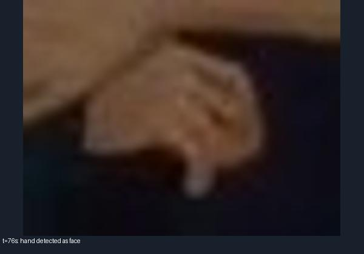

Một trường hợp khác là khuôn mặt **trong ảnh treo tường** ở ảnh đăng ký góc 1. Rekognition có thể phát hiện khuôn mặt in trên ảnh; đó không phải bằng chứng người đang có mặt/liveness. Ứng dụng phải cho chọn đúng người thay vì mặc định chọn mọi mặt.

## 6. Lật ngang và các biến đổi ảnh

“Lật ngang” trong phép thử là **phản chiếu trái–phải**, tương đương `flip(image, 1)`, không phải xoay ảnh lộn ngược trong mặt phẳng. Đã lật các **ảnh đăng ký**, giữ nguyên video kiểm thử và xét lại đủ 16 tổ hợp.

| Số ảnh lật ngang | Tổ hợp tốt nhất | Đúng / 86 | Recall |
| ---------------: | --------------- | --------: | -----: |
|                1 | `[0]`           |        52 | 60,47% |
|                2 | `[0,2]`         |        58 | 67,44% |
|                3 | `[0,2,4]`       |        61 | 70,93% |
|                4 | `[0,2,3,4]`     |        62 | 72,09% |
|                5 | `[0,1,2,3,4]`   |        62 | 72,09% |

Với cả 5 ảnh lật: video thứ nhất 34/44, video có kính 11/23, video đông người 17/19. Có ít nhất một KNOWN ở từng video. Người lạ vẫn không bị nhận nhầm là bạn. Lật ngang không làm mất khả năng nhận diện, nhưng cũng không cải thiện đồng đều; hiệu quả theo từng video thay đổi.

Để kiểm tra cả cách hiểu “xoay 180°”, đã thử thêm biến đổi **ảnh truy vấn** từ crop video thứ nhất t=16 s, so với bộ 5 ảnh gốc:

| Biến đổi ảnh truy vấn         | DetectFaces | Similarity tốt nhất | Kết quả ở ngưỡng 90% |
| ----------------------------- | ----------: | ------------------: | -------------------- |
| Gốc                           |           1 |            ~100,00% | KNOWN                |
| Lật ngang                     |           1 |            ~100,00% | KNOWN                |
| Xoay 180°                     |           1 |            ~100,00% | KNOWN                |
| Xoay 90°                      |           1 |              99,99% | KNOWN                |
| Độ sáng còn 25%               |           1 |              99,99% | KNOWN                |
| Độ sáng x2                    |           1 |            ~100,00% | KNOWN                |
| Gaussian blur radius 5        |           1 |              99,89% | KNOWN                |
| Thu nhỏ trong khung 40×40 px  |           1 |              97,17% | KNOWN                |
| Che nửa dưới mặt bằng màu đen |           1 |              98,03% | KNOWN                |

Đây là **chín ca trên một crop rõ mặt**, không phải chín phép thử trên toàn bộ video. Kết quả tốt ở ảnh nhỏ/ảnh tối được tạo từ crop rõ không phủ định các false negative ở ảnh camera vốn mờ, tối hoặc mất chi tiết. Không dùng kết quả này làm bảo đảm chống giả mạo hoặc nhận diện khuôn mặt bị che trong mọi trường hợp.

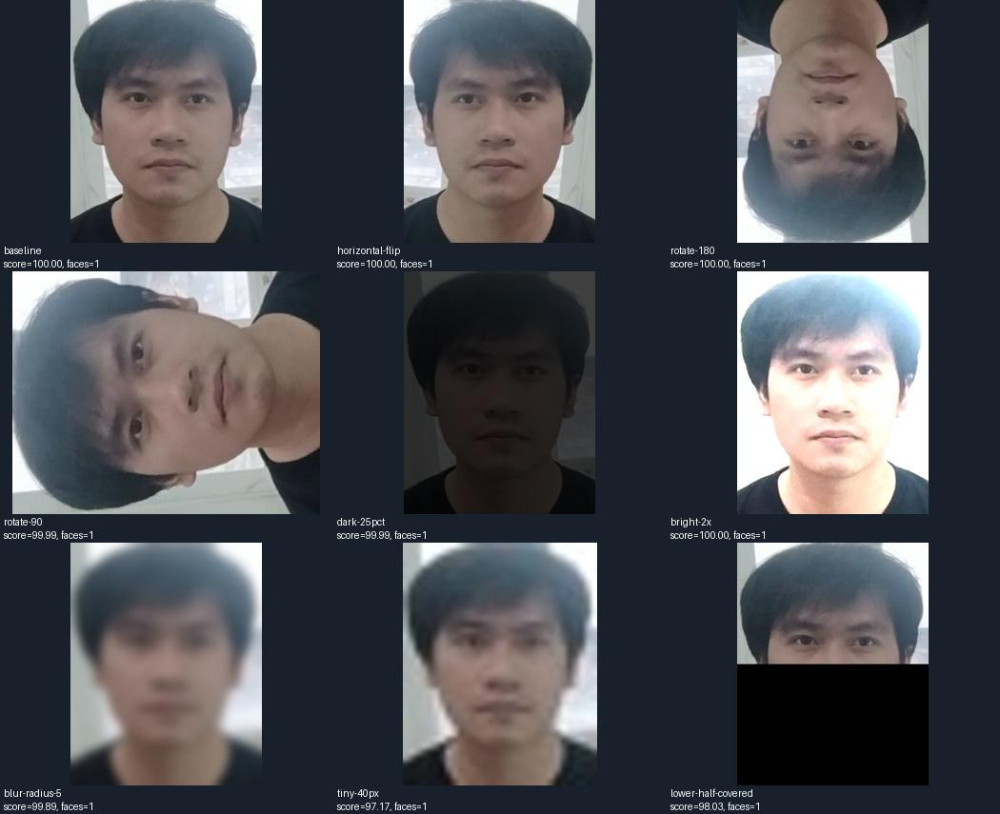

Dữ liệu gốc: [transformation-edges.json](data/transformation-edges.json).

## 7. Luồng đăng ký và những lỗi code đã sửa

### 7.1 Ảnh có thêm mặt ở nền

Luồng trước sửa: tải đủ 5 ảnh → trả `MULTIPLE_FACES` cho `known_face_half_left.jpg` → UI cho chọn mặt → backend Rekognition bỏ qua `faceSelections`, vẫn xét toàn bộ ảnh → tiếp tục lỗi.

Đã sửa backend đọc và kiểm tra `faceSelections`, chuẩn hóa hướng ảnh, cắt đúng mặt được chọn, gọi DetectFaces lại để bảo đảm crop có đúng một mặt rồi mới IndexFaces. Selection vượt phạm vi trả 422. Nếu crop vẫn không tách riêng được một mặt, trả thông báo chọn ảnh khác thay vì trả bounding box của ảnh crop lên ảnh gốc.

Đã kiểm tra service thật và UI thật: chưa chọn trả **422**; chọn mặt 1 (mặt chính) trả **201**, bản ghi có **5 ảnh, REKOGNITION, READY**.

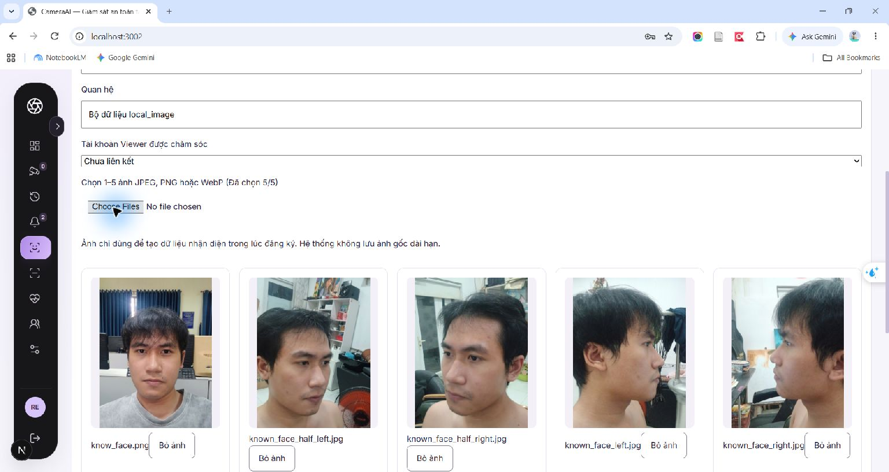

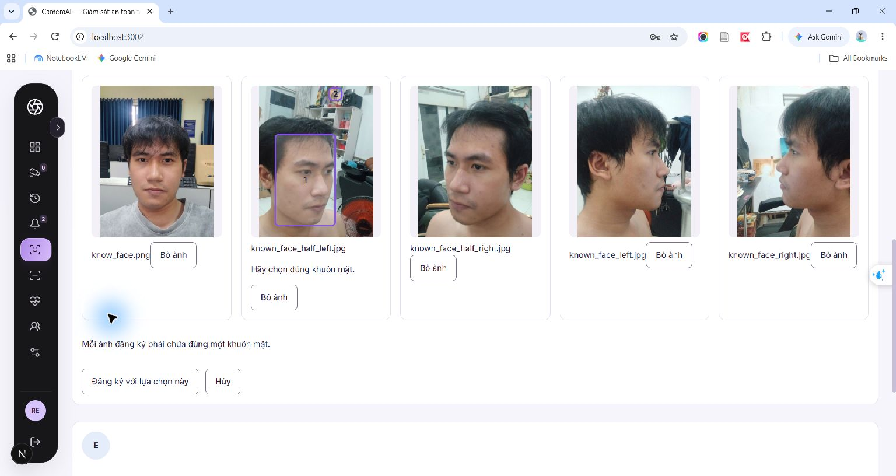

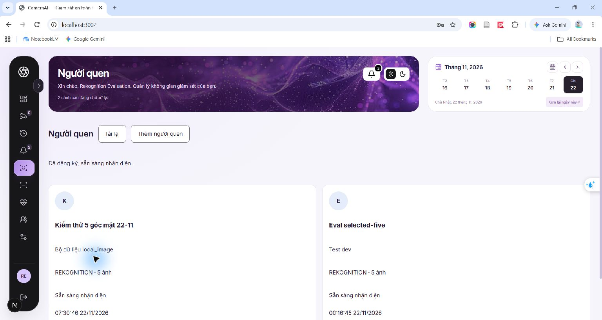

### 7.2 WebP

UI nhận WebP nhưng Rekognition chỉ nhận JPEG/PNG. Đã chuyển WebP sang JPEG trước khi gọi AWS; áp giới hạn pixel khi giải mã. HTTP thật với ảnh WebP trả **201**, provider REKOGNITION. Ảnh hỏng trả INVALID_IMAGE, không báo sai là provider mất kết nối.

### 7.3 Đăng ký lại cùng ảnh

IndexFaces có thể tái sử dụng FaceId khi trùng ảnh, collection và ExternalImageId. Prefix cũ chỉ theo owner có thể làm hai bản ghi dùng chung vector; câu lệnh upsert mapping có thể chuyển mapping sang người mới, và cleanup/replace có nguy cơ xóa vector cũ.

Đã thêm ID riêng cho **mỗi thao tác create và replace photos**. Thử đăng ký lại cùng 5 ảnh với tên test khác trên UI: **cả bản ghi trước và sau đều giữ 5 mapping riêng**, cùng trạng thái sẵn sàng. Bằng chứng: [duplicate-enrollment-mappings.json](data/duplicate-enrollment-mappings.json). Chưa xóa các bản ghi fixture này để giữ bằng chứng có thể kiểm tra lại.

### 7.4 HTTP edge cases

| Ca kiểm thử HTTP thật          | HTTP | Mã/kết quả                      |
| ------------------------------ | ---: | ------------------------------- |
| Ảnh trắng                      |  422 | NO_FACE_DETECTED                |
| File giả ảnh                   |  400 | INVALID_IMAGE                   |
| JPEG bị cắt cụt                |  400 | INVALID_IMAGE                   |
| 6 ảnh                          |  400 | INVALID_IMAGE                   |
| Ảnh vượt 5 MiB                 |  413 | IMAGE_TOO_LARGE                 |
| Tên người quen đã có           |  409 | KNOWN_FACE_NAME_EXISTS          |
| Selection JSON không phải mảng |  422 | FACE_SELECTION_INVALID          |
| WebP hợp lệ                    |  201 | REKOGNITION, đăng ký thành công |

**8/8 ca đạt.** Đăng nhập và HTTP chạy với fixture riêng; không dùng mock. Response và kết quả so với kỳ vọng: [http-enrollment-edges.json](data/http-enrollment-edges.json), [log](logs/http-enrollment-edges.txt).

## 8. Kiểm thử tích hợp S3/SQS/Lambda/database và giao diện

Các sự kiện/job test được tạo trong database dev với owner, camera, envelope và khóa S3 đúng scope; sử dụng dispatcher, SQS trigger, Lambda, cache callback và Results consumer thật. Ảnh là crop thực từ video tại timestamp nêu bên dưới. **Bước tạo sự kiện Frigate/camera ingestion được thay bằng fixture có kiểm soát**, không tuyên bố đây là phép thử phát liên tục 4 video qua RTSP/Frigate. Nhãn `FRIGATE` trên UI là source mặc định của event fixture; timestamp trên UI là thời điểm tạo event dev, không phải giây trong video.

| Ca                                 | Dữ liệu                            | Kết quả Lambda/DB                           |   Similarity |
| ---------------------------------- | ---------------------------------- | ------------------------------------------- | -----------: |
| Không kính                         | Video thứ nhất t=16 s              | KNOWN                                       |      99,995% |
| Có kính                            | Video có kính t=14 s               | KNOWN                                       |      99,302% |
| Trong nhiều người                  | Crop mục tiêu video đông người t=0 | KNOWN                                       |      98,620% |
| Người lạ                           | Video âm tính t=0, mặt 0           | UNKNOWN                                     |       2,950% |
| Crop bàn tay bị nhận nhầm là face  | Video thứ nhất t=76 s              | UNDETERMINED                                |     Không có |
| Ảnh trắng                          | Ảnh tạo để kiểm thử                | UNDETERMINED / NO_FACE_DETECTED             |     Không có |
| Cả frame nhiều người               | Video đông người t=0               | UNDETERMINED / MULTIPLE_FACES               |     Không có |
| File ảnh hỏng, sau đó sửa và retry | Cùng job ID, S3 key đúng scope     | Lần đầu partial failure; retry hợp lệ KNOWN | 100% sau sửa |

**8/8 ca có kết quả cuối đúng kỳ vọng**, mỗi job đúng **1 cloud result receipt**. Với ca lỗi ảnh, Lambda ghi `InvalidImageFormatException`, trả `batchItemFailures`; không chuyển lỗi kỹ thuật thành UNKNOWN. Sau thay ảnh hợp lệ, cùng job nhận diện được. Phát lại cached result giữ nguyên resultId và receipt vẫn bằng 1.

Ca nhiều người cho thấy yêu cầu quan trọng của luồng sản phẩm: cần crop đúng từng người trước khi gọi worker. Gửi nguyên khung nhiều người vào Lambda hiện tại sẽ UNDETERMINED; tăng số ảnh đăng ký không thay đổi chính sách này. Phép đo định lượng tại mục 3 đã tách mặt bằng DetectFaces; vì crop người từ Frigate có thể khác, các tỷ lệ này chưa phải tỷ lệ end-to-end của camera tracking.

Trong UI, “độ tin cậy AI” của UNKNOWN đang là `1 - similarity`, là quy ước score của ứng dụng, **không phải xác suất thống kê đã hiệu chuẩn rằng người đó là người lạ**.

Bằng chứng định danh đầy đủ: [e2e-results.json](data/e2e-results.json), [lambda-invocations.json](data/lambda-invocations.json). Lượt đầu trước khi máy khởi động lại được giữ ở [e2e-results-first-run.json](data/e2e-results-first-run.json) và [CloudWatch lượt đầu](data/cloudwatch-first-run.json).

### Ảnh chụp giao diện nhận diện

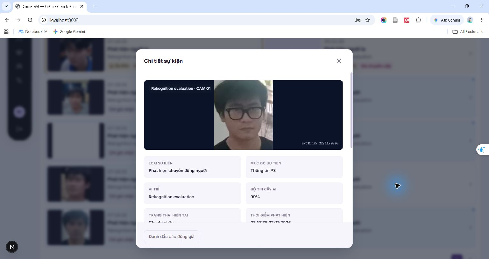

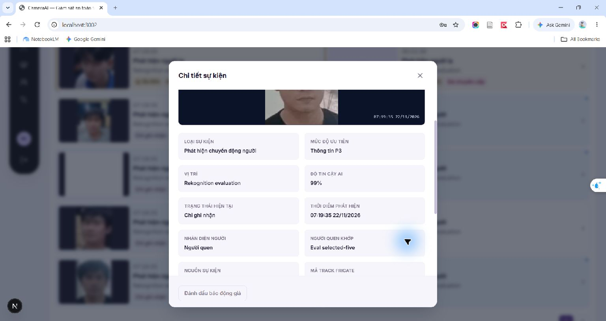

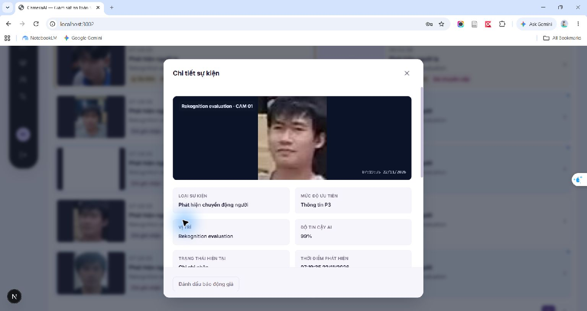

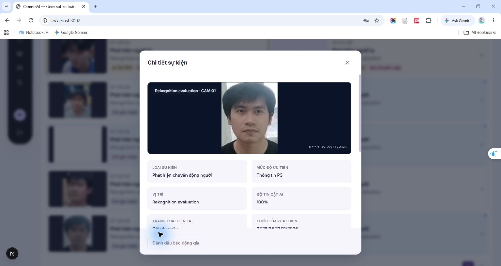

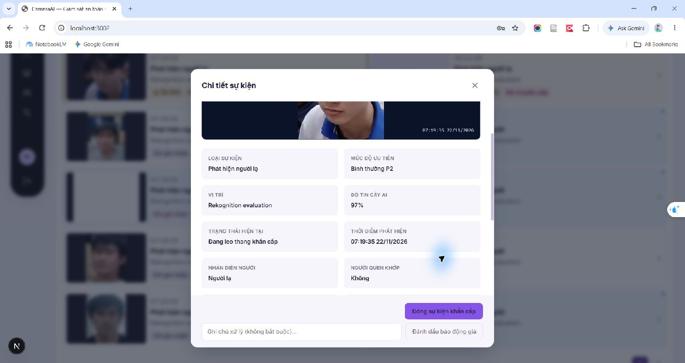

## 9. Logs và ảnh chụp logs

Đã thêm log Lambda thành công gồm jobId, resultId, status, cacheHit và thời gian; log lỗi chỉ ghi messageId và tên loại exception. Không ghi token, bytes ảnh hoặc thông điệp lỗi thô có thể chứa dữ liệu bí mật. Có test bảo đảm nội dung exception giả chứa secret không xuất hiện trong log.

- [CloudWatch nguyên bản dạng text](logs/cloudwatch.txt), [raw AWS response](data/cloudwatch.json).
- [Các dòng KNOWN / UNKNOWN / UNDETERMINED / lỗi / retry / cache tiêu biểu](logs/cloudwatch-selected.txt).
- [Logs enrollment thật](logs/enrollment-live.txt), [logs backend UI](logs/ui-backend-final.txt).
- [AWS request IDs của phép đo](logs/aws-requests.jsonl), [tiến độ đánh giá](logs/rescore-progress.txt).

Ảnh chụp logs bên dưới là **ảnh trình duyệt của bản xem log được xuất từ CloudWatch**, không phải AWS Console. Mỗi dòng được sao chép từ response AWS; file text/JSON đi kèm cho phép kiểm chứng.

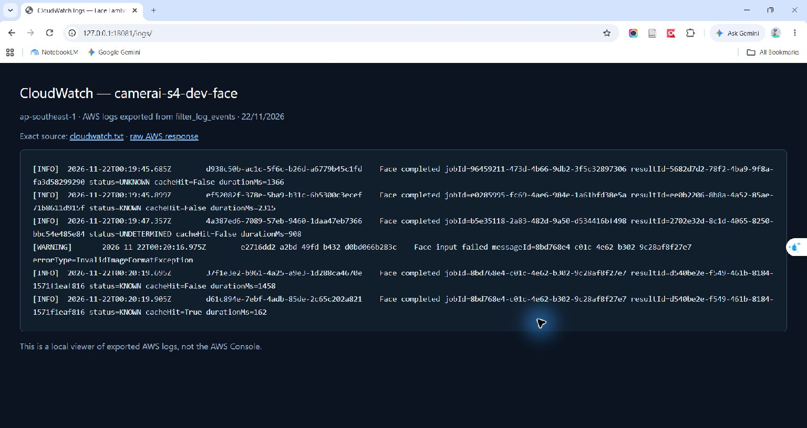

## 10. Code và kiểm tra hồi quy

Các file sản phẩm được cập nhật trong đợt này:

- `apps/orchestrator/src/known-faces/face-image.ts`: chuẩn hóa ảnh, cắt theo bounding box và giới hạn pixel.
- `apps/orchestrator/src/known-faces/rekognition-face-enrollment.service.ts`: WebP, selection, kiểm tra lại crop.
- `apps/orchestrator/src/known-faces/known-faces.service.ts`: chuyển selection, ExternalImageId riêng theo thao tác.
- `apps/orchestrator/package.json`, `pnpm-lock.yaml`: thêm dependency trực tiếp `sharp@0.35.4` đã có trong dependency graph.
- `services/aws-workers/face/handler.py`: logs thành công, cache và loại lỗi an toàn; đã triển khai log lên Face Lambda dev.
- Các test regression liên quan, script đánh giá và cấu hình tách thư mục build cho phiên UI test.

Các thay đổi có sẵn trên nhánh ở camera/config/media trước khi bắt đầu được giữ nguyên. Không commit/merge tự động.

Kiểm tra: test backend của face selection/enrollment/repository/known faces/cloud queue; test worker Python; TypeScript typecheck; ESLint các file liên quan; Ruff; secret scan; `git diff --check`. Kết quả đầy đủ được ghi trong [validation-summary.json](data/validation-summary.json) và các file `logs/*tests.txt`, `logs/lint.txt`, `logs/python-lint.txt`, `logs/typecheck.txt`.

Các warning ESLint về độ dài/độ phức tạp hoặc kiểu trả về được giữ trong log; không có lint error sau sửa. Test mock chỉ là bằng chứng hồi quy, không thay thế các bằng chứng AWS/HTTP/UI thật ở trên.

## 11. Giới hạn và cách chạy lại

1. Đã lấy mẫu theo thời gian, chưa chấm nhãn toàn bộ 5.922 frame. Không kết luận rằng mọi frame trong toàn bộ video đều không có false positive.
2. Recall định lượng bắt đầu sau khi detector đề xuất crop; không đo đầy đủ việc Frigate bắt người, tạo track và chọn crop. Không coi frame quay lưng là nhận dạng thất bại nếu không có mặt quan sát được.
3. Chỉ một danh tính mục tiêu và một nhóm người lạ trong hai bối cảnh. Các crop liên tiếp tương quan mạnh. Chưa kiểm thử tập người giống mặt rộng, sinh đôi, liveness, ảnh in dùng để giả mạo, hoặc độ chính xác bảo mật của xác thực danh tính.
4. Bộ 3 góc tốt nhất được chọn ngay trên bộ video này; chưa có tập video độc lập để ước lượng độ chính xác sau khi chọn cấu hình. Cần tập holdout mới để nghiệm thu triển khai rộng.
5. Đăng ký lại cùng một người dưới nhiều tên giờ giữ mapping riêng; điều này không tự xác minh các tên là cùng một danh tính. Không dùng nhãn do người đăng ký đặt làm bằng chứng danh tính pháp lý.
6. Quick tunnel và ứng dụng local cần còn chạy để Lambda gọi lại. Khi khởi động lại tunnel phải cập nhật URL mới; `.env` và credentials không nằm trong gói bằng chứng.

Các script đã lưu ở `tools/scripts/`:

| Script                          | Vai trò                                                                                      |
| ------------------------------- | -------------------------------------------------------------------------------------------- |
| `face-eval-run.mjs`             | Nạp `.env`, chuyển hostname Docker sang localhost cho các tiến trình native, không in secret |
| `rekognition-eval.py`           | Manifest, lấy mẫu, gọi AWS, cập nhật URL Lambda, rescore                                     |
| `rekognition-e2e.mjs`           | Fixture riêng, enrollment thực, tạo job đúng scope, thu DB receipts                          |
| `rekognition-analyze.py`        | Nhãn, 32 cấu hình, các loại abstention và CSV                                                |
| `rekognition-verify-subsets.py` | Đối chiếu hai collection độc lập thật                                                        |
| `rekognition-live.py`           | S3, gọi Lambda, retry, CloudWatch, biến đổi ảnh                                              |
| `rekognition-http-edges.py`     | Edge cases HTTP thật                                                                         |
| `rekognition-evidence.py`       | Hình minh họa và bản xem log chính xác từ dữ liệu đã lưu                                     |
| `face-eval-ui.mjs`              | Phiên backend/UI fixture riêng, không đổi Cognito trong `.env`                               |

Lệnh phân tích lại dữ liệu đã có, không gọi AWS:

```powershell
.venv/Scripts/python.exe tools/scripts/rekognition-analyze.py
.venv/Scripts/python.exe tools/scripts/rekognition-evidence.py
```

Các lệnh live được chạy qua runner, ví dụ:

```powershell
node tools/scripts/face-eval-run.mjs .venv/Scripts/python.exe tools/scripts/rekognition-eval.py configure-lambda
node tools/scripts/face-eval-run.mjs node tools/scripts/rekognition-e2e.mjs results
node tools/scripts/face-eval-run.mjs .venv/Scripts/python.exe tools/scripts/rekognition-http-edges.py
```

Script live có thể tạo collection, ảnh S3, bản ghi fixture và phát sinh lời gọi dịch vụ dev. Khi chạy đợt mới cần giữ riêng bản bằng chứng cũ và tạo job mới; phát lại một job đã cache chỉ kiểm thử replay, không phải phép thử lại lỗi ảnh ban đầu. Vectors/fixture của đợt này được giữ để đối chiếu, ảnh/secret trung gian nằm trong `artifacts/rekognition-eval-2026-11-22/` được Git ignore và không đóng gói credentials.

## 12. Tài liệu đối chiếu của AWS

- [SearchFacesByImage](https://docs.aws.amazon.com/rekognition/latest/APIReference/API_SearchFacesByImage.html): tìm mặt lớn nhất trong ảnh đầu vào; muốn xét nhiều mặt cần tách crop; similarity dùng thang 0–100.
- [IndexFaces](https://docs.aws.amazon.com/rekognition/latest/APIReference/API_IndexFaces.html): đặc trưng mặt được lưu thành vector; ảnh JPEG/PNG; hành vi tránh trùng với cùng ảnh, collection và ExternalImageId.
- [Face collections](https://docs.aws.amazon.com/rekognition/latest/dg/collections.html): có thể lưu nhiều vector của cùng người. Số góc phù hợp trong báo cáo này được xác định bằng thực nghiệm, không phải hạn mức hay bảo đảm do AWS công bố.

## 13. Bảng bằng chứng theo yêu cầu

| Yêu cầu                                     | Bằng chứng chính                                                                                           |
| ------------------------------------------- | ---------------------------------------------------------------------------------------------------------- |
| Caddy, Cloudflare, cập nhật Lambda dev      | `data/lambda-update.json`, `logs/lambda-final-config.txt`, `logs/cloudflared.txt`, `data/caddy-config.txt` |
| Số góc có chính diện, so sánh 1–5           | `data/subset-results.csv`, `data/subset-live-summary.json`                                                 |
| 3 video có bạn và video âm tính             | `data/manifest.json`, `data/labeled-scores.json`, `data/e2e-results.json`, UI 07–12                        |
| FP/FN và lỗi AI                             | Ma trận mục 5, `false-negative-examples.jpg`, `ai-false-face-hand.jpg`                                     |
| Ảnh đăng ký lật ngang                       | 16 cấu hình mirror trong `data/subset-results.json`                                                        |
| Edge cases                                  | `data/transformation-edges.json`, `data/http-enrollment-edges.json`, `data/lambda-invocations.json`        |
| Sửa code trên nhánh hiện tại                | Các file mục 10 và test/log hồi quy                                                                        |
| Nội dung logs, ảnh logs, ảnh UI, báo cáo MD | `logs/`, `screenshots/`, file báo cáo này                                                                  |
