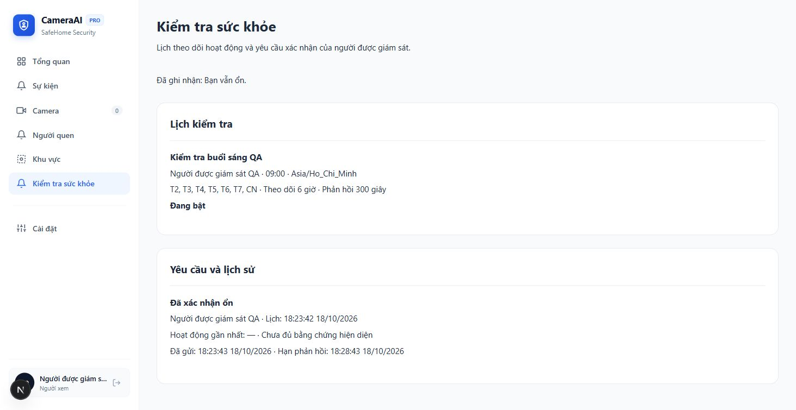
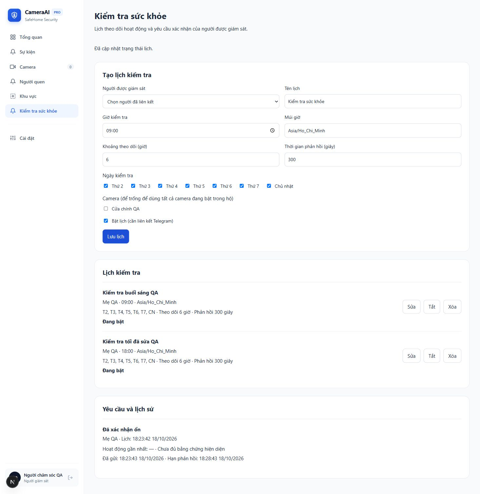

# Báo cáo sửa lỗi và retest US-20 — 18/10/2026

## Kết quả

**24/24 case US-20 Passed trong môi trường kiểm chứng cục bộ**, chuyển từ baseline4 Passed/16 Failed/4 Blocked. Đã sửa13 lỗi BUG-M5-01..13 và hoàn thiện ba đường tích hợp còn thiếu: M1 motion/direction, resident delivery/callback và giao diện wellness. Expected Result được giữ từ bảng QA cũ; bảng retest có đúng16 cột theo hai hướng dẫn của dự án.

- [Bảng retest16 cột](TEST_CASES_RETEST.md), [kết quả máy đọc](case_results.json), [manifest/revisions/checksums](manifest.json).
- [Kế hoạch đã thực thi](../../sprint-3/FIX_PLAN_US-20_QA.md), [runbook](../../sprint-3/RUNBOOK_M5_WELLNESS.md), [cách chạy lại](REPRODUCE.md).
- Bản sửa production: `ba138441326f2b5ff1b7fd540e5b323afff5cc01`, nhánh `codex/fix-us20-wellness`, base US20 `872a895cd88ac8303bfe448831873aea562dfba5`.
- Snapshot ghép thử: `e36eee7` trên `codex/verify-us20-combined`, ghép pose/fall `549f9c0` với bản sửa. Snapshot có thêm fixture hồi quy, không merge vào main.

Các số Passed ở đây không phải tuyên bố đã kiểm thử camera/Telegram production hoặc mọi interleaving có thể xảy ra. Những giới hạn này được ghi rõ bên dưới và trong Remarks từng case.

## Thay đổi và đối chiếu yêu cầu

| Lỗi/gap  | Sửa đã thực thi                                                                                                                                                                      | Bằng chứng chính                                                                  |
| -------- | ------------------------------------------------------------------------------------------------------------------------------------------------------------------------------------ | --------------------------------------------------------------------------------- |
| M5-01/02 | Materialize bằng PostgreSQL AT TIME ZONE; ngày ISO, DST, activation/cursor và unique local date; không admission trước enable                                                        | TC001–003, DST gap/fold thực thi trên PG16                                        |
| M5-03    | Flag off chặn materialize/claim; worker delivery/deadline đã persist vẫn chạy                                                                                                        | policy unit và DB recovery timeout                                                |
| M5-04    | Bỏ bypass role VIEWER; active registered household link và camera owner scope; PATCH revalidate cấu hình merged                                                                      | real service/HTTP/DB scope tests                                                  |
| M5-05    | Observation bắt buộc face/event/camera; đối chiếu provenance camera/session/track, motion và direction đã persist                                                                    | DTO tests; source adapter/outbox/DB tests                                         |
| M5-06    | Canonical JSON; observation replay ổn định; confirmation replay xét response/note/actor, giữ nguyên full response                                                                    | key reorder/changed payload/note và HTTP replay assertions                        |
| M5-07    | Presence đọc ledger as-of scheduledFor, TTL và conflicting timestamp; projection không bị observation cũ ghi đè; ledger/projection atomic                                            | as-of/expiry/conflict/out-of-order/rollback tests                                 |
| M5-08    | Deadline bắt đầu tại actual first SENT, snapshot300s; PENDING/HTTP503 không tạo deadline; không giả dashboard delivery                                                               | local HTTP provider + NotificationsRepository thật                                |
| M5-09    | Event terminal không nhận confirmation mới; bảo vệ authoritative confirmation; event/run lock order và đồng hồ DB sau lock                                                           | CLOSED/RESOLVED/ESCALATED; concurrent commands; 299.999/300/300.001s              |
| M5-10    | Typed SQL params, lease/retry và atomic event/intent/run/outbox; camera/confidence null, P2; không lặp active request                                                                | real DB no-activity path và hai scheduler replicas                                |
| M5-11    | Confirmation/history dùng đúng enum/SQL; NEED_HELP chỉ một history transition, routing đúng owner                                                                                    | real HTTP IM_OK/NEED_HELP; timeout worker/recovery                                |
| M5-12    | CamelCase responses; observation202/confirm200; Confirmation đủ phase/channel/resultingStatus, kể cả replay                                                                          | real Nest HTTP assertions và generated contract type                              |
| M5-13    | Range, days nonempty/unique, timezone PG và empty PATCH validation                                                                                                                   | policy/service/HTTP tests                                                         |
| GAP01    | Durable M1 identity outbox, association TTL và metadata motion/direction adapter; bridge/job dùng session nhất quán; không suy AWAY do silence                                       | accepted M1 result→receipt/outbox→consumer→adapter→ledger; departure→SKIPPED_AWAY |
| GAP02    | Resident Telegram text request, assigned VIEWER callback với source checks; caregiver escalation; M5 SSE/list/detail/stats scoped; generic confirmation không xác nhận thay resident | HTTP provider/callback/DB scope và recovery tests                                 |
| GAP03    | Sidebar wellness, caregiver CRUD/history, resident IM_OK/NEED_HELP, loading/error/empty, stable retry command, SSE/poll refresh                                                      | React interactions và browser thao tác thật với PG                                |

Migration0016 chỉ thêm `resident_wellness_track_links` và `resident_wellness_source_evidence`. Không sửa migration lịch sử, enum, hai OpenAPI hoặc lockfile. Generated contracts đã regenerate và không lệch baseline. Không thêm runtime dependency. Feature flag mặc định off.

## Thực thi năm cấp kiểm thử

| Cấp              | Đường thực thi                                                                                                                                  | Kết quả                                                                                                 |
| ---------------- | ----------------------------------------------------------------------------------------------------------------------------------------------- | ------------------------------------------------------------------------------------------------------- |
| Unit Test        | Canonical payload, config limits, DTO ranges/provenance, role/scope, scheduler/confirmation, first-dispatch invariant                           | Bộ Orchestrator nhánh US20: **365/365**,48 suites                                                       |
| Module Test      | Controller/service/repository boundaries, M1/outbox, notification/callback; React caregiver/resident interactions                               | Unit/module dùng chung bộ trên; Web **196/196**,32 files, gồm5 ca UI wellness; không cộng trùng các cấp |
| Integration Test | PostgreSQL16 thật, migration, transaction, lease/concurrency, HTTP provider/callback và scope; regression M1/Telegram/MQTT/escalation/camera    | Snapshot ghép thử **87/87**,7 suites, gồm **25 ca US20**                                                |
| System Test      | Nest HTTP + JWT/internal guard + DB; scheduler→intent→real HTTP local Telegram provider→SENT→callback; recovered sent-request timeout→caregiver | Các assertion trong25 ca US20 đạt; provider là giả lập cục bộ                                           |
| Acceptance Test  | 09:00/18:00, X6h, grace300s, IM_OK/NEED_HELP/timeout/skip-away; browser caregiver/resident với production AuthModule/WellnessModule/PG          | Các assertion và thao tác browser đã quan sát đạt trong môi trường cục bộ                               |

Snapshot ghép thử còn đạt **395/395 Orchestrator unit/module**, **196/196 Web**, typecheck, lint0error và format. Chênh30 ca so với nhánh US20 là các test pose/fall sẵn có; kết quả này không đóng các defect pose/fall được QA tìm thấy trước đó. Hai bộ test không được cộng lại vì trùng phần lớn ca.

Quality gates của bản sửa: production build Contracts/Orchestrator/Web đạt; tools109/109; metadata bridge7/7; Ruff check/format đạt; OpenAPI lint hợp lệ với5 warnings của baseline; generated contracts không diff; format/typecheck/lint đạt. Lint Orchestrator có82 warnings trên nhánh sửa và86 trên snapshot ghép, chủ yếu length/complexity/return type; không đổi rule để che cảnh báo. Build có cảnh báo cấu hình Next ESLint plugin.

Migration gate:18 file trên DB fresh trong Testcontainers; upgrade0015→0016 có lịch legacy giữ nguyên; chạy lại runner không áp lại migration. Chỉ DB disposable được sử dụng.

## Bằng chứng và xử lý lỗi môi trường

- [Unit US20](evidence/unit-results.json), [unit snapshot ghép](evidence/combined-unit-results.json), [integration cuối snapshot ghép](evidence/combined-integration-results.json), [Web](evidence/web.txt), [Web snapshot ghép](evidence/combined-web.txt).
- [Build](evidence/build.txt), [migration](evidence/migration.txt), [typecheck](evidence/typecheck.txt), [lint](evidence/lint.txt), [API](evidence/api.txt), [bridge](evidence/bridge.txt).
- Các lần đầu Jest gặp EPERM cache chưa chạy được test; chạy lại bằng cache tại workspace và quyền thực thi phù hợp. Không tính lần đó là test sản phẩm Failed.
- Suite US15 cũ dùng DB mặc định và cần fixture admin; lần đầu lỗi kết nối. Đã cấp DB QA riêng và chạy lại4/4 đạt, giữ [log retry](evidence/rules.txt).
- Sau khi phiên bị gián đoạn, container QA dừng; lần ghép đầu có lỗi kết nối. MQTT còn chờ chuỗi log subscribe cũ dù broker đã subscribe. Đã khởi động lại đúng container QA; đổi điều kiện chờ trong fixture của snapshot ghép theo log ACK hiện hành, giữ assertion DB và giới hạn3 giây. [Log lần bị gián đoạn](evidence/combined-integration-interrupted.txt) được giữ; kết quả cuối87/87 thay thế lần đó.
- Ba xung đột merge thử được giải quyết bằng cách giữ WellnessModule/FallDetectionModule, cả hai MQTT consumers và ngưỡng metadata0.25s. Chỉ snapshot kiểm thử chứa merge đó.

## Phạm vi và giới hạn nghiệm thu

Motion/direction sử dụng metadata Frigate tổng hợp và kết quả M1 fixture qua validator/repository/outbox/adapter production. Không có bộ video ground truth để đo độ chính xác nhận diện/ra-vào hoặc chạy camera vật lý; metadata thiếu explicit motion/start_time sẽ không được tính là hoạt động. Identity hết TTL cần kết quả M1 mới, không tự kéo dài theo camera silence.

HTTP transport Telegram đã chạy thật tới loopback provider với dummy token. Không gửi người thật, không xác nhận account/webhook Telegram staging ngoài máy. Browser dùng production AuthModule/WellnessModule và PG; các endpoint camera/face/event phục vụ điều hướng trong harness là read-only fixtures. Không coi chúng là kiểm thử toàn hệ thống camera.

**Không merge main.** `main` vẫn `0f5c948a27fc82e1e20cfd35bf56781a468750f2`; điều kiện của yêu cầu ban đầu “cả hai nhánh không có lỗi” chưa đạt vì các lỗi M2a trong báo cáo QA cũ nằm ngoài đợt sửa US20. Working tree gốc `docs/testing` và báo cáo baseline được giữ nguyên. Chưa push/deploy hoặc bật feature trên môi trường thật.

## Bằng chứng giao diện

Resident xác nhận IM_OK qua API/DB và thấy trạng thái đã giải quyết:

Caregiver tạo/sửa/bật/tắt lịch; lịch sử resident được giữ lại:

